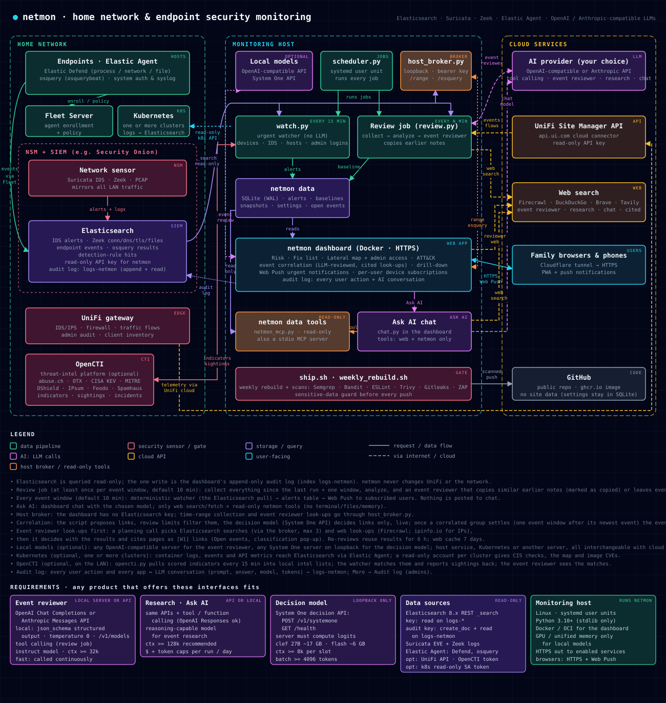

# netmon architecture



This page describes how netmon's pieces fit together: which processes run where, what each one may touch, where
data lives, and how an event moves from a log line to a decision. For setup see [SETUP.md](SETUP.md); for the
correlation and AI stages in depth see [CORRELATION.md](CORRELATION.md).

## Design rules

These hold everywhere in the code and explain most of the layout below.

- **Read-only toward the network.** netmon never changes UniFi, the firewall or any endpoint. Elasticsearch is
  queried read-only; the one write is the append-only audit log (index `logs-netmon`).
- **Deterministic first, AI last.** The watcher, the analysis, risk scoring and correlation proposals are plain code.
  Models only decide things the code has already narrowed down, and the expensive model (event research) runs only
  when a person asks for it.
- **The dashboard holds no data-source credentials.** It runs in a locked-down container without the Elasticsearch
  key. Anything that needs the key goes through the loopback host broker, which offers a fixed list of operations.
- **No site data in git.** IPs, host names, accounts and settings live in SQLite (`cfg` and `docs` tables), edited on
  the dashboard. The repository holds only `*.example.json` templates. There are no JSON state or settings files.
- **Nothing is posted to chat.** Alerts reach people through the dashboard and Web Push only.

## Runtime components

| Component | Runs as | Trigger | Reads | Writes |
|---|---|---|---|---|
| `scheduler.py` | systemd user unit `netmon-scheduler` | always on | `review_cfg`, job state | starts jobs, `logs/<job>.log` |
| `watch.py` (watcher) | child of the scheduler | every 15 min | Elasticsearch (read-only), intel lists, device registry | `alerts` table |
| `unifi.py --prewarm` | child of the scheduler | every 5 min | UniFi Site Manager API | `data/unifi_cache` |
| `opencti.py` | child of the scheduler | every 15 min (+5 min offset), only when configured | OpenCTI indicators | `intel/opencti_*.txt`, sightings/incidents back to OpenCTI |
| `review.py` (review job) | child of the scheduler | grid set on AI review (5 min–24 h, anchored 05:00 UTC) or **Run now** | Elasticsearch, UniFi cache, earlier notes | snapshot, `review_job.json`, copied notes |
| `research.py` (event research) | started by the host broker | only **Send to research** | event, web, optional Elasticsearch | event note (`enrich.db`), host notes (`kb.db`), `logs/` |
| `weekly_rebuild.sh` | child of the scheduler | Sunday 03:00 UTC | — | new dashboard image, security scan results |
| `host_broker.py` | systemd user unit `netmon-broker`, `127.0.0.1:8650`, bearer key | dashboard requests | Elasticsearch (read-only), collectors | `dashboard/state/ranges/` |
| Dashboard (`dashboard/app/server.py`) | container `netmon-dashboard`, HTTPS `:8443` | always on | pipeline output (mounted read-only), `state/` | `state/*.db`, audit log |
| Decision model (clef) | Patapsco AI k8s (SGLang) or host unit `netmon-clef` (llama-server) | called by the dashboard | — | — |
| Event reviewer model | Patapsco AI k8s (vLLM, Gemma) or LM Studio, or an API provider | called by the dashboard and `review.py` | — | — |

The scheduler never runs a job twice at once; a slot missed while the host was down is skipped, except the review
job, which starts late within its own slot.

### Inside the dashboard

The dashboard is a stdlib-only Python HTTPS server with a plain-JS front end. Besides serving pages and the JSON API it
runs these background threads:

| Thread | Module | Job |
|---|---|---|
| `eventstore-ingest` | `eventstore.py` | turns each new snapshot into events with stable ids; open until checked off |
| `corr-llm` | `corr_llm.py`, `clef.py` | correlation review: decision model per proposed link, then one event pass per event |
| `webpush` | `pushsvc.py` | sends unpushed rows of the `alerts` table as Web Push (VAPID) |
| `audit-writer` | `audit.py` | ships user actions and AI conversations to `logs-netmon`; spools locally while Elasticsearch is down |
| `notes-consolidate-timer` | `notes_consolidate.py` | nightly merge of duplicate analyst notes |
| auto-close | `autoclose.py` | closes events the reviewer or researcher classed expected/benign, when those options are on |

**Ask AI** (`chat.py`) also runs in the dashboard. Its tools are web search/fetch and the read-only `netmon_*` tools
from `netmon_mcp.py`, which open SQLite read-only. It has no terminal, file or memory tools.

## Trust boundaries

```
 Internet / cloud                 Monitoring host                                  Home LAN
 ────────────────                 ─────────────────────────────────────────        ─────────────────
 AI provider (API key)  ◄──────── review.py / research.py / chat / corr_llm        Security Onion
 Web search             ◄──────── webtools.py                                      Elasticsearch ◄── Elastic Agent,
 UniFi Site Manager     ◄──────── unifi.py                                              ▲            Suricata, Zeek
                                  host_broker.py (127.0.0.1, bearer) ── ES key ─────────┤
                                       ▲                                                 │
                                       │ loopback                                        │ audit key
                                  dashboard container ──────────────────────────────────┘ (create + read only)
                                  (read-only rootfs, no caps, UID 1000,                 OpenCTI (Talos k8s)
                                   /netmon mounted ro, /state rw)                         ▲
                                       ▲                                                  │
                                       │ HTTPS + login (admin / defender / user)     opencti.py
                                  family browsers and phones
```

- **Dashboard container:** `--read-only`, `--cap-drop ALL`, `no-new-privileges`, runs as UID 1000, `/tmp` is a
  `noexec` tmpfs. The repository is mounted read-only at `/netmon`; only `dashboard/state` is writable. Roles are
  `admin`, `defender` and `user` ([ACCESS_CONTROL.md](ACCESS_CONTROL.md)).
- **Host broker:** loopback only, every request needs the bearer key from `dashboard/.env`. It accepts exactly
  `/range`, `/section`, `/research-event`, `/esquery`, `/clef` and `/health`. `/esquery` takes a structured request,
  not DSL; `es_context.py` builds and bounds the query (at most 600 per hour).
- **Keys:** the Elasticsearch read key stays on the host. The audit log uses its own key that can only create and
  read documents in `logs-netmon`. AI provider keys are added by an admin on the AI review page (shown masked); a
  Firecrawl cloud key is never sent to a self-hosted Firecrawl.
- **Systemd units** run with `UMask=0077` and `NoNewPrivileges=yes`.

## Data flow

1. **Collect.** `collect.py` queries Elasticsearch (Zeek, Suricata, Elastic Defend, osquery) and the UniFi cache
   over a time window (`window.py`). The watcher uses the last 15 minutes, the review job its lookback window
   (`lookback.py`), the daily run 24 hours, a dashboard time range an explicit start and end.
2. **Analyze.** `analyze.py` compares the snapshot against each device's baseline (`host_baseline`, `history`),
   runs the deterministic issue checks (`issues.py`), risk scoring (`risk.py`), ATT&CK mapping (`mitre.py`) and
   threat-intel matching (`extras.py`, `intelmatch.py`).
3. **Suppress.** Never-send rules, checked-off items and known-benign patterns (`suppress.py`) hide matching events.
4. **Correlate.** `correlate.py` proposes links between events (shared hosts, IPs, accounts, time, ATT&CK, same
   problem). The decision model answers one yes/no question per link; the event reviewer model then labels each
   event suspicious, benign or expected and writes link notes. Verdicts live in `corr_llm.db`.
5. **Review job.** For events in a "review" category without a note, the event reviewer copies a matching earlier
   note (marked as copied). It never writes new notes. Everything else waits on **AI review → Queue**.
6. **Research (on request).** A person clicks **Send to research**; the host broker starts `research.py --event ID`,
   which uses the research model with web search and optional Elasticsearch look-ups, under $ and token caps per
   run and per day (`research_cfg.py`).
7. **Act.** People check events off, add notes or suppress rules on the dashboard. Every action and every model
   conversation goes to the audit log.

The urgent path is separate and has no AI: watcher → `alerts` table → `webpush` thread → subscribed browsers.

## AI stages

| Stage | Model | Where chosen | Input | Output |
|---|---|---|---|---|
| Correlation link decision | clef (decision model, probabilities only) | AI review → Decision model | the two events + the script's evidence | related / not related per link |
| Event pass | event reviewer model | AI review → Models | event + decided links + notes + intel hits | suspicious / benign / expected, link notes |
| Review job | event reviewer model | AI review → Models | queued events + earlier notes | copied note or left queued |
| Event research | research model | AI review → Models | one event, web, optional Elasticsearch | research note with verdict |
| Ask AI | chat model | AI review → Models | user question + read-only tools | answer |

All tool-using conversations go through `agent.py` (provider-agnostic tool loop) and `llm_providers.py` (OpenAI-
compatible, Anthropic, LM Studio). `aijob.py` holds the shared tools, budget and conversation logging for the review
job and event research.

## Storage

| Store | Location | Contents |
|---|---|---|
| `netmon.db` (SQLite, WAL) | `dashboard/state/` | devices, baselines, history, served ports, alerts, acks, suppress rules, push subscriptions, security findings, `cfg` (site settings), `docs` (JSON documents: snapshots, ranges, job state, users) |
| `corr_llm.db` | `dashboard/state/` | link verdicts, decision-model answers, event classes, Elasticsearch look-ups |
| `enrich.db` | `dashboard/state/` | event notes: research results and notes copied by the review job, research queue |
| `kb.db` | `dashboard/state/` | host notes: what AI runs and people have learned about each device (role, normal behaviour, decisions) |
| `chat.db` | `dashboard/state/` | Ask AI conversations (per user, mode 0600) |
| `ranges/` | `dashboard/state/` | dashboard time-range results from the host broker |
| `data/` | repo root (git-ignored) | collector work files, UniFi cache |
| `intel/` | repo root (git-ignored) | threat-intel lists (OpenCTI and configured feeds) |
| `logs/` | repo root (git-ignored) | job logs, saved AI conversations (newest 60 per job) |
| `logs-netmon` | Security Onion Elasticsearch | audit log: user actions, AI conversations, review-job log |

`store.py` is the only code that opens `netmon.db` for writing; the Ask AI / MCP tools (`netmon_mcp.py`) open it
read-only. Each dashboard module owns its own database (`chat.py`, `corr_llm.py`, `enrich.py`, `kb.py`).

## Development and release path

`ship.sh` is the only way code reaches git: unit and end-to-end tests (`tests/run_tests.py`), requirement
traceability, the security scan suite (`sec_scan.sh`), a gitleaks gate over the files being committed, then commit,
push and an optional dashboard redeploy (`dashboard/deploy.sh`). `weekly_rebuild.sh` rebuilds the dashboard image with
updated libraries every Sunday and raises in-app alerts for new vulnerabilities. See [TESTING.md](TESTING.md).

## Regenerating the diagram

`python3 docs/make_architecture.py` writes `docs/architecture.svg`. Update it together with this page when a
component, data flow or trust boundary changes.
