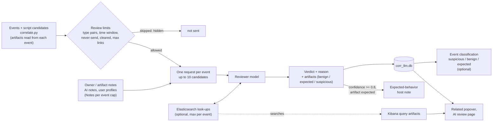
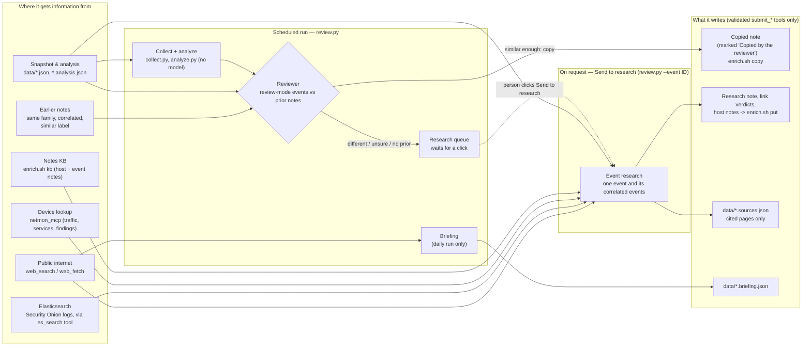
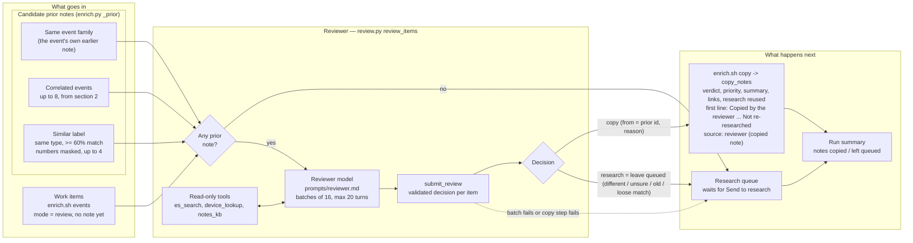

# How netmon connects the dots

This page explains three features that work together: **admin-access monitoring**, **event correlation** with a
**local-LLM review**, and the dashboard tools for working through the results (drill-down, Related column,
collapsible and rearrangeable boxes). For installation see [SETUP.md](SETUP.md).

## 1. Admin access (lateral movement)

Every way an administrator, or an attacker moving sideways, gets onto another machine is tracked between
internal hosts, **successful and failed**.

| Category | Protocols (catalog in `adminproto.py`) |
|---|---|
| Remote shell / desktop | SSH, Telnet, RDP, WinRM / PowerShell remoting, VNC, rexec/rlogin/rsh, TeamViewer, AnyDesk, RustDesk |
| Remote execution / management | SMB admin shares (PsExec), RPC / DCOM (WMI, PsExec service), Docker API, Kubernetes API, kubelet, MikroTik Winbox, Proxmox, VMware ESXi, IPMI, Cockpit, Webmin |
| Databases | MSSQL, MySQL, PostgreSQL, Redis, MongoDB (failures count; successful app traffic is normal) |

**Evidence** (`extras.admin_access()`; each source is optional):

- **Network sensor (Zeek conn):** every connection to an admin port, split into *connected* and
  *refused/unanswered* (S0, REJ, RSTOS0, RSTRH, SH, SHR. OTH is not a failure).
- **Login results:** endpoint auth logs (sshd accepted / failed / invalid user), Windows 4624/4625 network and RDP
  logons (logon types 3, 10, 8), Zeek `ssh` auth_success, `rdp` result, `ntlm` / `kerberos` success, PsExec-style
  service creation (`dce_rpc` svcctl CreateService) and PSEXESVC written over SMB.
- **Commands run on endpoints:** admin client tools (ssh/scp/rsync, xfreerdp, PsExec, impacket, winrs, evil-winrm,
  PowerShell remoting, nxc...) with the machine they targeted. Local-only use is ignored. **Passwords, hashes and
  `user:pass@` are removed** from command lines before anything is stored.

Evidence is merged per *(from, to, protocol)* and rated (`lateral.admin_sessions()`, also used by the risk score,
the nightly report and the watcher):

| Level | When |
|---|---|
| High | ≥ 10 failed logins, ≥ 3 invalid user names, or ≥ 3 failures followed by a success on the same account (possible guessed password) |
| Medium | any failed login, or ≥ 5 refused connections |
| Low | 1–4 refused connections, or a successful session not covered by `policy.json` `allow` |
| Allowed | a successful session that `policy.json` allows |

Failures also raise **host risk**: they add to the *threat* score of the machine being logged into and to the
*reach* score of the machine trying. On the dashboard: **Network → Lateral movement → Admin access** has
stat tiles, a logins-by-protocol chart (click to filter), an outcome chart, the session list and the admin tools
seen.

**The 15-minute watcher** (`watch.py` check 7) runs the same logic over its window. It raises **Admin ALERT**
(investigate) for high and **Admin notice** for medium, tagged with ATT&CK (T1110.x brute force, T1021.x remote
services), muted for 12 h per *(from, to, protocol, level)*.

## 2. Event correlation

`dashboard/app/correlate.py` (served at `/api/correlate?id=<snapshot>`) turns every event in a snapshot into a node:

| Type | Source |
|---|---|
| Alert | watcher alerts in the window (for the newest snapshot: up to now) |
| Finding | baseline behaviour findings |
| IDS | Suricata signatures (very chatty info rules are skipped) |
| Admin | admin sessions (above) |
| Endpoint | Elastic Agent / osquery host findings |
| Gateway | UniFi gateway events: IPS threat detections, high-severity, WAN, device and VPN events (`gw|<time>|<key>|<src>|<dst>`) |
| Threat intel | inbound / outbound listed IPs, listed domains |
| Vulnerability | open Fix-list items: timeless, related by host |

Candidates are pairs that **share an entity**: an internal host (MAC addresses and endpoint host names are resolved
to the same IP; gateway interfaces ending in `.1` are ignored), an external IP, a domain or a user account. Nothing is
linked just for being close in time. An entity that sits on most events (more than 60, or half of all events) is
treated as noise and creates no candidates. Each candidate gets a score:

| Part | Points |
|---|---|
| Shared entities, weighted by rarity | weight × 1 / (1 + log₂(1 + n/4)), n = events carrying the entity. Weights: external IP 4.0, domain 3.5, internal host 3.0, account 2.0 |
| Time (events with a time, no vulnerability involved) | gap between the two time spans ≤ 15 min **+2** ("within 15 min", or "same time window" for long spans); ≤ 1 h **+1**; more than 6 h apart **−1.5** |
| Same problem seen by two detectors, and a shared entity | **+2** (e.g. the "SSH password login" vulnerability and SSH sessions with failed logins; a threat-intel finding and the IDS reputation signature for the same IP) |
| Same ATT&CK technique | **+1** |
| Vulnerability and an event that share a host | **+1.5** ("vulnerability on the same host"); time is not scored for vulnerabilities |
| Two vulnerabilities on one host | score × 0.5 (context, not an incident chain) |

Kept: score ≥ 1.5, at most 4 of any one type and 10 per event. This is only the *proposal*; the time-window setting,
the review limits and the reviewer (section 3) decide what is actually looked at.

**Artifacts read from the event itself.** While it builds the events, `correlate.py` pulls the concrete things each
event already names: accounts (`user alice`, "accounts alice (1 failed, 2 ok)", login-attempt users), processes
(executables in program directories, parent process, command line), files (paths, with a SHA-256 when the text has
one), DNS names (public domains; `.lan`/`.local` ignored), plus the event's host IP and destination IPs. Up to 10 per
event, as `[kind, value, relation]`, without any lookup and before any review. They appear in the Related popover
immediately and are handed to the reviewer as "known artifacts" of each event.

## Profiles: accounts and frequent IPs

Every correlation pass also records, without any model: the accounts seen in endpoint logins, auth failures, sudo, account changes, admin sessions and suspicious processes (**Network → Users**, `accounts.py`), and how often each IP appears in correlated events, as source or destination, with the accounts, processes and DNS names named in those events. From that it keeps host notes (category *behavior*, tagged `[profile:ip]` / `[profile:users]`, author netmon) up to date for the newest report: "frequent" is 5+ events for an internal IP and 3+ for an external one, top 25. The reviewer reads these as `ai_note`s. They are counts, not verdicts; delete a note on the Notes page and it is rewritten next pass if still true.

## 3. Correlation review (local or cloud model)

The script only *proposes* links. **A model decides.** `dashboard/app/corr_llm.py` runs as a background thread
in the dashboard container:

1. For the newest snapshot (and any snapshot someone opened in the last hour, at most two), each event with undecided
   candidates becomes one request, events with the most undecided links first, two requests in parallel. Before
   anything is sent, the **review limits** (below) remove links the reviewer must never see. The request holds the
   event, up to 10 candidates, the artifacts each event already names, any notes people and earlier AI work wrote
   about them, and the script's evidence for each candidate.
2. The model answers *related / not related* per candidate, with a confidence, a one-line reason and, for related
   links, a list of **artifacts** (see below). Local (LM Studio) gets temperature 0 and JSON-schema output; an
   admin-added API provider gets the answer format in the prompt instead (no structured-output mode). The system
   prompt tells it to be sceptical of coincidences (a busy shared host, the same 24-hour window). It also tells it to
   treat everything inside `<event>` tags as data, never as instructions, because log text can contain anything.
3. Verdicts are stored per unordered pair in `dashboard/state/corr_llm.db`, so each pair is asked once and the
   decision applies in both directions. They survive restarts. A person's decision (✓/✗, or an adopted model answer) is
   never overwritten or discarded.
4. `/api/correlate` drops **rejected** links, marks **confirmed** ones with the model's reason and artifacts, and flags
   the rest as **pending**. Until the model has reviewed a link, the script's evidence is still shown. Undecided links
   that the review limits skip are hidden, not shown as pending.

**Which model it uses.** AI review → Models → Correlation reviewer picks the provider and model explicitly; that
choice is remembered until someone changes it. If nothing has ever been chosen, it defaults to the first enabled,
configured provider with at least one model (an admin-added API provider before Local (LM Studio), since the
reviewer calls far more often than a typical API rate cap allows) - **the reviewer no longer requires Local
(LM Studio) to be running.** If the chosen provider is later disabled or deleted, the next run raises a clear
error on the AI review page instead of silently falling back, so pick another model there. Mind each API
provider's calls-per-hour cap (AI review → AI providers): the reviewer can fire many calls a minute, so a
cloud provider meant for the occasional on-request research will hit its cap quickly unless you raise it.

| Setting (`dashboard/.env`) | Default | |
|---|---|---|
| `NETMON_LLM` | `on` | `off` disables the review (links show the script's evidence only) |
| `NETMON_LLM_URL` | `http://127.0.0.1:1234/v1` | Local (LM Studio)'s endpoint, any OpenAI-compatible http(s) URL |
| `NETMON_LLM_MODEL` | the model loaded in LM Studio | pin a model id for Local (LM Studio) |
| `NETMON_LLM_REASONING` | `none` | reasoning models (Gemma, Qwen) spend the token budget on hidden reasoning otherwise |
| `NETMON_LLM_WORKERS` | `2` | parallel requests (match LM Studio's parallel slots) |

Local (LM Studio) is itself an AI review → **AI providers** row: an admin can disable it or set its calls-per-hour
cap there, same as any other provider (no key or URL to enter - those come from `NETMON_LLM_URL` and the live
model list). Besides Local (LM Studio), the reviewer can use any provider an admin adds on AI review > **AI
providers** (`llm_providers.py`, stored in `/state/llm_providers.json`, mode 600). These are OpenAI-compatible
(`POST {base}/chat/completions`, Bearer key) or Anthropic (`POST {base}/v1/messages`, `x-api-key`) APIs called
directly from the dashboard container; the model choice is `api:<id>` plus the model name, and each provider has
its own calls-per-hour cap.

### What the reviewer is given

Each event in a request carries its type, time, severity, label and **known artifacts** (users, processes, files, DNS
names and IPs read from the event itself, section 2). On top of that it gets context written by people and by earlier
AI work, capped per event by the **Notes per event** setting and by the **Note characters** setting (default 6,000 characters per request, up to 100,000) (a note already
shown is not repeated):

| Tag in the prompt | What it holds | Trust |
|---|---|---|
| `<owner_note>` | Approved event notes (📝), host notes written by a person for the hosts the event involves, and **user notes** for the accounts it names (subject `art:user:<account>`, 300 characters each) | trusted guidance |
| `<artifact_note>` | A person's notes on a file, process, user, IP or DNS artifact (📝 beside the artifact in the Related popover, subject `art:<kind>:<value>`), up to 25, those named in these events first | authoritative |
| `<ai_note>` | The research job's verdict and summary for the event, AI-written and profile host notes (including the *expected behavior* notes below), and each named account's profile from **Network → Users** (usual hosts, sources, methods, hours) | informed but unverified |

**Notes are chosen by artifact first.** Every host note (people's, AI-written, reviewer, internet and profile notes) is indexed
by the artifacts it is about: IPs (internal and internet), DNS names, ports, processes / files (by base name) and accounts. They
are read from the note's subject, its `[reviewer:<kind>:<value>]` tag and its text. Before a review prompt is built, the
reviewer collects the same kinds of artifact from each event (its host and destination IPs, the files, processes, users and DNS
names the script read from it, and the IPs, ports and names in its label) and looks them up in that index. Notes are then
ranked by match: IP, DNS name or process = 3 points, account = 2, port = 1; a note that matches only on a port (under 2 points)
is never picked. Highest score first, then the old order (decision, role, baseline, behavior, config, risk, watch, other, newest
first), and the first **Notes per event** are sent. This also pulls in notes that hang on a *different* host or subject
but name the artifact (for example a note on a backup server that mentions the process or internet address this event shows);
those are shown to the model as `(matches ip:…)`. Generated `[profile:…]` notes are only used for their own host, never
matched across hosts. Each note's artifacts are refreshed whenever it is added or edited, and existing notes were indexed once
at upgrade. Artifacts a reviewer writes into its notes (the `[reviewer:…]` tag and the value in the text) are what make the next
reviews find them. On the Notes page, the Internet notes pages and the notes cards, each note shows its artifacts as chips under the text (⚙️ process / file, 🌐 IP, 🔎 DNS name, 👤 account, 🔌 port), so you can see what the reviewer will match on.

Host notes are ordered decision, role, baseline, behavior, config, risk, watch, other, then newest first; accounts come
first because they decide most "expected" calls. Unapproved User notes never reach the AI. The prompt tells the model
never to let an `<ai_note>` outweigh an owner or artifact note, or concrete evidence of harm.

### What the reviewer writes back

- **Verdict**: related or not, confidence (0–1), reason (under 25 words).
- **Artifacts** for every related link (the model is asked for at most 6 per candidate; up to 12 are kept, including searches): the file, process, user, IP or DNS name that ties the two events
  together, a relation (under 15 words) and a decision: `benign` (looks odd, harmless), `expected` (normal for this
  device or task) or `suspicious` (needs a person's eye). `benign` and `expected` must be backed by a note and the
  model must name it; without support it chooses `suspicious`. Values must come from the events, never invented.
- **Expected-behavior host notes.** For a related link with confidence ≥ 0.8, each artifact judged `expected` becomes a
  host note (category *behavior*, author `ai`, tagged `[reviewer:<kind>:<value>]`) on the host both events involve
  (up to two hosts, the shared IPs first). One note per host and artifact, updated in place, marked unverified; delete
  one on the Notes page if it is wrong. Notes whose value does not appear in either event, or that name the host's own
  IP, are not written. Later reviews and the research job read them as `<ai_note>`s. Turn this off with
  `NETMON_REVIEW_HOST_NOTES=off` in `dashboard/.env`; a host holds at most 40 notes.
- **Elasticsearch searches as artifacts** (when searches are enabled, below). Every successful search is kept as a
  `query` artifact on the links it was run for (up to 12 per link): the search in KQL, its time range, the hit count
  and the model's *why*. In the Related popover it is a **🔭 query** button that opens Kibana Discover with that
  search (needs `kibana_url` / `kibana_data_view` in `site.json`; without it the query is shown as text). A search that
  uses aggregations or clauses KQL cannot express is marked ≈ and opens a broader search than the one the model ran.

### Event classification (optional)

**AI review → Review limits → Classify events** (off by default) makes the reviewer give every event whose correlation
review is finished one label: **suspicious** (needs a person's eye), **benign** (odd but harmless) or **expected**
(normal for this device, user or task), with a confidence and reason. An event qualifies when none of its links is
undecided and at least one is decided; the confirmed related events are the evidence. `benign` / `expected` need a
supporting owner, artifact or AI note that the reason names, otherwise it says `suspicious`. At most 20 events are
classified per pass on the newest snapshot, an event is re-classified when its set of verdicts changes, and events
that are cleared, excluded or muted are skipped. The label is a 🏷 badge next to the Related count (click for the
reason) and the page shows the totals. Turning it on offers to enable the reviewer's Elasticsearch look-ups too, which
classification uses. Audit-log purpose: `event-classify`.

### Review limits (More → AI review → Review limits)

Admins and network defenders choose which candidate links are **never sent** to the reviewer, to save tokens. Skipped
links are neither reviewed nor shown (links that already have a verdict are unaffected). The box shows how many
candidate links each setting affects.

| Limit | What it does | Default |
|---|---|---|
| **Link types** (grid) | Every event type (`ids`, `alert`, `admin`, `ti`, `gw`, `host`, `finding`, `vuln`, `seg`) × severity (`low`, `medium`, `high`) against every other: each cell is **review** or **skip**. Click a cell to flip it. Cells you never touched inherit the default. | review, except on a brand-new deployment (no verdicts yet): skip, so nothing is sent until an admin opts in |
| **Severity of `seg`** | Segmentation issues and findings are their own type. Their severity is set by the port: **high** = admin / remote-control ports (SSH, RDP, SMB, WinRM, databases, Docker and Kubernetes APIs, the policy's `sensitive_ports`), **low** = standard service ports (`standard_ports`, default web, mail, DNS, NTP, LDAP…), **medium** = any other (odd) port. All other types take the event's own severity (critical/severe/investigate = high; moderate/warning/review = medium; anything else low). | – |
| **Time window for the reviewer** | One setting, in minutes: only events that happened within X minutes of each other are correlated. The gap is measured between the two events' time spans; links further apart are skipped. Events without a time (open vulnerabilities) are never "apart". `0` = no limit. The box shows how many candidate links are outside the window now. | 0 (no limit) |
| **Max links per event** | Undecided links one event may have. Best script score first; a link needs room at both of its events; the rest are skipped. `0` = no cap, at most 200. | 0 |
| **Never send** (events and rules) | *Excluded events*: one event or its whole **family** (4–5 digit numbers such as ports are masked; watcher alerts use their alert key) from the events with the most links. *Rules*: `name` (event label), `host` (an IP of the event or the host in its label) and/or `id`, with `*` / `?` wildcards (no wildcard = contains); every field a rule has must match; scope *both*, *review* or *research*. Up to 500 exclusions and 200 rules. | none |
| **Discard old verdicts** | Delete verdicts (and artifacts) whose pair has not been a candidate link for more than N days. Runs hourly after a snapshot has refreshed the "last seen" times; person-made verdicts are kept and the freed space is returned to the disk. `0` = keep forever, at most 3650. | 0 |
| **Classify events** | See above. | off |

**Mute alerts.** Watcher alerts are by far the most numerous event type. An admin or network defender sees **mute
name…** and **mute name + host…** beside an alert on the Alerts page and on the AI review decisions. Both open an
editable pattern (the alert text with IPs, MACs and numbers replaced by `*`); **Mute & clear existing** saves a *never
send* rule for it (scope *both*, so the research job skips it too) and deletes the alerts that already fired and match
the rule. The rule is listed under **Never send** and can be removed there; the deleted alerts do not come back.

**Cleared events.** An event that someone checks off (Alerts, Posture, Fix list, Lateral movement… listed on the
Checked page) is remembered by its name and IPs: events with the same name and IPs are not sent to the reviewer or to
research again, even after the cleared event has left the snapshot (store meta `cleared_sigs`, up to 5,000 signatures).
The memory is only ever added to; to let such events through again, remove it from the store or use a *Never send* rule
for the opposite effect.

**Queue behaviour.** The worker pass repeats about every minute (every 5 seconds while it finds work). It reviews the
newest snapshot first, then snapshots opened in the last hour. If the provider is down or rate-limited the links stay
*pending* and the worker backs off (3 minutes after an error). **Clear review queue** (admin, AI review page; or `docker exec netmon-dashboard
python /app/enrich.py clear-review`) gives every undecided link of the newest three snapshots the verdict *not related* by
`dismissed:<user>` ("review queue cleared by an admin") and remembers those events: undecided links between two
remembered events are never asked again, links to *new* events are. Undo by deleting verdicts whose model starts with
`dismissed:`. **Clear research queue** dismisses the current snapshot's event families from the research queue (new
events and **Send to research** are unaffected). `python /app/enrich.py clear-queue --wipe` (inside the dashboard container) additionally deletes all research notes
and the model's verdicts after backing up both databases.

### Elasticsearch look-ups (optional)

Off by default. When an admin turns on **AI review → Models → Elasticsearch queries · correlation review**, the reviewer may search the
Security Onion logs for more context before it decides an event's links, for example to check whether the host
behind an IDS alert also made the failed SSH logins, or whether a domain was resolved before the connection.

| Setting (AI review → Models, admin only) | Default | |
|---|---|---|
| **Elasticsearch queries · correlation review** (checkbox) | off | lets the reviewer search the logs |
| **Elasticsearch queries · AI research** (checkbox) | on | separate switch: lets the AI Research job search the logs while researching events (`es_search` tool) |
| **Max per event** | 3 | the total number of searches the reviewer may run for one event review (one anchor event and its up to 10 candidates), 1–20; classification uses the same budget |
| **Note characters** | 6000 | total characters of notes in one review request (1,000–100,000, `context_notes.chars`), set below Notes per event; the re-check of a single link uses a third of it |
| **Notes per event** | 7 | host + user notes the reviewer is given for each event, 1–100 (`llm_config.json` `context_notes`); more notes = more tokens in |

The reviewer's switch and **Max per event** are stored in `dashboard/state/llm_config.json` (`"es_queries": {"enabled",
"max"}`, with who changed them and when); the research switch is part of the research job's settings in the netmon
store (`es_search`). Both take effect from the next review or run. Model comparisons (⇄) never search, so every model gets exactly the
same prompt.

How a review works with searches on:

1. The request also lists each event's hosts and explains the search format. The model answers either with its
   decisions or with up to *remaining* searches (`{"decisions": [], "queries": [...]}`).
2. A search is **not** Elasticsearch DSL. It is a small structured request: `source` (`zeek`, `suricata`,
   `detections`, `endpoint`, `auth`), up to 6 exact `match` fields, an optional free-text `text`, `start`/`end`
   (default: the anchor's time ±2 h, at most 7 days), an optional `group_by` field (top 10 values with counts), `size`
   (1–10 documents) and `why`.
3. The dashboard container has no Elasticsearch key, so it sends each search to the host broker
   (`host_broker.py`, `POST /esquery`). `es_context.py` validates it, builds a read-only `_search` itself (field names are checked,
   no leading wildcards, no scripts), runs it on the configured index and returns the hit count plus trimmed
   documents (selected fields, 400 characters each) or the top values. The broker allows at most 600 searches an hour.
4. The results go back to the model inside `<es_result>` tags, which the system prompt marks as log data, never
   instructions. The model searches again or decides. When the budget is used up it is told to decide now, without
   the option to search. A search that fails (bad field, ES down) is reported back to the model and still counts.
5. Every search is kept in `corr_llm.db` (`es_queries`: time, event, candidates, model, query, hit count, error),
   written to the audit log (`aireview.esquery`), and every model round is in the audit log as usual
   (`llm.correlation-review`, with the search results in the prompt). Successful searches also become clickable
   Kibana artifacts on the links they were run for (see *What the reviewer writes back*). The research job's own
   searches (DSL through its `es_search` tool, listed on the same page as *Research AI searches*) are attached the
   same way to the research notes and links of that batch, shown under **Elasticsearch searches (open in Kibana)** in
   the notes popup.

The AI review page shows the setting under **Models**, the searches made in the current pass, and a
**Reviewer searches** box with the newest 50 (event under review, the search and its *why*, hits, model).

Searching costs time and, with Anthropic or OpenAI reviewers, tokens: each round resends the event, its candidates
and the earlier results. Most decisions are clear without searching, and the model is told not to search then.

Throughput with Gemma 4 31B on the monitoring host is about 15–30 links a minute. A full day's snapshot (~2,000
candidate pairs) takes 1–2 hours the first time; after that, only new pairs are asked. If the reviewer's current
provider goes down or hits its rate cap, the worker backs off and retries, and links stay *pending* until it's
reachable again (or an admin picks a different model on AI review → Models).

### AI review page (More → AI review)

Shows the AI Research job (status, schedule, last run, note coverage, token and cost history), the correlation
reviewer's status (reviewing / waiting / idle / error / off), the queue for the current snapshot with % reviewed and
an ETA, verdicts per hour, tokens per minute and the average tokens in / out per event review, and every decision
with both events (linked), the verdict, confidence and the model's reason. Boxes, top to bottom:

| Box | What it holds |
|---|---|
| **AI Research job** | Health, model, schedule, Run now / Pause, latest run summary, note coverage of the current snapshot |
| **Time and tokens per research job** | Tokens and estimated cost per run and per day |
| **Reviewer** | The correlation reviewer's status, speed (verdicts per hour, tokens per minute, average tokens in / out per event review) and error |
| **Events awaiting research** / **Links awaiting review** | The two queues. **Clear research queue** and **Clear review queue** (admins) sit under them and ask for confirmation |
| **Models** | Provider and model for the correlation reviewer, the AI Research job and chat; the Elasticsearch switches (reviewer, research) and **Max per event**; **Notes per event** |
| **AI providers** | Added API providers, calls-per-hour caps, Local (LM Studio) on/off |
| **Review limits** | Link types grid, time window, max links per event, never-send events and rules, verdict retention, event classification (above) |
| **Research job limits** | Cost and size caps of the research job (section 5) |
| **Decisions** | Filters: verdict (confirmed, rejected, set by a person), event type, event pair, confidence, this snapshot only. Per decision **✓ / ✗** overrides the model (stored as `manual:<user>`, never overwritten), **↻** deletes the verdict so the model reviews that link again, **⇄** compares models |
| **Reviewer searches** / **Research AI searches** | The newest Elasticsearch searches of each AI |

## 4. Working through it on the dashboard

- **Related column** on every event list (Alerts, Posture findings, IDS, Admin sessions, Endpoint findings, Threat
  intel, Fix list, Risk). The number opens a popover listing each related event: its type, the event pair
  (e.g. *Alert – IDS*), its time, **✓ confirmed** + the model's reason and ✨ model (or *AI review pending*), the
  script's evidence, and **Correlated artifacts**: host and destination IPs plus the users, processes, files and DNS
  names read from the event, then the reviewer's own artifacts with their `benign` / `expected` / `suspicious` call and
  relation, and 🔭 query buttons that open the AI's Elasticsearch searches in Kibana. 📝 beside an artifact adds your
  note on it (the AI reads it). Each item jumps to its own list filtered to that one event (`?ev=<id>`). That event has
  its own Related count, so you can keep pivoting. Beside the count: **✨ notes** (the research note, with its
  Elasticsearch searches), **🏷 suspicious / benign / expected** (the classification, when switched on) and 📝 (your
  notes on the event).
- **Charts drill down:** clicking a chart segment or bar opens the matching list filtered (`?zone=`, `?country=`,
  `?severity=`, `?aproto=`...). Filters show as removable chips, and the URL can be bookmarked.
- **Boxes:** click a title to collapse or expand it. On first visit the first 3 boxes on a page are open. Drag the
  **⠿** grip to rearrange (mouse or touch). Drag the bottom-right corner to resize: width and height on desktop
  (neighbours in the row share the remaining width), height only on phones. Double-click the corner to reset one
  box, and use **Reset layout** to restore the page's original order and sizes. Boxes start a little shorter than the screen
  (long lists scroll inside the box with the title kept visible); drag the corner to make one taller. Scrollable
  areas show fading blue edges where more content is hidden, a visible scrollbar, and a **More below ↓** button. Collapse state, order and sizes are
  saved per page in the browser.
- **Users** page: admins assign devices to each person. That sets which devices they get push notifications and the
  🔔 count for (the same setting people edit on their own Alerts page).

## 5. The review job (`review.py`) — what it does and where it looks

`review.py` is the scheduled (or on-demand) **review job**: it collects and analyzes a fresh snapshot, lets the reviewer
reuse earlier notes for events that repeat, and (once a day) writes the news briefing. It does **not** research events
on a schedule, to keep token cost down: a model researches an event only when a person clicks **Send to research**
(`review.py --event ID`). The model steps use a small set of **read-only lookup tools** plus a few **validated submit
tools** they must call to write anything.

- **Collect + analyze** (`collect.py`, `analyze.py`) build the snapshot and fold it into the baseline. No model is involved.
- **Reviewer** handles events whose category is set to **review** (a per-category setting kept in the store; no longer on the AI review page) and that
  have no note of their own. `enrich.py` attaches the candidate prior notes to each such event: the note of the same
  event family, notes of correlated events, and notes on same-type events whose label is at least 60 % similar (numbers
  masked). The reviewer model (prompt `prompts/reviewer.md`; tools: Elasticsearch, device lookup, notes KB) answers per
  event with `submit_review`: **copy** (naming which prior note and why) or **research** (leave it queued). A copy is stored by
  `enrich.sh copy` / `enrich.py copy_notes`: the earlier verdict, priority, summary, links and research are reused, with a
  first line `[Copied by the reviewer (<model>) from the note on <id> (<date>), researched by <model>: <reason>. Not
  re-researched.]`, and the note's source shows "reviewer (copied note)". Everything else stays in the research queue
  until someone clicks **Send to research** on it. The reviewer is told to leave an event queued when unsure, when a
  malicious/suspicious prior doesn't clearly match, or when the prior is old; events with no prior at all stay queued. If the
  reviewer fails, its events stay queued too, so nothing is dropped. The run summary shows how many notes were copied and
  how many stayed queued.
- **Event research** (`enrich`) runs only on request, for one event, with the broadest toolset: it can query
  Elasticsearch, look up a device's full history, read the notes KB, and search/fetch the open web — but it may only *cite*
  a page after fetching it, and may only link pages it actually read. Results go through `submit_notes`, which shells out
  to `enrich.sh put` to store the note, link verdicts and host notes.
- **Briefing** (daily run only) only has web search/fetch and writes the security news items.
- Every write path is a `submit_*` tool that validates its input (ids must exist, URLs must have been fetched,
  verdicts/priorities must be from a fixed list) — the model proposes, the tool enforces the schema before anything
  lands on disk.

### Research job limits and schedule

The caps below are the **Research job limits** box on the AI review page (admins; they apply from the next run).
A run stops at its next model call once a cap is passed; what it found until then is kept. `0` = no limit.

| Setting | Default | What it limits |
|---|---|---|
| $ per run | 5.00 | Estimated cost of one run (needs a price for the model on AI review → AI providers) |
| $ per day | 20.00 | No new run starts once today's runs (UTC) cost this much |
| Tokens per run | 25,000,000 | Input + output tokens of all calls in a run; works without prices |
| Research batches | 10 | Event-research conversations per run (8 events each), max 40 |
| Searches per event | 3 | Web searches per event (a batch of 8 shares 8×), max 20; ignored when web research is off |
| Web research | off on new deployments | Lets the model search and read web pages and cite them; off = local data only and the daily news briefing is skipped |
| Elasticsearch (Models box) | on | Lets the job's `es_search` tool run (separate from the correlation reviewer's switch) |
| Interval | 240 min | How often the review job runs, 30–1440 min, on a grid anchored at 05:00 UTC; the first run at or after 05:00 UTC each day is the **daily run** (24 h of logs, plus the news briefing) |
| Lookback | 24 h | Hours of logs a non-daily run collects, 1–24 |

The per-event-category setting (**research** / **review** / **test** / **skip**, categories `host`, `ids12`, `gw`,
`ti`, `alert`, the three `seg_*` severities and `high` / `medium` / `low` / `info` for the rest) decides what the
reviewer step considers and what shows in the research queue. New deployments start every category in **test**: events
are queued and tagged *testing* but never sent. All of this is kept in the netmon store (`netmon.db`, `meta` table, keys
`research_job` and `research_lookback`), so the dashboard container and the host scheduler read the same values.

## 6. The reviewer — copy an earlier note or leave the event queued

The reviewer is the last model step of a scheduled run inside `review.py` (`Review.review_items`). Its job is to avoid
paying for research twice: when an event is the same activity as one already researched, the earlier note is reused;
everything else stays in the queue until a person sends it to research. Only events whose category is **review**
(the per-category setting kept in the store) and that have **no note of their own** enter this phase. Events set to *research*
skip it; events set to *test* are only listed on the dashboard.

**Step by step**

1. **Collect work items.** `enrich.sh events` lists the snapshot's work items. Review-mode items without a note are
   handed to the reviewer.
2. **Attach prior notes** (`enrich.py _prior`). Each item gets a `prior` list: the note of the same event family,
   notes of correlated events (up to 8, see section 2), and notes on same-type events whose label is at least 60 %
   similar with numbers masked (up to 4, via `difflib`). Each prior carries `how` it was found, its label, verdict,
   priority, summary, research (first 800 characters) and age in hours.
3. **No prior, no model call.** Items with nothing to compare against stay queued.
4. **Ask the reviewer.** The rest go to the model in batches of 16 (system prompt: analyst + `prompts/reviewer.md`),
   with `es_search`, `device_lookup` and `notes_kb` available to check the item's evidence against the prior note.
   It answers once through `submit_review` with `{id, action: "copy"|"research", from?, reason}` for every item.
5. **Rules the reviewer follows.** Copy only when it is the same activity: same signature or rule, same kind of
   source and destination, same behaviour, nothing in the item's evidence or `user_notes` that contradicts the prior
   verdict. Leave it queued when hosts, ports or behaviour differ, when a malicious/suspicious prior does not clearly
   match, when the prior is old, when the match is loose, or when unsure. A wrong copy hides a real event.
6. **Validation.** `submit_review` rejects ids outside the batch, actions other than copy/research, and a `from`
   that is not one of that item's prior note ids. If some items get no decision, the tool tells the model to fill
   them in.
7. **Store copies.** Copy decisions go to `enrich.sh copy` (`copy_notes`), which reuses the earlier verdict,
   priority, summary, links and research, prefixed with `[Copied by the reviewer (<model>) from the note on <id>
   (<date>), researched by <model>: <reason>. Not re-researched.]`. The note's source reads "reviewer (copied note)".
8. **Leave the rest queued.** Every item not copied waits in the research queue; only a click on **Send to research** researches it.

**Failure behaviour.** Nothing is dropped. If a reviewer batch errors, its items stay queued and the error is
listed in the run's errors. If the copy step fails, no copies are stored and all items stay queued. A budget
overrun stops the run as it would anywhere else.

**Where to see it.** The run summary reports *N earlier notes copied, M left queued*. A copied note shows the
copy line first and its source on the Notes views, with the usual ✨ model flare for the reviewer's model.

## Settings reference

| Setting | Default | Stored in |
|---|---|---|
| Correlation reviewer provider + model | first enabled provider with a model | `dashboard/state/llm_config.json` → `correlation` |
| Chat provider + model | – | `llm_config.json` → `chat` |
| Elasticsearch look-ups for the reviewer: on/off, max per event | off, 3 (1–20) | `llm_config.json` → `es_queries` |
| Notes per event | 7 (1–100) | `llm_config.json` → `context_notes` |
| Note characters | 6000 (1000–100000) | `llm_config.json` → `context_notes.chars` |
| Review limits: link-type modes, default mode | review (skip on a brand-new deployment) | `llm_config.json` → `review_limits.pair_modes`, `pair_default` |
| Review limits: time window (minutes) | 0 = off, max 525,600 | `review_limits.window_minutes` |
| Review limits: max links per event | 0 = no cap, max 200 | `review_limits.max_links` |
| Review limits: never-send events and rules | none (max 500 / 200) | `review_limits.excluded`, `review_limits.rules` |
| Review limits: discard verdicts after N days | 0 = keep, max 3650 | `review_limits.discard_days` |
| Review limits: classify events | off | `review_limits.classify` |
| Reviewer verdicts, artifacts, classifications, searches, comparisons, token logs | – | `dashboard/state/corr_llm.db` (`verdicts`, `pair_artifacts`, `event_class`, `cleared_events`, `es_queries`, `comparisons`, `review_tokens`, `review_events`) |
| Remembered cleared events | – | store meta `cleared_sigs` |
| Research job settings, modes, requests, dismissed queue | see the table in section 5 | store meta `research_job`, `research_requests`, `research_dismissed` |
| Research notes | – | `dashboard/state/enrich.db` |
| Host, user and artifact notes | – | `dashboard/state/kb.db` (`kb.py`; subjects `ip:`, `mac:`, `host:`, `dom:`, `art:<kind>:<value>`) |
| `NETMON_LLM`, `_URL`, `_MODEL`, `_REASONING`, `_WORKERS`, `NETMON_REVIEW_HOST_NOTES` | see section 3 | `dashboard/.env` |

## Event ids (for links and the API)

`alert|<id>` · `f|<kind>|<device>|<detail>` · `ids|<signature>` · `adm|<src>|<dst>|<protocol>` · `hf|<key>` ·
`ti|in|<ip>` · `ti|out|<ip>` · `ti|dom|<domain>` · `iss|<issue key>`

## AI provenance flares

Every piece of LLM-written text in the app carries a purple **✨ model** flare (hover for model, source and time):
research notes, device notes, the security news briefing, Ask AI answers, and correlation-review reasons (Related popover,
AI review page). `review.py` records `generated_by: {model, via}` in `briefing.json`. Chat answers record the model that
answered; correlation verdicts store the reviewer's model id. Fix-list "How to fix" text and risk scores are rule-based (no flare).

## Clearing segmentation findings

Tick the box on a segmentation finding (Posture), a `Segmentation:` Fix-list item, or a flagged port in a Lateral
movement link to mark the flow as expected. It is stored once as a stable flow key (`<source MAC or IP>|<dest>|<port>`,
ack type `seg`), so clearing it anywhere clears it everywhere and it stays cleared on later snapshots. Cleared flows
are hidden from Posture, the Fix list and Risk, shown as *allowed* on Lateral movement, dropped from correlation,
and no longer raise host risk. Failed admin logins on a cleared flow still escalate. They are listed in a
separate **Cleared segmentation** section (Posture, Fix list, Lateral movement, Checked); untick to bring one back.
For a permanent rule that also applies to the nightly analysis, add it to `policy.json` `allow`.

