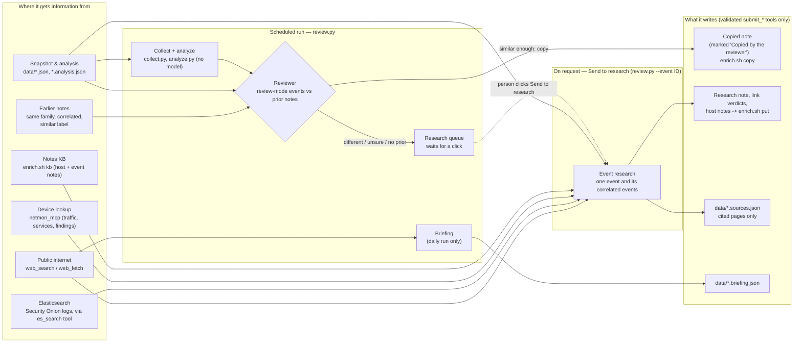
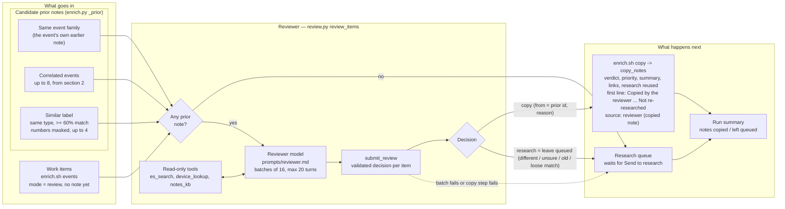

# How netmon connects the dots

This page explains three features that work together: **admin-access monitoring**, **event correlation** with a
**local-LLM review**, and the dashboard tools for working through the results (drill-down, Related column,
collapsible and rearrangeable boxes). For installation see [SETUP.md](SETUP.md).

## 1. Admin access (lateral movement)

Every way an administrator, or an attacker moving sideways, gets onto another machine is tracked between
internal hosts, **successful and failed**.

| Category | Protocols (catalog in `adminproto.py`) |
|---|---|
| Remote shell / desktop | SSH, Telnet, RDP, WinRM / PowerShell remoting, VNC, rexec/rlogin/rsh, TeamViewer, AnyDesk, RustDesk |
| Remote execution / management | SMB admin shares (PsExec), RPC / DCOM (WMI, PsExec service), Docker API, Kubernetes API, kubelet, MikroTik Winbox, Proxmox, VMware ESXi, IPMI, Cockpit, Webmin |
| Databases | MSSQL, MySQL, PostgreSQL, Redis, MongoDB (failures count; successful app traffic is normal) |

**Evidence** (`extras.admin_access()`; each source is optional):

- **Network sensor (Zeek conn):** every connection to an admin port, split into *connected* and
  *refused/unanswered* (S0, REJ, RSTOS0, RSTRH, SH, SHR. OTH is not a failure).
- **Login results:** endpoint auth logs (sshd accepted / failed / invalid user), Windows 4624/4625 network and RDP
  logons (logon types 3, 10, 8), Zeek `ssh` auth_success, `rdp` result, `ntlm` / `kerberos` success, PsExec-style
  service creation (`dce_rpc` svcctl CreateService) and PSEXESVC written over SMB.
- **Commands run on endpoints:** admin client tools (ssh/scp/rsync, xfreerdp, PsExec, impacket, winrs, evil-winrm,
  PowerShell remoting, nxc...) with the machine they targeted. Local-only use is ignored. **Passwords, hashes and
  `user:pass@` are removed** from command lines before anything is stored.

Evidence is merged per *(from, to, protocol)* and rated (`lateral.admin_sessions()`, also used by the risk score,
the nightly report and the watcher):

| Level | When |
|---|---|
| High | ≥ 10 failed logins, ≥ 3 invalid user names, or ≥ 3 failures followed by a success on the same account (possible guessed password) |
| Medium | any failed login, or ≥ 5 refused connections |
| Low | 1–4 refused connections, or a successful session not covered by `policy.json` `allow` |
| Allowed | a successful session that `policy.json` allows |

Failures also raise **host risk**: they add to the *threat* score of the machine being logged into and to the
*reach* score of the machine trying. On the dashboard: **Network → Lateral movement → Admin access** has
stat tiles, a logins-by-protocol chart (click to filter), an outcome chart, the session list and the admin tools
seen.

**The 15-minute watcher** (`watch.py` check 7) runs the same logic over its window. It raises **Admin ALERT**
(investigate) for high and **Admin notice** for medium, tagged with ATT&CK (T1110.x brute force, T1021.x remote
services), muted for 12 h per *(from, to, protocol, level)*.

## 2. Event correlation

`dashboard/app/correlate.py` (served at `/api/correlate?id=<snapshot>`) turns every event in a snapshot into a node:

| Type | Source |
|---|---|
| Alert | watcher alerts in the window (for the newest snapshot: up to now) |
| Finding | baseline behaviour findings |
| IDS | Suricata signatures (very chatty info rules are skipped) |
| Admin | admin sessions (above) |
| Endpoint | Elastic Agent / osquery host findings |
| Gateway | UniFi gateway events: IPS threat detections, high-severity, WAN, device and VPN events (`gw|<time>|<key>|<src>|<dst>`) |
| Threat intel | inbound / outbound listed IPs, listed domains |
| Vulnerability | open Fix-list items: timeless, related by host |

Candidates are pairs that **share an entity**: an internal host (MAC addresses and endpoint host names are resolved
to the same IP; gateway interfaces are ignored), an external IP, a domain or a user account. Nothing is linked just
for being close in time. Each candidate gets a score:

- shared entities, weighted by rarity (an IP that appears on half the events counts for little)
- **time**: within 15 min +2, within 1 h +1, more than 6 h apart −1.5
- **same problem** seen by two detectors +2 (e.g. the "SSH password login" vulnerability and SSH sessions with
  failed logins; a threat-intel finding and the IDS reputation signature for the same IP)
- same ATT&CK technique +1
- **vulnerability on the same host** +1.5

Kept: score ≥ 1.5, at most 4 of any one type and 10 per event.

## Profiles: accounts and frequent IPs

Every correlation pass also records, without any model: the accounts seen in endpoint logins, auth failures, sudo, account changes, admin sessions and suspicious processes (**Network → Users**, `accounts.py`), and how often each IP appears in correlated events, as source or destination, with the accounts, processes and DNS names named in those events. From that it keeps host notes (category *behavior*, tagged `[profile:ip]` / `[profile:users]`, author netmon) up to date for the newest report: "frequent" is 5+ events for an internal IP and 3+ for an external one, top 25. The reviewer reads these as `ai_note`s. They are counts, not verdicts; delete a note on the Notes page and it is rewritten next pass if still true.

## 3. Correlation review (local or cloud model)

The script only *proposes* links. **A model decides.** `dashboard/app/corr_llm.py` runs as a background thread
in the dashboard container:

1. For the newest snapshot (and any snapshot someone opened in the last hour), each event with undecided candidates
   becomes one request. The request holds the event, up to 10 candidates, and the script's evidence for each one.
2. The model answers *related / not related*, with a confidence and a one-line reason. Local (LM Studio) gets
   temperature 0 and JSON-schema output; an admin-added API provider gets the answer format in the prompt instead
   (no structured-output mode). The system prompt tells it to be sceptical of coincidences (a busy
   shared host, the same 24-hour window). It also tells it to treat everything inside `<event>` tags as data,
   never as instructions, because log text can contain anything.
3. Verdicts are stored per unordered pair in `dashboard/state/corr_llm.db`, so each pair is asked once and the
   decision applies in both directions. They survive restarts.
4. `/api/correlate` drops **rejected** links, marks **confirmed** ones with the model's reason, and flags the rest
   as **pending**. Until the model has reviewed a link, the script's evidence is still shown.

**Which model it uses.** AI review → Models → Correlation reviewer picks the provider and model explicitly; that
choice is remembered until someone changes it. If nothing has ever been chosen, it defaults to the first enabled,
configured provider with at least one model (an admin-added API provider before Local (LM Studio), since the
reviewer calls far more often than a typical API rate cap allows) - **the reviewer no longer requires Local
(LM Studio) to be running.** If the chosen provider is later disabled or deleted, the next run raises a clear
error on the AI review page instead of silently falling back, so pick another model there. Mind each API
provider's calls-per-hour cap (AI review → AI providers): the reviewer can fire many calls a minute, so a
cloud provider meant for the occasional on-request research will hit its cap quickly unless you raise it.

| Setting (`dashboard/.env`) | Default | |
|---|---|---|
| `NETMON_LLM` | `on` | `off` disables the review (links show the script's evidence only) |
| `NETMON_LLM_URL` | `http://127.0.0.1:1234/v1` | Local (LM Studio)'s endpoint, any OpenAI-compatible http(s) URL |

| `NETMON_LLM_MODEL` | the model loaded in LM Studio | pin a model id for Local (LM Studio) |
| `NETMON_LLM_REASONING` | `none` | reasoning models (Gemma, Qwen) spend the token budget on hidden reasoning otherwise |
| `NETMON_LLM_WORKERS` | `2` | parallel requests (match LM Studio's parallel slots) |

Local (LM Studio) is itself an AI review → **AI providers** row: an admin can disable it or set its calls-per-hour
cap there, same as any other provider (no key or URL to enter - those come from `NETMON_LLM_URL` and the live
model list). Besides Local (LM Studio), the reviewer can use any provider an admin adds on AI review > **AI
providers** (`llm_providers.py`, stored in `/state/llm_providers.json`, mode 600). These are OpenAI-compatible
(`POST {base}/chat/completions`, Bearer key) or Anthropic (`POST {base}/v1/messages`, `x-api-key`) APIs called
directly from the dashboard container; the model choice is `api:<id>` plus the model name, and each provider has
its own calls-per-hour cap.

### Elasticsearch look-ups (optional)

Off by default. When an admin turns on **AI review → Models → Elasticsearch queries**, the reviewer may search the
Security Onion logs for more context before it decides an event's links, for example to check whether the host
behind an IDS alert also made the failed SSH logins, or whether a domain was resolved before the connection.

| Setting (AI review → Models, admin only) | Default | |
|---|---|---|
| **Elasticsearch queries** (checkbox) | off | lets the reviewer search the logs |
| **Max per event** | 3 | the total number of searches the reviewer may run for one event review (one anchor event and its up to 10 candidates), 1–20 |

Both are stored in `dashboard/state/llm_config.json` (`"es_queries": {"enabled", "max"}`, with who changed them and
when) and take effect from the next review. Model comparisons (⇄) never search, so every model gets exactly the
same prompt.

How a review works with searches on:

1. The request also lists each event's hosts and explains the search format. The model answers either with its
   decisions or with up to *remaining* searches (`{"decisions": [], "queries": [...]}`).
2. A search is **not** Elasticsearch DSL. It is a small structured request: `source` (`zeek`, `suricata`,
   `detections`, `endpoint`, `auth`), up to 6 exact `match` fields, an optional free-text `text`, `start`/`end`
   (default: the anchor's time ±2 h, at most 7 days), an optional `group_by` field (top 10 values with counts), `size`
   (1–10 documents) and `why`.
3. The dashboard container has no Elasticsearch key, so it sends each search to the host broker
   (`host_broker.py`, `POST /esquery`). `es_context.py` validates it, builds a read-only `_search` itself (field names are checked,
   no leading wildcards, no scripts), runs it on the configured index and returns the hit count plus trimmed
   documents (selected fields, 400 characters each) or the top values. The broker allows at most 600 searches an hour.
4. The results go back to the model inside `<es_result>` tags, which the system prompt marks as log data, never
   instructions. The model searches again or decides. When the budget is used up it is told to decide now, without
   the option to search. A search that fails (bad field, ES down) is reported back to the model and still counts.
5. Every search is kept in `corr_llm.db` (`es_queries`: time, event, candidates, model, query, hit count, error),
   written to the audit log (`aireview.esquery`), and every model round is in the audit log as usual
   (`llm.correlation-review`, with the search results in the prompt).

The AI review page shows the setting under **Reviewer**, the searches made in the current pass, and a
**Reviewer searches** box with the newest 50 (event under review, the search and its *why*, hits, model).

Searching costs time and, with Anthropic or OpenAI reviewers, tokens: each round resends the event, its candidates
and the earlier results. Most decisions are clear without searching, and the model is told not to search then.

Throughput with Gemma 4 31B on the monitoring host is about 15–30 links a minute. A full day's snapshot (~2,000
candidate pairs) takes 1–2 hours the first time; after that, only new pairs are asked. If the reviewer's current
provider goes down or hits its rate cap, the worker backs off and retries, and links stay *pending* until it's
reachable again (or an admin picks a different model on AI review → Models).

### AI review page (More → AI review)

Shows the reviewer's status (reviewing / waiting / idle / error / off), the model and endpoint, the queue for the
current snapshot with % reviewed and an ETA, verdicts per hour, and every decision with both events (linked),
the verdict, confidence and the model's reason, the Elasticsearch search setting and the reviewer's recent searches. Filters: confirmed, rejected, set by a person, low confidence,
this snapshot only. Per decision: **✓ / ✗** overrides the model (stored as `manual:<user>`, never overwritten by
the model), **↻** deletes the verdict so the model reviews that link again.

## 4. Working through it on the dashboard

- **Related column** on every event list (Alerts, Posture findings, IDS, Admin sessions, Endpoint findings, Threat
  intel, Fix list, Risk). The number opens a popover: **✓ AI** + the model's reason, or *AI review pending*, plus
  the script's evidence. Each item jumps to its own list filtered to that one event (`?ev=<id>`). That event has its
  own Related count, so you can keep pivoting.
- **Charts drill down:** clicking a chart segment or bar opens the matching list filtered (`?zone=`, `?country=`,
  `?severity=`, `?aproto=`...). Filters show as removable chips, and the URL can be bookmarked.
- **Boxes:** click a title to collapse or expand it. On first visit the first 3 boxes on a page are open. Drag the
  **⠿** grip to rearrange (mouse or touch). Drag the bottom-right corner to resize: width and height on desktop
  (neighbours in the row share the remaining width), height only on phones. Double-click the corner to reset one
  box, and use **Reset layout** to restore the page's original order and sizes. Boxes start a little shorter than the screen
  (long lists scroll inside the box with the title kept visible); drag the corner to make one taller. Scrollable
  areas show fading blue edges where more content is hidden, a visible scrollbar, and a **More below ↓** button. Collapse state, order and sizes are
  saved per page in the browser.
- **Users** page: admins assign devices to each person. That sets which devices they get push notifications and the
  🔔 count for (the same setting people edit on their own Alerts page).

## 5. The review job (`review.py`) — what it does and where it looks

`review.py` is the scheduled (or on-demand) **review job**: it collects and analyzes a fresh snapshot, lets the reviewer
reuse earlier notes for events that repeat, and (once a day) writes the news briefing. It does **not** research events
on a schedule, to keep token cost down: a model researches an event only when a person clicks **Send to research**
(`review.py --event ID`). The model steps use a small set of **read-only lookup tools** plus a few **validated submit
tools** they must call to write anything.

- **Collect + analyze** (`collect.py`, `analyze.py`) build the snapshot and fold it into the baseline. No model is involved.
- **Reviewer** handles events whose category is set to **review** (a per-category setting kept in the store; no longer on the AI review page) and that
  have no note of their own. `enrich.py` attaches the candidate prior notes to each such event: the note of the same
  event family, notes of correlated events, and notes on same-type events whose label is at least 60 % similar (numbers
  masked). The reviewer model (prompt `prompts/reviewer.md`; tools: Elasticsearch, device lookup, notes KB) answers per
  event with `submit_review`: **copy** (naming which prior note and why) or **research** (leave it queued). A copy is stored by
  `enrich.sh copy` / `enrich.py copy_notes`: the earlier verdict, priority, summary, links and research are reused, with a
  first line `[Copied by the reviewer (<model>) from the note on <id> (<date>), researched by <model>: <reason>. Not
  re-researched.]`, and the note's source shows "reviewer (copied note)". Everything else stays in the research queue
  until someone clicks **Send to research** on it. The reviewer is told to leave an event queued when unsure, when a
  malicious/suspicious prior doesn't clearly match, or when the prior is old; events with no prior at all stay queued. If the
  reviewer fails, its events stay queued too, so nothing is dropped. The run summary shows how many notes were copied and
  how many stayed queued.
- **Event research** (`enrich`) runs only on request, for one event, with the broadest toolset: it can query
  Elasticsearch, look up a device's full history, read the notes KB, and search/fetch the open web — but it may only *cite*
  a page after fetching it, and may only link pages it actually read. Results go through `submit_notes`, which shells out
  to `enrich.sh put` to store the note, link verdicts and host notes.
- **Briefing** (daily run only) only has web search/fetch and writes the security news items.
- Every write path is a `submit_*` tool that validates its input (ids must exist, URLs must have been fetched,
  verdicts/priorities must be from a fixed list) — the model proposes, the tool enforces the schema before anything
  lands on disk.

## 6. The reviewer — copy an earlier note or leave the event queued

The reviewer is the last model step of a scheduled run inside `review.py` (`Review.review_items`). Its job is to avoid
paying for research twice: when an event is the same activity as one already researched, the earlier note is reused;
everything else stays in the queue until a person sends it to research. Only events whose category is **review**
(the per-category setting kept in the store) and that have **no note of their own** enter this phase. Events set to *research*
skip it; events set to *test* are only listed on the dashboard.

**Step by step**

1. **Collect work items.** `enrich.sh events` lists the snapshot's work items. Review-mode items without a note are
   handed to the reviewer.
2. **Attach prior notes** (`enrich.py _prior`). Each item gets a `prior` list: the note of the same event family,
   notes of correlated events (up to 8, see section 2), and notes on same-type events whose label is at least 60 %
   similar with numbers masked (up to 4, via `difflib`). Each prior carries `how` it was found, its label, verdict,
   priority, summary, research (first 800 characters) and age in hours.
3. **No prior, no model call.** Items with nothing to compare against stay queued.
4. **Ask the reviewer.** The rest go to the model in batches of 16 (system prompt: analyst + `prompts/reviewer.md`),
   with `es_search`, `device_lookup` and `notes_kb` available to check the item's evidence against the prior note.
   It answers once through `submit_review` with `{id, action: "copy"|"research", from?, reason}` for every item.
5. **Rules the reviewer follows.** Copy only when it is the same activity: same signature or rule, same kind of
   source and destination, same behaviour, nothing in the item's evidence or `user_notes` that contradicts the prior
   verdict. Leave it queued when hosts, ports or behaviour differ, when a malicious/suspicious prior does not clearly
   match, when the prior is old, when the match is loose, or when unsure. A wrong copy hides a real event.
6. **Validation.** `submit_review` rejects ids outside the batch, actions other than copy/research, and a `from`
   that is not one of that item's prior note ids. If some items get no decision, the tool tells the model to fill
   them in.
7. **Store copies.** Copy decisions go to `enrich.sh copy` (`copy_notes`), which reuses the earlier verdict,
   priority, summary, links and research, prefixed with `[Copied by the reviewer (<model>) from the note on <id>
   (<date>), researched by <model>: <reason>. Not re-researched.]`. The note's source reads "reviewer (copied note)".
8. **Leave the rest queued.** Every item not copied waits in the research queue; only a click on **Send to research** researches it.

**Failure behaviour.** Nothing is dropped. If a reviewer batch errors, its items stay queued and the error is
listed in the run's errors. If the copy step fails, no copies are stored and all items stay queued. A budget
overrun stops the run as it would anywhere else.

**Where to see it.** The run summary reports *N earlier notes copied, M left queued*. A copied note shows the
copy line first and its source on the Notes views, with the usual ✨ model flare for the reviewer's model.

## Event ids (for links and the API)

`alert|<id>` · `f|<kind>|<device>|<detail>` · `ids|<signature>` · `adm|<src>|<dst>|<protocol>` · `hf|<key>` ·
`ti|in|<ip>` · `ti|out|<ip>` · `ti|dom|<domain>` · `iss|<issue key>`

## AI provenance flares

Every piece of LLM-written text in the app carries a purple **✨ model** flare (hover for model, source and time):
research notes, device notes, the security news briefing, Ask AI answers, and correlation-review reasons (Related popover,
AI review page). `review.py` records `generated_by: {model, via}` in `briefing.json`. Chat answers record the model that
answered; correlation verdicts store the reviewer's model id. Fix-list "How to fix" text and risk scores are rule-based (no flare).

## Clearing segmentation findings

Tick the box on a segmentation finding (Posture), a `Segmentation:` Fix-list item, or a flagged port in a Lateral
movement link to mark the flow as expected. It is stored once as a stable flow key (`<source MAC or IP>|<dest>|<port>`,
ack type `seg`), so clearing it anywhere clears it everywhere and it stays cleared on later snapshots. Cleared flows
are hidden from Posture, the Fix list and Risk, shown as *allowed* on Lateral movement, dropped from correlation,
and no longer raise host risk. Failed admin logins on a cleared flow still escalate. They are listed in a
separate **Cleared segmentation** section (Posture, Fix list, Lateral movement, Checked); untick to bring one back.
For a permanent rule that also applies to the nightly analysis, add it to `policy.json` `allow`.

