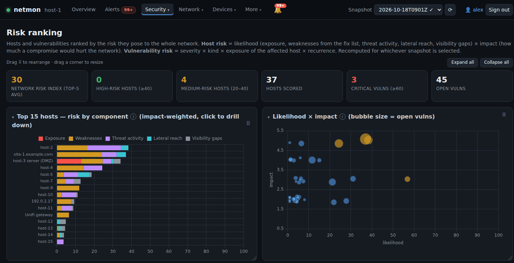
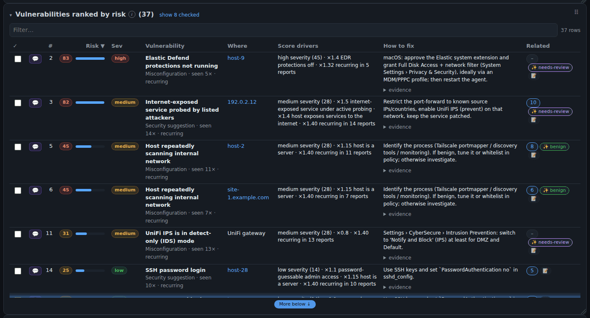
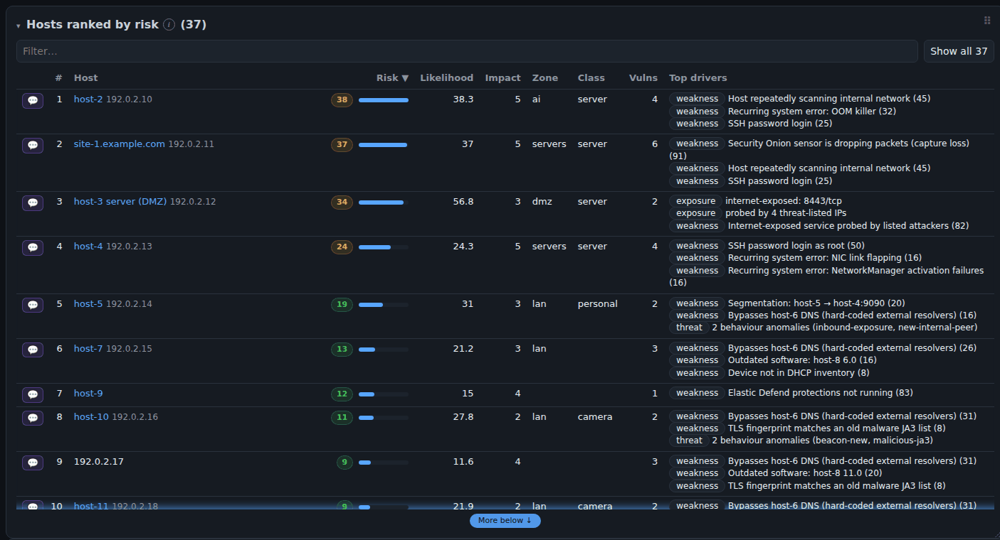
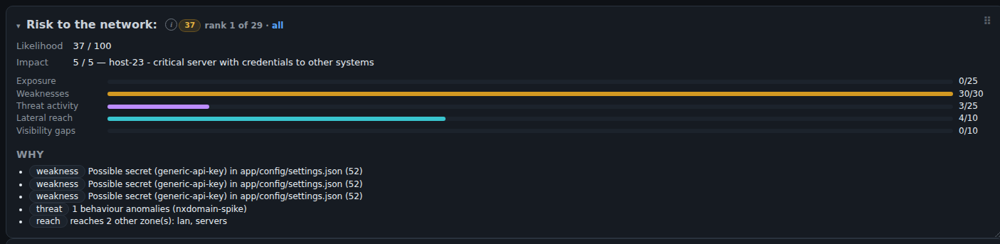
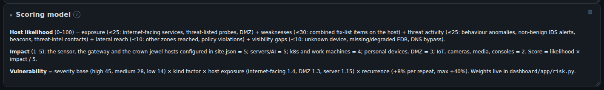

# Risk scoring

How netmon ranks **vulnerabilities**, **hosts** and **lateral-movement links**. The scores you see on
**Security → Risk**, the Overview "Highest-risk host" tile, the Network map colours, the host risk cards and the
Lateral movement graph all come from the model described here.

The model is rule-based and deterministic. No LLM is involved, and the same snapshot plus the same Fix list always
produces the same numbers. Every score comes with a list of **drivers**, the plain-language reasons the dashboard
shows next to it. All weights are constants at the top of `dashboard/app/risk.py` (vulnerability and host scores)
and `dashboard/app/lateral.py` (admin sessions and link scores).

- [Where the scores are computed](#where-the-scores-are-computed)
- [Vulnerability risk](#vulnerability-risk-0100)
- [Host risk](#host-risk-0100)
- [Admin sessions and lateral-link risk](#admin-sessions-and-lateral-link-risk)
- [Colour bands and dashboard summaries](#colour-bands-and-dashboard-summaries)
- [What lowers a score](#what-lowers-a-score)
- [Worked example](#worked-example)
- [Tuning](#tuning)
- [Known limitations](#known-limitations)



---

## Where the scores are computed

`GET /api/risk?id=<snapshot>` (and `/api/lateral`) calls `risk.compute()` on request, so scores always reflect:

| Input | Source |
|---|---|
| Snapshot raw data: devices, served ports, IDS signatures, beacons, threat intel, TLS, internal flows, admin access, endpoint fleet | snapshot document `data/<snapshot>` in the netmon database (collect.py) |
| Behaviour findings and segmentation violations | `data/<snapshot>.analysis` document in the netmon database (analyze.py) |
| Open Fix-list issues, with occurrence counts across **all** snapshots | `issues.track()` plus software-scan findings |
| Zones, device classes, allow list | network policy (More → Settings) |
| Cleared segmentation flows (ack type `seg`) | ack store |
| Known-benign IDS signatures, beacon domains, names | Known benign list (More → Settings) |
| Crown-jewel hosts, endpoint-name→IP map | Site settings (More → Settings) |

Because scores are computed on request, picking an older snapshot recomputes risk for that snapshot. Clearing a
segmentation flow or fixing an issue changes the scores right away, without waiting for the next nightly run.

---

## Vulnerability risk (0–100)

Each **open** Fix-list issue gets a score:

```
vuln risk = min(100, severity base × kind factor × host exposure × recurrence)
```

### Severity base

| Severity | Base |
|---|---|
| high | 45 |
| medium | 28 |
| low | 14 |
| info | 5 |
| anything else | 10 |

### Kind factor

This factor reflects how bad this *type* of issue is compared with others of the same severity. It is looked up
from the issue key (`<kind>|<target>|…`). The lookup tries, in order: the key minus its last segment, the first
two segments, then the bare kind.

| Kind (key prefix) | Factor | Why |
|---|---|---|
| `seg-dmz` (segmentation issue whose host is in the DMZ) | 1.5 | DMZ host reaching internal zones (pivot path) |
| `ti-in` | 1.5 | internet-exposed service under active probing |
| `defend` | 1.4 | EDR protections off |
| `unifi\|admin-src` | 1.4 | admin access to the gateway |
| `unifi\|ips-mode` | 1.3 | network-wide: attacks are logged, not blocked (see [limitations](#known-limitations)) |
| `sensor` | 1.25 | network-wide monitoring blind spot (capture loss) |
| `plain` | 1.2 | credentials in cleartext |
| `agent` | 1.1 | reduced endpoint visibility |
| `sshpw` | 1.1 | password-guessable admin access |
| `scan`, `seg`, `sw` | 1.0 | |
| `tls-legacy`, `dns-ext`, `authfail`, `unifi` (other UniFi items) | 0.8 | `dns-ext`: bypasses DNS filtering/logging |
| `syslog` | 0.7 | stability, not directly exploitable |
| `doh`, `ja3` | 0.5 | visibility only / likely fingerprint collision |
| `inv` | 0.4 | inventory hygiene |
| anything not listed (e.g. software-scan findings) | 1.0 | |

### Host exposure factor

This depends on the affected host. The issue's `ip` is used, or the host name is resolved to an IP through
the site setting `host_ips` or a device-name match. Only the first matching row applies:

| Condition | Factor |
|---|---|
| host serves a TCP port below 32768 to the internet (`ext_conns` > 0; ICMP ignored) | 1.4 |
| host is in a zone with role `dmz` (network policy `zone_roles`) | 1.3 |
| host is in a zone with role `protected` | 1.15 |
| otherwise, or the host can't be resolved | 1.0 |

### Recurrence

```
recurrence = 1 + 0.08 × min(occurrences − 1, 5)
```

An issue gains +8% for each snapshot it reappears in, up to +40% (6 or more occurrences). The dashboard
labels an issue *recurring* once it has been seen in 2 or more snapshots.

### Drivers

These are shown in the "Score drivers" column, for example `high severity (45) · ×1.1 password-guessable admin
access · ×1.4 host exposes services to the internet · ×1.24 recurring in 4 reports`.



---

## Host risk (0–100)

```
host risk  = likelihood × impact / 5
likelihood = exposure (≤25) + weaknesses (≤30) + threat activity (≤25)
           + lateral reach (≤10) + visibility gaps (≤10)        (capped at 100)
impact     = 1–5
```

Likelihood measures how probable a compromise is. Impact measures how much a compromise would hurt the rest of the
network. An impact-5 host can reach the full 100. An impact-2 IoT device tops out at 40, so a noisy camera never
outranks a moderately exposed server.



Each host's device or endpoint page has a **Risk to the network** card. It shows the five likelihood components as
bars against their caps, the impact and its reason, and every driver:



### Which hosts are scored

- Every device in the snapshot, except addresses ending in `.0`, `.1` or `.255`. Those belong to the gateway, and
  their issues are merged into a single **UniFi gateway** entity.
- Every Fix-list target that isn't a device IP, such as Elastic-agent endpoints known only by host name (case
  variants are merged).
- A host is dropped when its score is 0 **and** it has no open issues.

### 1. Exposure (max 25)

| Signal | Points | Driver text |
|---|---|---|
| internet-exposed services (TCP < 32768, real external connections) | 8 + 2 per service, max 18 | `internet-exposed: 443/tcp, …` |
| targeted by threat-listed source IPs (`threat_intel.ip_hits_in`) | +7 | `probed by N threat-listed IPs` |
| host is in the DMZ | +5 | (no driver) |

### 2. Weaknesses (max 30)

These come from the host's open Fix-list issues, using their vulnerability scores *s₁…sₙ*. Each issue
independently "fills" part of the 30-point bucket, so many small issues add up while still having diminishing
returns:

```
weaknesses = 30 × (1 − Π (1 − 0.6 × sᵢ / 100))
```

A single 100-point vulnerability gives 18. Two of them give 25.2. The 30-point cap is only approached with
many serious issues. The top three issues are listed as drivers.

### 3. Threat activity (max 25)

| Signal | Points |
|---|---|
| behaviour findings from analyze.py (excluding segmentation, outdated-software, legacy-tls, which are counted as weaknesses) | high 6 / medium 3 / low 1 each |
| IDS signatures with this host as source, excluding known-benign signatures | 3 per signature, max 10 |
| beacon-like patterns from this host, excluding known-benign beacon domains | 3 per beacon, max 8 |
| contacted a threat-listed IP or domain (`ip_hits_out`, `domain_hits`) | +15 |
| host is a source of a malicious JA3 fingerprint | +2 (no driver) |
| **failed admin logins against this host** (high/medium admin sessions with it as destination, see below) | 3 per session, +4 if any is *high*, max 10 |

The admin-login points are added after the first cap, and the total is capped at 25 again.

### 4. Lateral reach (max 10)

| Signal | Points |
|---|---|
| other internal zones this host has *answered* connections to (own zone and internet excluded) | 2 per zone, max 6 |
| segmentation-policy violations with this host as source (cleared flows excluded) | 1 each, max 4 |
| failing admin logins *from* this host (high/medium sessions with it as source) | 2 per session, max 4 |

### 5. Visibility gaps (max 10)

| Signal | Points |
|---|---|
| device not in the inventory (`known` false) | +4 |
| server, workstation or `dmz`/`protected`-role zone host with no Elastic agent (infra excluded) | +4 |
| Elastic agent present but not online/healthy | +3 (no driver) |
| host has an open `doh` or `dns-ext` issue (DNS bypass) | +2 (no driver) |

### Impact (1–5)

Only the first matching rule applies:

1. **Override.** Crown-jewel hosts listed in the site setting `crown_jewels` (with a reason) are 5. The **UniFi
   gateway** entity is 5.
2. **DMZ** host: 3. It is isolated by design, but becomes a pivot point if segmentation leaks.
3. **Endpoint known only by host name** (Elastic agent, no device IP): 4.
4. Otherwise, by **device class** from the network policy `device_classes`. When the device has no class, the
   **zone role** is used instead (`protected` 5, `mgmt` 4, `dmz` 3, `user` 3, `iot` 2; `zone_roles` is filled by Auto-discover from UniFi, see SETUP.md).

| Class | Impact | | Zone (only used when there is no class) | Impact |
|---|---|---|---|---|
| infra, server | 5 | | servers, ai | 5 |
| k8s, work | 4 | | k8s | 4 |
| personal | 3 | | dmz, lan, vlan3, vlan4, vlan21 | 3 |
| camera, media, game, iot | 2 | | anything else | 2 |

A class not in the table scores 2. The reason is shown as a tooltip on the Impact column.

---

## Admin sessions and lateral-link risk

`lateral.admin_sessions()` merges admin access (SSH, RDP, PsExec/SMB, WMI, WinRM, VNC, Docker/k8s, remote
support…) by *(source, destination, protocol)* and gives each session a level. The rules are checked in order:

| Level | Rule |
|---|---|
| **high** | ≥ 10 failed logins, or ≥ 3 invalid user names (password guessing) |
| **high** | an account with ≥ 3 failures followed by a success ("check it was really you") |
| **medium** | any failed login |
| **medium** | ≥ 5 refused/unanswered connections to an admin port |
| **low** | 1–4 refused/unanswered connections |
| normal | database client traffic |
| allowed-admin | successful session matched by the network policy `allow` list, or on a user-cleared segmentation flow |
| **low** | successful session not covered by the allow list |

Only **high** and **medium** sessions feed host risk: the destination's *threat* and the source's *reach*.
Clearing a segmentation flow never hides failed logins on it, because failures are checked before the allow
list.

### Segmentation severity (by port)

A flow that breaks the segmentation policy (the network policy) becomes a *violation*, a Fix-list `seg` issue and a
behaviour finding. The reason says why it is flagged (a DMZ host initiating inward, an IoT or camera device reaching
servers, an admin port between internal hosts, cross-zone access to a server zone); its **severity comes from the port
alone**, so one noisy zone pair cannot flood the high bucket:

| Severity | Ports |
|---|---|
| **high** | admin / remote-control ports: the policy's `sensitive_ports` plus the admin catalog (SSH, RDP, SMB, WinRM, databases, Docker and Kubernetes APIs…, the same set as Admin access) |
| **low** | standard service ports: the policy's `standard_ports` (default 20, 21, 25, 53, 80, 110, 123, 143, 389, 443, 465, 587, 636, 993, 995, 3000, 5000, 8000, 8080, 8443, 8888) plus `discovery_ports` |
| **medium** | any other (odd) port |

Unanswered flows with fewer than 5 attempts, gateway services and flows covered by `allow` are not flagged. The
severity sets the base of the `seg` Fix-list issue (high 45, medium 28, low 14) and the points the violation gives in
the source host's *reach* (1 each, max 4). The correlation reviewer's segmentation categories use the same three
severities ([CORRELATION.md](CORRELATION.md)).

### Link (edge) score

Each internal host-to-host edge on the Lateral movement page takes the worst level of its ports and admin
sessions. Port levels come from policy violations (their port-based severity, above), ≥ 5 unanswered attempts at a sensitive
port (medium), being part of an internal scan (medium), or an answered sensitive port that isn't allowed (low).
A flow whose segmentation finding a person cleared is shown as *allowed-admin*.
The edge is then scored for sorting and line weight:

```
edge score = level weight × (0.6 + 0.2 × destination impact)
           × (1 + min(conns, 1000) / 1000) × (1 + min(failed logins + refused, 50) / 25)
```

Level weights are high 3, medium 2, low 1, allowed-admin 0.5 and normal 0. Destination impact is the host-risk
impact (3 if unknown). As a result, a medium link into a crown jewel with repeated failures can outrank a high
link between two IoT devices.

**Several periods.** With the time picker the Lateral movement page can show more than one period at once
(up to three are collected in parallel, each straight from Elasticsearch through the host broker). They are merged
before scoring, as if they were one longer window: flows, connection counts and bytes are summed per
*(source, destination, port, protocol)*, admin logins and tools are concatenated (so failures add up and can cross a
threshold), violations are summed per flow keeping the worst severity, and internal scans keep the worst per source.
Host risk bubbles use the newest nightly snapshot, not the picked periods.


---

## Colour bands and dashboard summaries

| | Red | Amber | Yellow / blue | Grey / green |
|---|---|---|---|---|
| Host risk | ≥ 40 | 20–40 | 8–20 | < 8 |
| Vulnerability risk (charts) | ≥ 60 ("critical") | 30–60 | < 30 | |

- **Network risk index** is the average score of the top five hosts (red ≥ 40, amber ≥ 20).
- The **Top 15 hosts** chart stacks each component scaled by impact (`component × impact / 5`), so the bar
  length equals the host's score.
- The **Likelihood × impact** bubble chart plots every host, with bubble size set by its number of open issues.
- **Network map** zone badges show the highest host risk in the zone. Badges appear only when that value is ≥ 8.
  With **Colour by: Risk**, each host is filled green → red by its score, and riskier hosts are drawn larger.


---

## What lowers a score

- **Fix the issue.** Once a snapshot can re-check the issue and no longer sees it, it moves to *Fixed* and stops
  counting toward vulnerability and weakness scores.
- **Clear an expected segmentation flow** (checkbox on Posture, the Fix list or Lateral movement). This removes
  the issue, the violation and its reach points. To make it permanent for everyone, add it to the network policy `allow` list
  `allow`.
- **Mark noise as known-benign.** IDS signatures and beacon domains in the Known benign list stop adding threat
  points.
- **Close visibility gaps.** Add the device to the inventory, install or repair the Elastic agent, and stop DNS
  bypass.
- **Classify devices.** An unclassified device falls back to its zone's impact. Setting its class in
  the network policy `device_classes` gives it the right impact.

Acknowledging (checking off) a vulnerability on the Risk page only moves it to the "checked" view. It does **not**
change its score. Only fixing or clearing does.

---

## Worked example

This example uses invented values. A server-class host in the `servers` zone exposes two services to the internet
and has two open issues.

**Vulnerabilities**

- SSH password logins (`sshpw`, high, seen in 4 snapshots): 45 × 1.1 × 1.4 × 1.24 = **85.9**
- An outdated package (`sw`, medium, seen once): 28 × 1.0 × 1.4 × 1.0 = **39.2**

The exposure factor is 1.4, not 1.15, because the internet-exposure rule comes first.

**Host**

| Component | Calculation | Points |
|---|---|---|
| Exposure | 8 + 2×2 services = 12, + 7 probed by threat-listed IPs | 19 |
| Weaknesses | 30 × (1 − (1 − 0.515)(1 − 0.235)) | 18.9 |
| Threat | 1 medium anomaly (3) + 1 IDS signature (3) | 6 |
| Reach | answered connections into 1 other zone | 2 |
| Visibility | in inventory, healthy agent | 0 |
| **Likelihood** | | **45.9** |

With impact 5 (class `server`), risk = 45.9 × 5 / 5 = **45.9**, which is red. The same likelihood on an IoT device
(impact 2) would score 18.4.

---

## Tuning

The **Scoring model** box at the bottom of the Risk page summarises the model and reads the severity bases live
from the API:



All weights are module-level constants:

| What | Where |
|---|---|
| Severity bases | `risk.SEV_BASE` |
| Kind factors and their reasons | `risk.KIND_FACTOR` |
| Impact by class / zone | `risk.IMPACT_BY_CLASS`, `risk.IMPACT_BY_ROLE` |
| Crown jewels (site-specific) | Settings → Site → `crown_jewels: {"<ip>": "<why>"}` |
| Component caps and per-signal points | inline in `risk.compute()` |
| Admin-session thresholds | `lateral.admin_sessions()` |
| Edge level weights | `lateral.SEV_W` |
| UI colour bands | `riskCls()` in `static/app.js`, `nmRiskColor()` in `static/netmap.js` |

If you change a cap, also update `components_max` in the `compute()` return value, `RISK_COMP` in `app.js` and the
**Scoring model** box text on the Risk page. Then ship with `./ship.sh "<message>" --deploy`.

---

## Known limitations

- **`unifi|ips-mode` gets 0.8, not 1.3.** The first lookup candidate is "key minus its last segment", which for a
  two-segment key is just `unifi`. That entry matches before the more specific `unifi|ips-mode`. Three-segment
  UniFi keys such as `unifi|admin-src|<ip>` resolve correctly.
- Some points have no driver text (DMZ exposure +5, JA3 +2, unhealthy agent +3, DNS bypass +2). In those cases the
  component bar can be higher than the listed drivers explain.
- Host-to-IP resolution for endpoint names uses the site setting `host_ips`, then a short-name match against device
  names longer than 3 characters. An endpoint that can't be resolved is scored separately by host name with
  impact 4, and gets no network-side signals.
- Threat-intel outbound matching is a substring test of the host IP against each hit. A short IP can, in rare
  cases, match inside a longer one.
- Risk is a ranking aid, not a probability. Compare hosts with each other and track trends over time rather than
  reading meaning into an absolute number.
