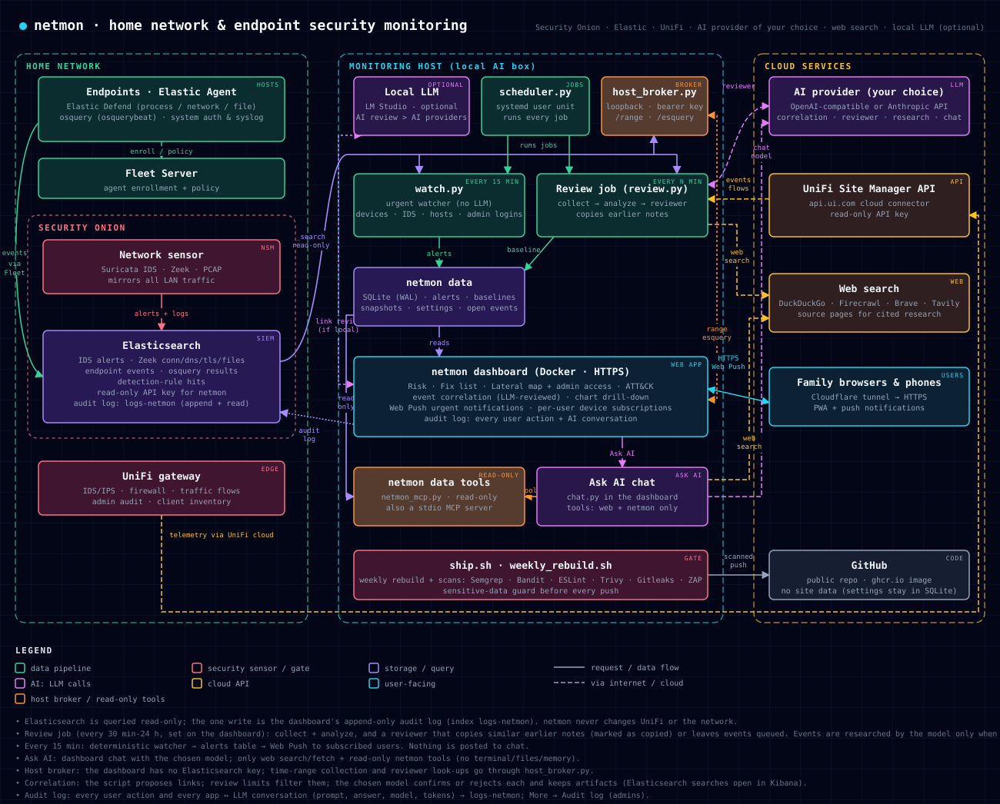

# Setting up netmon with your own Hermes

This guide takes you from a fresh clone to a working install: nightly AI-triaged PDF reports, a 15-minute urgent watcher, the HTTPS dashboard with phone push alerts, and the optional **Ask Hermes** chat.

netmon is **read-only** against your network. It queries Elasticsearch and the UniFi cloud API, and it never changes Security Onion, the gateway or any device.



---

## 0. What you need

| Component | Required? | Used for |
|---|---|---|
| **Linux host** with Docker, Python 3.10+ at `/usr/bin/python3`, git, openssl | yes | runs Hermes, the jobs and the dashboard container |
| **[Hermes Agent](https://hermes-agent.nousresearch.com/docs)** | yes | schedules the jobs and does the nightly triage |
| **LLM provider** for Hermes (Anthropic Claude recommended) | yes | nightly triage and the chat. The 15-minute watcher uses no LLM. |
| **Security Onion 2.4** (or any Elasticsearch with the same Suricata/Zeek data streams) | yes | network sensor and data store |
| **Elastic Agent via Fleet** on your endpoints (Elastic Defend + osquery integrations) | recommended | endpoint findings, host posture |
| **UniFi gateway** + UniFi Site Manager API key | optional | gateway IDS, admin audit, flows. Skipped when missing. |
| UniFi DHCP export CSV | optional | friendly device names. Without it, names come from DHCP/DNS. |
| Cloudflare Tunnel (or any reverse proxy) | optional | reach the dashboard and receive push notifications away from home |

Python packages on the host: `reportlab` (`sudo apt install python3-reportlab` or `pip install --user reportlab`). Everything else is the standard library. The dashboard image installs its own dependencies.

## 1. Clone to the expected path

The scripts and Hermes jobs expect the repo at `~/.hermes/netmon`:

```bash
git clone <this repository's clone URL> ~/.hermes/netmon
cd ~/.hermes/netmon
./setup.sh
```

`setup.sh` is safe to re-run. It never overwrites existing files. It:

- checks prerequisites
- copies the `*.example.json` templates to your local config files
- creates the data folders
- creates a self-signed TLS certificate and a first dashboard login (it prints the password)
- installs the two Hermes cron scripts and the `netmon` skill

`./setup.sh --check` only reports what is present or missing.

## 2. Describe your network (local files, never committed)

All network-specific values live in git-ignored files. Edit the copies `setup.sh` made:

| File | What to put in it |
|---|---|
| `site.json` | Your internal CIDR and prefixes, Elasticsearch URL, sensor IP, this host's IP and name, gateway name/DNS IP, home WAN IP, VPN prefixes, honeypot IPs, Fleet host name → IP (`host_ips`), crown-jewel hosts (scored highest impact), and `sensitive_terms` (host/user names the push guard should block). Optional pivot links (🔎 buttons): `kibana_url` (Kibana base, e.g. `https://so.example.lan/kibana/`), `kibana_data_view` (Discover data view id, default `logs-*`), `unifi_web_url` (UniFi Network web app base, e.g. `https://unifi.ui.com/consoles/<console-id>/network/default/` or `https://<gateway-ip>/network/default/`) and `unifi_paths` (label → page path under it). Leave `kibana_url` empty to hide the buttons. If you'll publish your own fork, also fill in `github_user`, `github_repo` and `image_repo`. |
| `policy.json` | Network **zones** (CIDR per VLAN), **device_classes** (MAC or IP → `iot`, `camera`, `media`, `game`, `personal`, `work`, `server`, `k8s` or `infra`), and **allow** rules for expected cross-zone flows. Anything else on a sensitive port, from the DMZ, or from IoT/cameras to servers is reported as a segmentation violation. |
| `host_policy.json` | Endpoint rules: expected admin source IPs (`admin_sources`), Fleet host → LAN IP (`endpoint_ips`), trusted tool paths (replace `/home/YOUR_USER`), syslog patterns, osquery posture expectations and per-host exceptions. The defaults are sensible; adjust the paths and IPs. |
| `known_benign.json` | Suricata signatures, IP names and domains you have explained as benign. The nightly triage adds to this over time. |
| `sec_accepted.json` | Reviewed security-scan findings (filled in by `secfindings.py accept-current`). Start empty. |

Optional extras:

- **Device inventory:** put a UniFi DHCP export at `~/dhcp-export-all-<date>.csv` (columns: `Name`, `IP Address`, `MAC Address`, `Hostname`, `Local DNS Record`, `Lease Type`), or point `NETMON_INVENTORY` at another file name pattern.
- **Device-name table** for UniFi client checks: a markdown table with rows `| <mac> | <ip> | <name> |` (MAC lower-case, colon-separated). Put it at `~/.hermes/skills/network/home-network-devices/SKILL.md`, or point `NETMON_DEVICE_TABLE` at it.

## 3. Secrets

| Secret | Where | Notes |
|---|---|---|
| Elasticsearch API key | `~/.hermes/.env` → `MCP_SO_ELASTICSEARCH_API_KEY=<key>` | Create a **read-only** key: Kibana → Stack Management → API keys, with `read` + `view_index_metadata` on `logs-*`. |
| UniFi Site Manager API key | `~/.hermes/secrets/unifi_api_key` (chmod 600) | https://unifi.ui.com → API. Optional. |
| LLM key (e.g. `ANTHROPIC_API_KEY`) | `~/.hermes/.env` | Used by Hermes itself. Run `hermes setup` if Hermes isn't configured yet. |
| Dashboard login + chat key | `dashboard/.env` | Created by `setup.sh` and `setup_chat_profile.sh`. |

None of these are ever committed: `.gitignore` and the push gate block them.

## 4. Elastic Agent / osquery on your endpoints (recommended)

In Kibana **Fleet**, give your endpoint agent policies these integrations:

- **Elastic Defend.** On macOS, approve the system extension and grant Full Disk Access, or protections stay off and netmon will tell you so.
- **System** (auth and syslog logs).
- **Osquery Manager.** Import `osquery_pack.json` as a pack named `netmon-host-posture`, assign it to your policies and enable it.

Hosts then appear on the dashboard's **Endpoints** page after the next collection.

## 5. First collection and report (manual)

```bash
cd ~/.hermes/netmon
/usr/bin/python3 esq.py logs-zeek-so '{"size":0}'      # connectivity test: prints hit totals
/usr/bin/python3 collect.py 24                          # → data/<stamp>.json
/usr/bin/python3 analyze.py                             # → data/<stamp>.analysis.json + baseline
NETMON_OUT_DIR=/tmp /usr/bin/python3 report.py          # test render of the PDF (no triage yet)
```

Behaviour rules (traffic spikes, new destinations and so on) need **3 days** of baseline before they fire. Static rules (IDS, threat intel, segmentation, endpoint findings) work from day one.

## 6. Dashboard

```bash
cd ~/.hermes/netmon/dashboard && ./deploy.sh
```

- It listens on **https://<host>:8443**. Sign in with the `admin` password `setup.sh` printed, then change it on the **My account** page. Add family accounts on the **Users** page.
- The container runs read-only, as your user, with all capabilities dropped. It mounts the repo read-only, `dashboard/state` (SQLite, users, push subscriptions) read-write, and `~/network_reports` read-only.
- **Phone push notifications** need HTTPS with a certificate the phone trusts. A Cloudflare Tunnel (`cloudflared`) pointing at `https://127.0.0.1:8443` with "No TLS Verify" works well. On iPhone, add the site to the Home Screen first, then enable notifications on the Alerts page.
- The login lockout trusts `CF-Connecting-IP` only from loopback, which is how cloudflared connects.

### Audit log (Elasticsearch `logs-netmon`)

Every user action and every AI conversation is written to the Elasticsearch index `logs-netmon` and shown on **More → Audit log** (admins only, see the [user guide](USER_GUIDE.md#more--audit-log)). One-time setup with an Elasticsearch account that can manage templates (Kibana → Dev Tools, or curl):

1. Index template (fixed mapping, so prompts and answers are full-text searchable): `PUT _index_template/netmon-audit` with the body in `docs/audit_index_template.json`, then `PUT logs-netmon`.
2. A key for the dashboard that can only add and read entries:
   `POST _security/api_key {"name": "netmon-audit", "role_descriptors": {"netmon_audit": {"indices": [{"names": ["logs-netmon"], "privileges": ["create_doc", "read", "view_index_metadata"]}]}}}`
   (create it as a user, not with another API key: Elasticsearch refuses keys with privileges derived from an API key).
3. Paste the `encoded` value on **More → Audit log → Change the audit key or index**, **Test**, **Save** (stored in `dashboard/state/integrations.json`, 0600). `NETMON_AUDIT_ES_KEY` in `dashboard/.env` works too.

Until a key works, entries wait in `dashboard/state/audit_spool.jsonl` (max 50 MB) and are sent automatically.

### Local LLM for correlation review (optional, recommended)

The dashboard links related events and vulnerabilities, then asks a **local LLM** to confirm or reject each link (details in [CORRELATION.md](CORRELATION.md)). Install [LM Studio](https://lmstudio.ai), load a capable instruction model (tested with Gemma 4 31B), and enable its server on port 1234. The container uses host networking and finds the loaded model automatically. Nothing leaves the machine.

```bash
lms server start && lms load google/gemma-4-31b-qat     # or load a model in the LM Studio app
curl -s http://127.0.0.1:1234/v1/models                 # the dashboard uses this endpoint
```

Optional settings in `dashboard/.env` (then `./deploy.sh`): `NETMON_LLM=off`, `NETMON_LLM_URL`, `NETMON_LLM_MODEL`, `NETMON_LLM_REASONING` (default `none`), `NETMON_LLM_WORKERS` (default 2). Without an LLM, links show the script's evidence only.

## 7. Scheduled jobs (Hermes cron)

All three deliver **locally**: results go to the dashboard and the Hermes cron log, never to a chat platform.

```bash
# 15-minute urgent watcher (deterministic, no LLM; includes failed admin logins)
hermes cron create '*/15 * * * *' --name "netmon watcher" --script netmon_watch.sh --no-agent --deliver local

# nightly AI triage + PDF (05:00 UTC; pick your own time)
hermes cron create '0 5 * * *' "$(cat ~/.hermes/netmon/hermes/cron/nightly_prompt.txt)" \
  --name "netmon nightly report" --skill netmon --deliver local

# weekly dashboard rebuild with updated libraries + security scan (Sunday 03:00 UTC)
hermes cron create '0 3 * * 0' --name "netmon weekly rebuild" --script netmon_weekly_rebuild.sh --no-agent --deliver local

hermes cron list
```

The report can also run several times a day (for example `'0 1,5,9,13,17,21 * * *'`): each run still covers a rolling 24 hours, and `analyze.py` folds a snapshot into the baseline only when the last baseline record is at least 23 hours old (`FOLD_MIN_HOURS`), so the baseline stays one record per day. A common split is triage and event enrichment on every run and the PDF only once a day: the job checks `date -u +%H` and runs `report.py` only on its PDF hour.

**Event enrichment.** On each run the triage model can add research notes and correlation verdicts to dashboard events. `enrich.sh events OUT.json` lists the newest snapshot's events that still need notes; every endpoint host finding (own quota, `--hosts N`, default 60) every Suricata severity 1-2 signature (`--ids N`, default 40) and every UniFi gateway event family (`--gw N`, default 30) is included on top of `--max N` other events. Gateway events (`gw|...`) are also correlation events, so the local LLM reviews their links. `enrich.sh put NOTES.json` stores `{"model", "notes": [{"id", "verdict", "priority", "summary", "research", "links"}], "links": [{"a", "b", "related", "confidence", "reason"}]}`. Notes go in `state/enrich.db` and show as a "✨ verdict" button next to an event's Related count. Link verdicts go in the same table as the local LLM's and replace them; manual verdicts are kept. The AI review page shows the Claude job's status: schedule, next run, whether a run is going on, recent runs and their results, enrichment passes and note coverage. The host script `claude_status.py` copies the job state from `~/.hermes/cron` into `dashboard/state/claude_jobs.json`; run it from the 15-minute watcher script, for example in `~/.hermes/scripts/netmon_watch.sh`.

The nightly job uses your default Hermes model. Pin a model with `--model`/`--provider` if you want, for example a strong reasoning model for triage. Make sure the Hermes gateway (scheduler) is running: `hermes gateway install`.

## 7b. Model choice and model comparison (optional)

The AI review page lets an admin choose the model for the **correlation reviewer** and for the **research job**. The choices are local LM Studio models or Anthropic models. On any current decision, the ⇄ button asks up to 4 models the same question side by side and can store one model's answer as the decision.

The dashboard container has no provider credentials. A small loopback-only broker on the host, `llm_broker.py`, runs under Hermes' own runtime and uses Hermes' configured Anthropic credentials. It also applies research-model changes with `hermes cron edit`, and the AI review page's **Cost limits** box through `GET/POST /costlimit`, which reads and writes `plugins.entries.cost_limit.settings.max_run_usd` / `max_session_usd` with `hermes config set` (0-1000 USD, 0 = off). These are the settings of the Hermes `cost_limit` plugin (`~/.hermes/plugins/cost_limit`), which stops a run or session once Hermes' estimated cost passes the cap; it is read live, so a change applies from the next model call.

```bash
# dashboard/.env
NETMON_BROKER_URL=http://127.0.0.1:8650
NETMON_BROKER_KEY=<long random string>      # python3 -c "import secrets;print(secrets.token_urlsafe(32))"

cp hermes/systemd/netmon-llm-broker.service ~/.config/systemd/user/
systemctl --user daemon-reload && systemctl --user enable --now netmon-llm-broker
cd dashboard && ./deploy.sh
```

Only dashboard **Admins** can change models or run comparisons. Roles are set on the Users page ([ACCESS_CONTROL.md](ACCESS_CONTROL.md)); the old `NETMON_ADMINS` variable is no longer used.

The broker only accepts `anthropic` and `lmstudio` models from its own model list, and limits Anthropic calls to 120 per hour. If the broker is down, the page still offers local models. The correlation choice is stored in `dashboard/state/llm_config.json`; deleting that file returns to the model loaded in LM Studio.

## 8. Ask Hermes chat (optional)

The chat runs as a **separate, restricted Hermes profile**. It has no terminal, file, memory or skill tools, and no secrets beyond an LLM key. It can only search the web and query netmon through `netmon_mcp.py`, a read-only MCP server.

```bash
~/.hermes/netmon/hermes/chat/setup_chat_profile.sh     # creates profile "netmonchat", API on 127.0.0.1:8643
~/.hermes/netmon/dashboard/deploy.sh                   # dashboard picks up HERMES_CHAT_URL/KEY
```

The script copies your Anthropic credential (`ANTHROPIC_API_KEY`, or else `ANTHROPIC_TOKEN`) from `~/.hermes/.env` into the profile. With neither, Hermes uses your Claude Code login if one exists. The **Ask Hermes** menu item and the 💬 button on every finding then work. Limits are 40 messages per user per hour and 4,000 characters per message (see `dashboard/app/chat.py`). To use a cheaper or local model for the chat, set `model:` in `~/.hermes/profiles/netmonchat/config.yaml` and run `systemctl --user restart hermes-gateway-netmonchat`.

## 9. Making changes (and publishing your fork)

- Every code change goes through `./ship.sh "<message>" [--deploy]`. It runs the security scan suite (`sec_scan.sh`: Semgrep, Ruff/Bandit, pip-audit, ESLint, Trivy, Hadolint, Gitleaks, ZAP; the scanners run in Docker), a secret gate, and **`repo_guard.py`**, which blocks commits containing your site IPs, MAC addresses, host/account names (from `site.json`) or any private config file. Then it rebases on `origin/main` and pushes.
- New scan findings show up as in-app alerts and Fix list entries. Review them, fix them, or accept them with a reason (`secfindings.py accept-current`).
- The weekly rebuild can also push a versioned image to `ghcr.io`, if `image_repo` is set and a token with `write:packages` is in `~/.config/netmon/github_token`.

## Troubleshooting

| Symptom | Check |
|---|---|
| `collect.py` errors on an index | `esq.py <index> '{"size":0}'`. Your Security Onion version may name data streams differently: adjust the index names in `collect.py`/`extras.py`. |
| Empty Endpoints page | Fleet agents healthy? `logs-endpoint.events.*` and `logs-osquery_manager.result-*` present? |
| UniFi section says "skipped" | No key at `~/.hermes/secrets/unifi_api_key` (or `UNIFI_API_KEY_FILE`). |
| Locked out of the dashboard | 8 failed logins → 5-minute lockout. `docker restart netmon-dashboard` clears it. To reset a password: `docker exec -it netmon-dashboard python /app/server.py set-password <user>` |
| Chat says "unavailable" | `curl http://127.0.0.1:8643/health`, `journalctl --user -u hermes-gateway-netmonchat` |
| Push notifications never arrive | The site must be reached over a trusted HTTPS name (tunnel), not the self-signed IP. |
| Related links all say "AI review pending" | LM Studio running with a model loaded? `curl http://127.0.0.1:1234/v1/models`. The popover footer shows the last error. A first full review takes 1–2 h. |
| LLM returns empty answers | Reasoning models use the whole token budget on hidden thinking. Keep `NETMON_LLM_REASONING=none`. |
| No admin-access data | The section starts with the first snapshot after the feature was added. Login results need Elastic Agent on the target (Linux auth logs / Windows security log). Without it you still see connection attempts. |
| Watcher testing | Never run the live `watch.py` by hand to test, because it mutes alerts for 12 h. Use `NETMON_DB=/tmp/copy.db /usr/bin/python3 watch.py`. |

## File map

| Path | Role |
|---|---|
| `collect.py`, `extras.py`, `unifi.py`, `hosts.py`, `hostdetail.py`, `osq.py` | data collection (Elasticsearch, UniFi, endpoints) |
| `analyze.py`, `mitre.py` | baselines, findings, ATT&CK mapping |
| `adminproto.py` | admin / lateral-movement protocol + tool catalog, session merger |
| `dashboard/app/lateral.py`, `risk.py` | lateral graph, admin-session scoring, host risk ([RISK_SCORING.md](RISK_SCORING.md)) |
| `dashboard/app/correlate.py`, `corr_llm.py` | event correlation, local-LLM review ([CORRELATION.md](CORRELATION.md)) |
| `report.py` | PDF rendering |
| `watch.py` | 15-minute urgent watcher |
| `store.py` | SQLite state store (WAL) |
| `netmon_mcp.py` | read-only MCP server for the chat |
| `dashboard/` | HTTPS dashboard (stdlib server, plain JS, Web Push) |
| `site_cfg.py` + `site.json` | site configuration loader + your local values |
| `setup.sh`, `hermes/` | installer, Hermes cron scripts, skill, chat profile |
| `sec_scan.sh`, `secfindings.py`, `repo_guard.py`, `ship.sh`, `weekly_rebuild.sh` | security scanning and the push gate |
