# netmon user guide

This guide covers everyday use of the netmon dashboard: what each page shows, how to work through alarms and findings, how notifications work, and how to use the AI features. For installation see [SETUP.md](SETUP.md). For how events are linked to each other, see [CORRELATION.md](CORRELATION.md). For who can see and change what, see [ACCESS_CONTROL.md](ACCESS_CONTROL.md). For the record of user actions and AI conversations, see [AUDIT_LOG.md](AUDIT_LOG.md).

> Screenshots in this guide come from a real dashboard with every IP address, MAC address, host name and account name replaced by placeholders (`192.0.2.x`, `host-N`, `site-N.example.com`, `alex`). Your dashboard shows your real names.

## Contents

1. [What netmon does](#1-what-netmon-does)
2. [Signing in and your account](#2-signing-in-and-your-account)
3. [Finding your way around](#3-finding-your-way-around)
4. [Notifications and alerts](#4-notifications-and-alerts)
5. [Working through findings](#5-working-through-findings)
6. [Page by page](#6-page-by-page)
7. [AI features](#7-ai-features)
8. [Reports](#8-reports)
9. [Phones and tablets](#9-phones-and-tablets)
10. [Admin tasks](#10-admin-tasks)
11. [FAQ and troubleshooting](#11-faq-and-troubleshooting)
12. [Glossary](#12-glossary)

---

## 1. What netmon does

netmon watches the home network and the computers on it and tells you what changed, what looks risky and what to fix.

| When | What runs | What you get |
|---|---|---|
| Every 15 minutes | **Urgent watcher.** Fixed rules, no AI. | Alerts on the Alerts page and push notifications for serious, new events. |
| Every few hours (the **research job**; interval set on the Configuration page, 30 min to 24 h, default every 4 h on a grid starting at 05:00 UTC) | **Collection, analysis, AI triage and research.** | A new *snapshot* (the lookback window, 24 hours by default), triage alarms, research notes on events, and correlation reviews. |
| First run at or after 05:00 UTC (1 AM Eastern in summer) | The same run, always over 24 hours, plus the **PDF report** and a news briefing. | A downloadable PDF on the Reports page. |
| All the time | The **correlation reviewer**, a local AI model. | It decides which events are really related (see [AI review](#ai-review)). |

The data comes from:

- **Security Onion:** Zeek connection logs, Suricata IDS alerts, DNS and TLS.
- **Elastic Agent** on each computer: Elastic Defend, osquery, logins and system logs.
- **The UniFi gateway:** IPS events, firewall flows, admin sign-ins and configuration changes.

netmon only reads data. It never changes the network, the gateway or Security Onion.

---

## 2. Signing in and your account

- Open the dashboard at the address you were given (HTTPS). Your browser may warn about the certificate the first time, because it is a private certificate for the home network.
- **More → My account** shows who you are signed in as and lets you change your password. Changing it signs out your other browsers and phones; the one you are using stays signed in.
- If you are locked out after too many wrong passwords, wait for the lockout to expire or ask an admin (see [Users](#10-admin-tasks)).
- The badge next to your name shows your role: **Admin** (everything), **Network defender** (sees everything, can't change settings) or **User** (only the alerts and events of the devices assigned to you; you get a **My devices** page and **Alerts**). Details: [ACCESS_CONTROL.md](ACCESS_CONTROL.md).

---

## 3. Finding your way around

### Header

| Item | What it does |
|---|---|
| **Overview** | The summary page. |
| **Alerts** | Urgent alerts from the 15-minute watcher. The number is your unread count. |
| **Security ▾** | Posture, Threat intel, ATT&CK, Risk, Fix list. |
| **Network ▾** | Network map, Lateral movement, DNS & TLS, Traffic map. |
| **Devices ▾** | Hosts (everything on the network) and Endpoints (computers running the Elastic Agent). |
| **More ▾** | Reports, Ask AI, AI review, Checked, Users. |
| 🔔 | Unread urgent alerts. Click to open Alerts. |
| **🕒 Time range** | The start and end of the time you are looking at (your local time). The newest nightly report's 24 hours are shown by default. Click it to set a **Start** and **End** date and time, use a quick button (**Last 1h / 6h / 24h / 3d / 7d / 30d**), or pick a **Nightly report window**. See [Choosing a time range](#choosing-a-time-range). ⟳ reloads the data (and moves to a newer report if you were on the newest). |

### Choosing a time range

Every page except the alarms shows the selected time range: Overview, Posture's findings, Threat intel, ATT&CK, Risk,
Network map, **Lateral movement**, DNS & TLS, Traffic map, **Devices (including New devices)** and Endpoints.

- **A nightly report window** (or a start/end within 10 minutes of one) loads instantly.
- **Any other range** is collected for exactly that time from Security Onion and UniFi. It takes about 20 seconds to a
  couple of minutes, depending on the length; the page shows the progress. Ranges are kept on the dashboard, so opening
  the same range again is instant (the last 30 are kept).
- **Limits:** at least 15 minutes, at most 31 days, starting at most 120 days ago, and the end can't be in the future.
  Security Onion only keeps network logs for a limited time; older ranges come back mostly empty.
- **New devices** in a range are devices whose *first ever* sighting falls inside it.
- **Baseline comparisons** (traffic spikes, NXDOMAIN spikes, …): a range's volumes are scaled to 24 hours before they
  are compared with the device's normal day, so a 3-day range isn't flagged just for being longer. "Went silent" is only
  checked for ranges of 24 hours or more.
- **Trend charts** show the daily baseline records inside the range (or all of them when fewer than two fall inside).
- **Alarms stay per report.** The Alerts page, Posture's AI triage alarms and summary, research notes, correlation and
  AI verdicts come from the nightly report that ends inside the range (named in the footer). They are written by the
  scheduled AI review, not recomputed for arbitrary ranges.
- A range never changes the baseline or the device registry.
- The range stays selected while you move between pages and when you reload the browser tab.

The **Audit log** has its own From / To fields (see [More → Audit log](#more--audit-log)).

### Boxes

Every page is made of boxes (cards).

- **ⓘ About this box:** the small *i* next to each box title explains what the box shows, where its data comes from and how to use it. Click it again, press Esc or click elsewhere to close it.
- **Collapse or expand:** click a box's title. The first three boxes on a page start open.
- **Rearrange:** drag a box by its ⠿ grip.
- **Resize:** drag a box's bottom-right corner (on phones, height only).
- **Remembered:** your layout is saved per page in this browser. **Original order and sizes** at the bottom of a page puts it back.

### Tables

- Click a column header to sort, and use the filter box to search.
- Many rows are clickable and open the device, host or detail behind them.
- **Charts drill down:** click a bar, slice or line to open the filtered list behind it. A chip at the top shows the active filter; click ✕ on the chip to clear it.

### Buttons you will see on rows

| Button | Meaning |
|---|---|
| ☐ (check box) | **Check off**, meaning "I've looked at this". The item is hidden from its list. See [Checking things off](#checking-things-off). |
| ☐ **Clear** (green) | On segmentation violations: "this flow is expected". See [Segmentation](#segmentation-violations). |
| 💬 | **Ask AI** about this item. See [Ask AI](#ask-ai). |
| ⇄ (purple) | **Compare models**: ask several AI models for their assessment of this item. Admins only. |
| 🔎 (blue) | **Open in Kibana**: a list of links to the raw events behind this item in Kibana Discover (IDS alerts, Zeek connections/DNS/TLS, endpoint and syslog events), already filtered to the IPs, host, signature or process involved and to the item's time range (or the snapshot window). On gateway events it also links to the UniFi web app (Security detections, Flows; search for the source IP there). Shown on baseline findings, IDS signatures, host findings, beacon candidates, triage alarms and gateway events. |
| **Related** (number) | Other events linked to this one. Click it for the list. See [Related events](#related-events). |
| ✨ *verdict* | The AI's research note on this event. Click it to read it. See [Research notes](#research-notes-on-events). |
| ✨ *model name* | Marks text written by an AI and which model wrote it. |

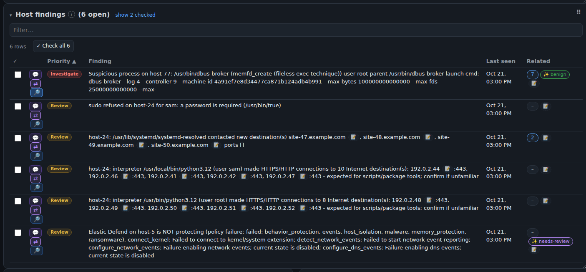
*Host findings on Posture: check box, 💬 Ask, ⇄ Compare, Related count and the ✨ verdict button on each row.*

---

## 4. Notifications and alerts

The 15-minute watcher raises an **urgent alert** for things such as:

- a device that has never been seen before;
- a high-severity IDS hit;
- a threat-intelligence match (a connection to or from a known-bad address);
- a new port open to the internet;
- DNS tunnelling;
- failed admin logins;
- a serious problem on a computer, such as an agent going offline or a suspicious process.

### Getting push notifications

1. Open **Alerts**.
2. Under **Notifications on this device**, tap **Enable** and allow notifications when the browser asks.
   - **iPhone and iPad:** first add the dashboard to the home screen (**Share → Add to Home Screen**), open netmon from that icon, then tap Enable.
3. Under **Which devices alert me**, choose **All devices** or pick only the devices you care about (for example your own laptop and phone), then **Save**.

Push is set up per browser or phone, so do it on each one you use. The device choice belongs to your account.

### Reading alerts

**Recent alerts** lists the last 30 days, newest first. Unread alerts are highlighted. **Mark all read** clears the counter. Each alert has a **Related** count that links to the network and endpoint events around it.

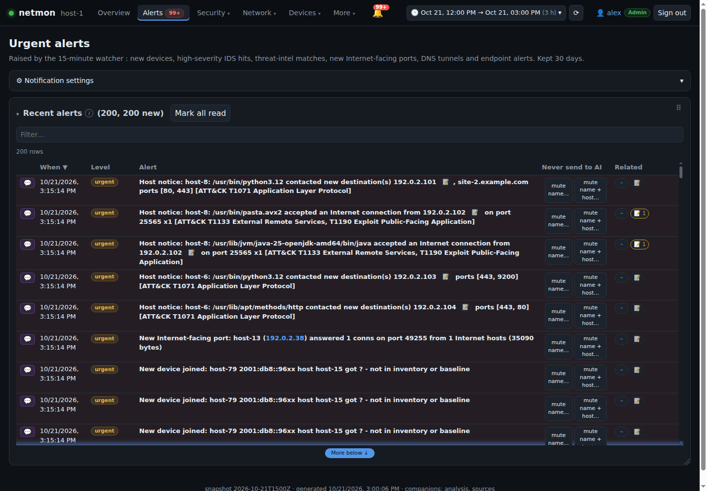

---

## 5. Working through findings

### Severity and priority

| Term | Where | Meaning |
|---|---|---|
| **Investigate / Review / Info** | Triage alarms, research notes | The AI's priority. *Investigate* means look at it now. *Review* means look when you can. *Info* means explained and benign. |
| **high / medium / low** | Baseline and host findings, IDS | How serious the rule considers it. |
| **malicious / suspicious / needs-review / benign / expected** | Research notes, comparisons | The AI's verdict after looking into it. |

### Checking things off

When you have looked at an alarm or finding and are satisfied, tick its check box.

- The item disappears from the list and is recorded under **More → Checked** with who checked it and when.
- **show N checked** in a box's title brings checked items back into view.
- **Unchecking** restores an item, either in its list or on the Checked page.
- **Carries over:** checking off is remembered across snapshots, so the same finding stays checked when it shows up again.

### Segmentation violations

The network is split into zones (for example main, IoT, servers, guest). `policy.json` says which zone may talk to which. A *segmentation violation* is a connection the policy doesn't allow.

- If the flow is expected (for example your laptop managing a server over SSH), click the green **Clear** box on **Posture → Segmentation violations**, or the Clear box on **Lateral movement**.
- **What clearing does:** the flow is hidden on Posture, the Fix list and Lateral movement; it stops counting toward host risk; and it is listed under **Cleared segmentation**.
- **To bring a flow back:** uncheck it in Cleared segmentation.
- For a permanent rule, ask the admin to add an `allow` entry to `policy.json`. The triage summary proposes such rules but never applies them itself.

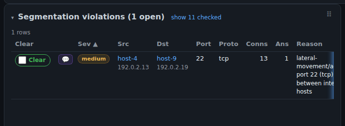

### Related events

Events that share a host, an IP address, a domain or an account, happen close together, or map to the same ATT&CK technique are proposed as *related* by a script. The correlation reviewer (an AI model) confirms or rejects each link. For each confirmed link it also lists the **correlated artifacts** (files, processes, users, IP addresses and DNS queries that tie the two events together), with a one-line relation and a decision: *benign*, *expected* or *suspicious*. Each artifact carries a flare showing which AI model wrote it. Click the Related count on an event to read them. Links confirmed before this feature get artifacts only when they are reviewed again.

The **Related** column shows how many links an event has. Click it to see them, each with the reason and the reviewer's verdict, then click any one to jump to it. Details: [CORRELATION.md](CORRELATION.md).

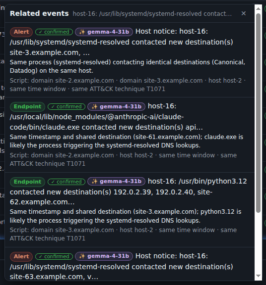
*The Related popup: each linked event with the reviewer's verdict, its reason and the script's evidence.*

### Research notes on events

On every research run the AI researches the important events, in batches of 8 (at most the *research batches* limit per run). The work list includes:

- every host finding;
- every Suricata severity 1 and 2 signature;
- every UniFi gateway event family;
- up to 40 other events.

An event with a note shows a **✨ verdict** button next to its Related count. Click it to read:

- the verdict and priority;
- a short summary;
- what was checked and found (hosts, ports and times);
- links to the sources the AI actually read.

Notes carry over to the same finding in later snapshots, and are refreshed when the evidence changes. *Written for an earlier run* means the numbers may have moved since. The **AI review** page shows how many events have notes.

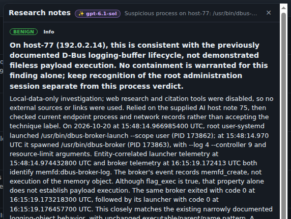

AI notes can be wrong. Treat them as a well-informed second opinion, and check the evidence before acting on anything important.

---

## 6. Page by page

### Overview

The one-page summary of the selected snapshot.

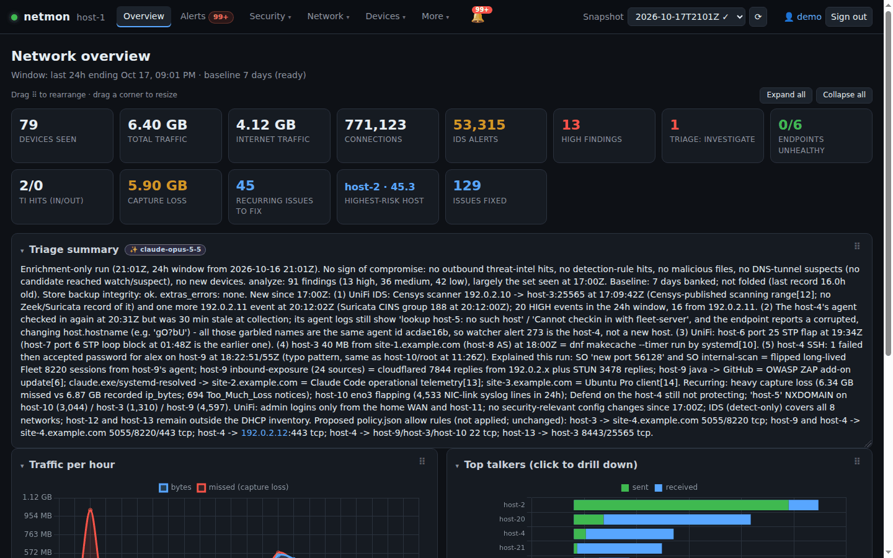

- **Tiles:** devices seen, traffic, IDS alerts, high findings, alarms the AI wants investigated, unhealthy endpoints, threat-intel hits, capture loss, recurring issues and the highest-risk host.
- **Triage summary and alarms:** the AI's short write-up of the window, and the alarms to look at.
- **Charts:** traffic per hour, top talkers, findings by severity and kind, devices by zone.
- **Health:** the endpoint fleet and the gateway's health.

### Alerts

Urgent watcher alerts and your notification settings (see [section 4](#4-notifications-and-alerts)).

### Security → Posture

The main working page.

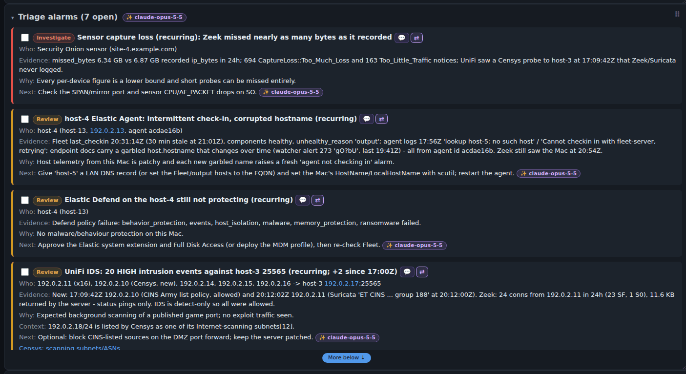
*Triage alarms: each one says who, what was seen, why it matters and what to do next, with 💬 and ⇄ buttons.*

| Box | What it is |
|---|---|
| Triage summary / Triage alarms | The AI's assessment of the window, with Investigate / Review / Info alarms. Each alarm says who, what was seen, why it matters, what to do next, and gives sources. |
| Research notes | Background research from the triage run, with numbered sources. |
| Baseline findings | Things a device did differently from its own normal: new ports or services, traffic spikes, new countries or ASNs, new DNS habits, new TLS fingerprints. Needs 3 days of history. |
| Cleared segmentation | Flows you marked as expected. |
| Host findings | Problems seen on the computers themselves: new accounts or groups, failed logins, sudo use, agent problems, Defend failures, system-log errors, new listening ports, unusual processes. |
| IDS signatures / alerts | Suricata detections in the window, grouped by rule. |
| Segmentation violations | Connections the zone policy doesn't allow, each with a **Clear** box. |
| Beacon candidates | Connections that repeat on a regular timer (possible malware check-ins; usually updates or telemetry). |
| Threat intel | Matches against threat-intelligence feeds (see Threat intel below). |
| DNS-tunnel scoring | Domains with many random-looking subdomains (possible data smuggling over DNS). | Each row has a check box (keyed by DNS name): check it off to hide it everywhere; "show N checked" or the Checked off page brings it back.
| Zeek notices / weird | Protocol oddities and notices from Zeek. |
| Files | Files transferred over the network and their reputation. |
| Software inventory from traffic | Software versions seen in network traffic. |
| Gateway security (UniFi) | IPS settings, security and gateway events (with Related links and research notes), admin sign-ins and configuration changes. |

### Security → Threat intel

Every DNS name, TLS server name, JA3 fingerprint and internet IP address in the window, checked against the threat feeds. The page also has an **Indicator lookup** box: paste an IP, domain or hash to check it against the loaded feeds.

### Security → ATT&CK

Everything in the snapshot mapped to MITRE ATT&CK techniques.

- **Observed:** behaviour that was actually seen.
- **Exposure only:** a weakness that would allow the technique.

Click a technique in the matrix to list the items behind it.

### Security → Risk

Hosts and vulnerabilities ranked by the risk they pose to the whole network. Host risk is how likely it is to be compromised (its exposure, weaknesses and threat activity) multiplied by how much damage that would do (its role and what it can reach). The **Scoring model** box explains every component. The full model (every weight, cap and threshold, with a worked example) is in [RISK_SCORING.md](RISK_SCORING.md).

### Security → Fix list

Misconfigurations and security suggestions from all snapshots, such as SSH password logins, legacy TLS, exposed admin ports or segmentation gaps.

- **Recurring:** an item becomes recurring once it shows up in 2 or more snapshots.
- **New / seen once:** an item seen only once stays here and moves up to Recurring if it comes back.
- **Fixed:** items that stopped appearing move here automatically.

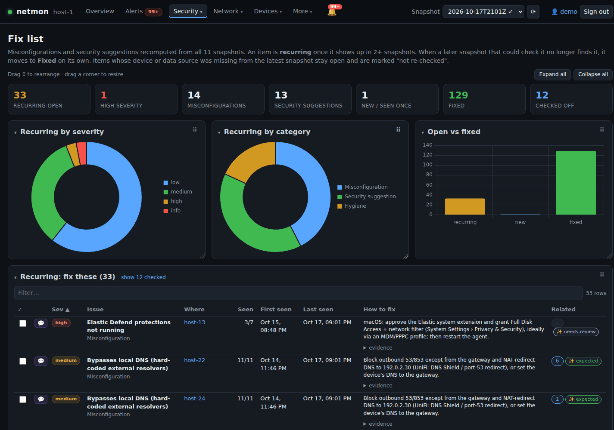

### Network → Network map

Every internal host in its zone behind the gateway. Click a host for details.

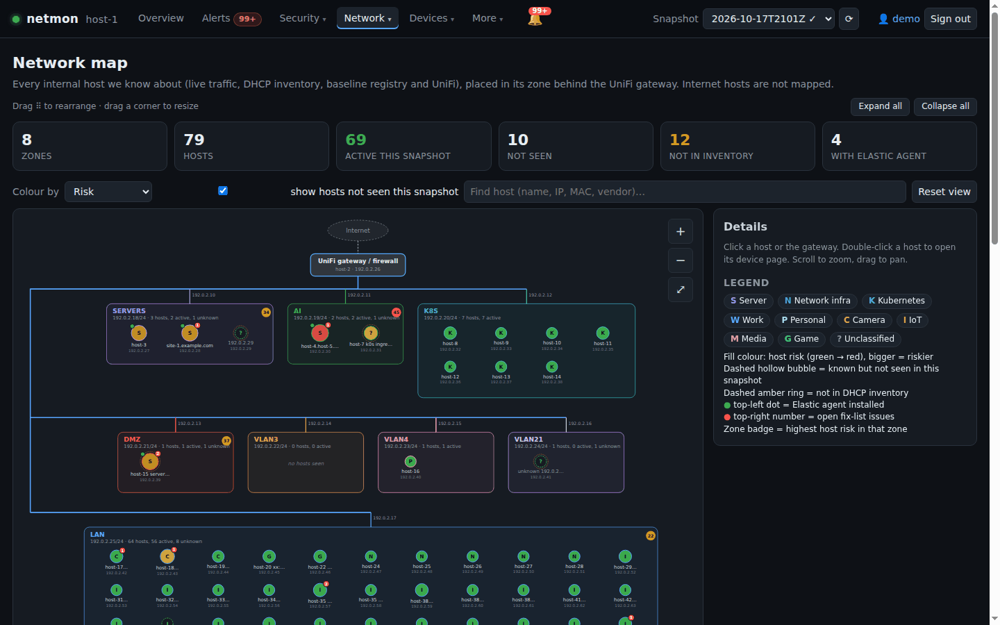

### Network → Lateral movement

Host-to-host connections inside the network, compared against the zone policy.

- **Admin access:** lists every admin session (SSH, RDP, PsExec/SMB, WMI, WinRM, VNC, Docker, Kubernetes, remote-support tools) with its successful and failed logins.
- **Failed logins** raise host risk and alert the watcher.

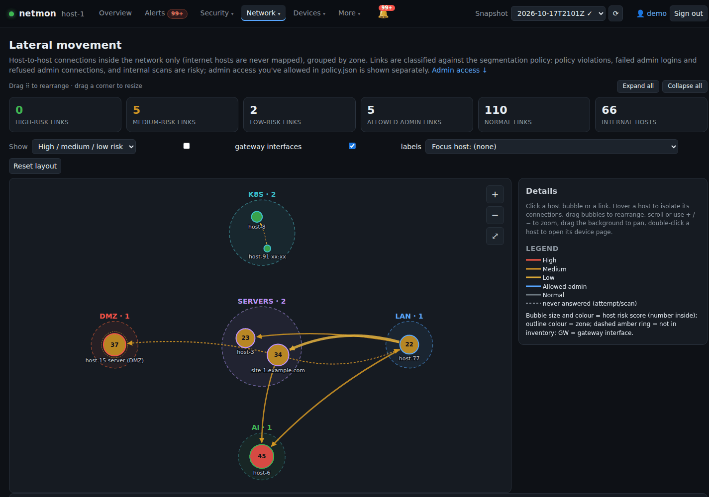


**Several time periods.** In the time picker at the top, press **+ Add period** under *Also include these periods* (up to 8 in total) and Apply. The graph, tables, charts and admin-session lists on this page then combine all periods: connection and login counts are added up and each link keeps its worst risk. A custom range, or any extra period, is queried straight from Security Onion's Elasticsearch (internal connections, admin logins, segmentation violations), so the page does not wait for the full range to be collected. Other pages show the main range only.

### Network → DNS & TLS

- **DNS:** queries and failures by device, top domains, query types, resolvers and TLDs.
- **TLS:** versions in use, certificates with problems, and client and server fingerprints (JA3, JA3S, JA4).
- **Devices using legacy TLS or bad certificates** are listed at the end.

### Network → Traffic map

- **Traffic:** top talkers, internet upload by device, traffic by country and ASN, protocols.
- **Zone-to-zone matrix:** hover a cell for the top ports.
- **UniFi firewall flows and blocks**, and trends across snapshots.

### Devices → Hosts

Every internal address with traffic in the selected time range, plus devices first seen in the range or not in the inventory. Click a host for its full page:

- **Identity and risk.**
- **Traffic:** by country, ASN, service and port, and its internal flows.
- **DNS and TLS habits.**
- **Detections:** IDS alerts, segmentation violations and beacons.
- **Files and software.**
- **Endpoint data:** shown if the device runs the Elastic Agent.

### Devices → Endpoints

Computers running the Elastic Agent: agent health, telemetry and auth/sudo/Defend counts. The open host-findings count links to the **Host findings** box on Posture. Click a host for its endpoint page:

- agent status and telemetry streams;
- findings, notable system-log entries and logins;
- network connections by process;
- what the host's baseline has learned.

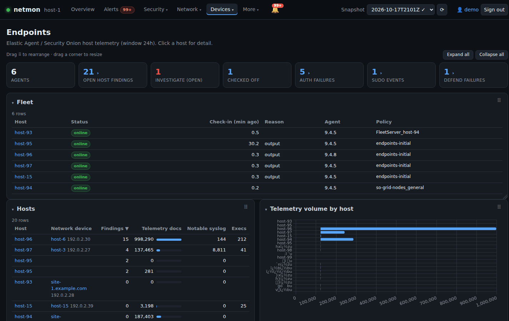

### More → Reports

The daily PDF reports (see [section 8](#8-reports)).

### More → Ask AI

The AI assistant (see [Ask AI](#ask-ai)).

### More → AI review

What the AI is doing and how well (see [AI review](#ai-review)).

### More → Checked

Everything checked off or cleared, with who did it and when. Uncheck to restore.

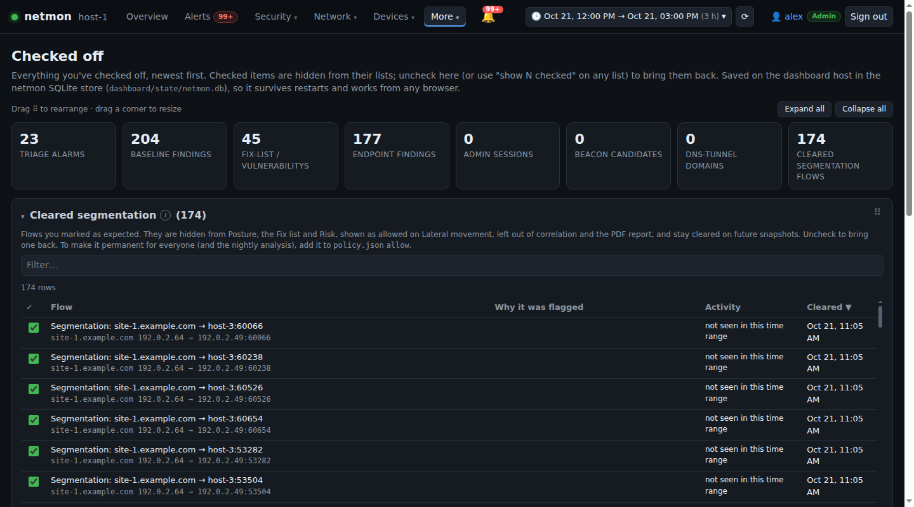

### More → Users

Accounts and their roles (see [section 10](#10-admin-tasks)). Network defenders see this page read-only; Users don't see it.

### More → Audit log

Admins only. A record of who did what in the dashboard and of every conversation between the dashboard and an AI model.

- **User actions**: sign-ins (failed ones too), sign-outs, page views, check-offs, notes, chat messages, AI verdicts, model comparisons, settings and user changes, report downloads and every refused request. Each entry has the user, role, time, source IP, browser and the result (HTTP status).
- **AI conversations**: Ask AI chats, the background correlation reviewer, model comparisons and the research job's input and results. Each entry has the instructions (system prompt), the exact prompt the dashboard sent, the model's answer, provider and model, tokens and time. Background jobs show as user `netmon (…)`.
- Passwords, keys and tokens are replaced by `[redacted]` before anything is stored.

Filter by type, time range (a quick range, or **From** / **To** dates and times), user, action, outcome or model, or search the text (this searches prompts and answers too). Click an entry to see all its details. Filters are kept in the address, so you can bookmark a view.

The entries are stored in Elasticsearch on Security Onion, in the index `logs-netmon` (also searchable in Kibana). The **Audit log storage** box shows whether the dashboard can write there. The dashboard needs its own API key with only `create_doc` and `read` on `logs-netmon`, so it can add and read entries but never change or delete them. If Elasticsearch is unreachable or no key is set yet, entries wait on the dashboard (`state/audit_spool.jsonl`, up to 50 MB) and are sent automatically later.

To create the key, in Kibana → Dev Tools:

```
POST /_security/api_key
{"name": "netmon-audit",
 "role_descriptors": {"netmon_audit": {"indices": [{"names": ["logs-netmon"], "privileges": ["create_doc", "read", "view_index_metadata"]}]}}}
```

Paste the `encoded` value into **Change the audit key or index**, press **Test**, then **Save**.

Full details (every recorded action, fields, Kibana queries, retention, troubleshooting): [AUDIT_LOG.md](AUDIT_LOG.md).

---

## 7. AI features

netmon uses two kinds of AI:

- **A cloud AI provider** of your choice (any OpenAI-compatible service or Anthropic, added by an admin on **AI review → AI providers**): the research job's triage, web research and news briefing, and the Ask AI chat.
- **A local model** (LM Studio, running on the monitoring computer): the correlation reviewer. It runs all the time and costs nothing per request. It can also be chosen for the research job or the chat.

Anything an AI wrote is labelled ✨ with the model name.

### Ask AI

A chat assistant that knows the netmon data. It can look up findings, devices, alerts, endpoint data, notes and reports, and search and read the web. It is **read-only**: it cannot change anything. It uses the chat model an admin chose on **AI review → Models**; until one is chosen, the chat is off.

- **Starting a chat:** open **More → Ask AI** and type a question. Earlier chats are listed on the left (☰ Chats on a phone).
- **From an item:** click **💬** on any alarm, finding, alert or event. Pick one of the suggested questions or type your own. The item's details are attached, and the answer opens as a new chat. *What the AI will be given* shows exactly what is sent.
- **Choosing the model (admins):** a **Model** menu in the chat header and in the 💬 dialog lets you pick *Default* (the chat model set on AI review > Models), any model of the providers added on AI review > AI providers, or any local LM Studio model. The choice applies to the next message, is the same in both places, and is remembered in your browser. Each answer's ✨ label shows which model actually answered.

Limits: 40 messages per person per hour, 4,000 characters per message. Answers can be wrong. Check important findings on the dashboard pages.

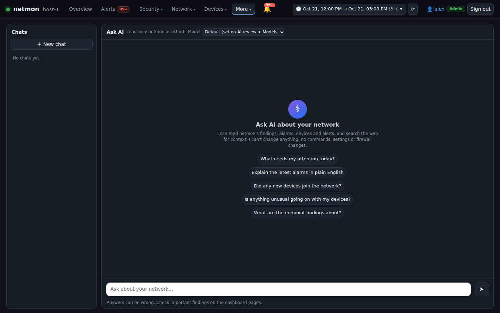

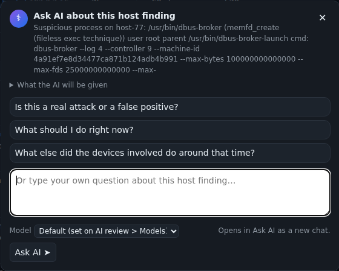
*The 💬 dialog: suggested questions, your own question, and the Model menu (admins).*

### Comparing models

The purple **⇄** button asks several models for their opinion on one item, side by side. Admins only.

**Where it appears:**

- triage alarms and research notes;
- baseline findings and host findings (on Posture, device pages and endpoint pages);
- event research notes (the ✨ popup);
- correlation decisions on the AI review page.

**How to use it:**

1. Click **⇄**.
2. Tick up to 4 models. The loaded local model is ticked by default.
3. Click **Run comparison**.

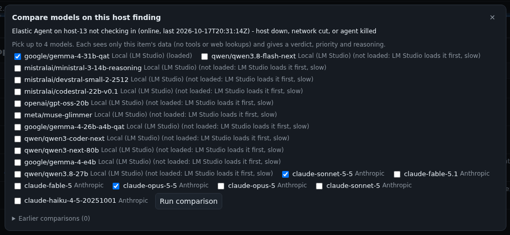

Each model answers with a verdict, a priority, a summary and its reasoning. The results also show the time taken and the tokens used. For items, the models see only the item's data and cannot look anything up. For correlation decisions, each model gets exactly the question the reviewer gets.

**"Use this"** stores one model's answer:

- for a correlation decision, as the decision;
- for an event research note, as the note, with the original research kept underneath.

**Earlier comparisons** lists every past comparison for that item.

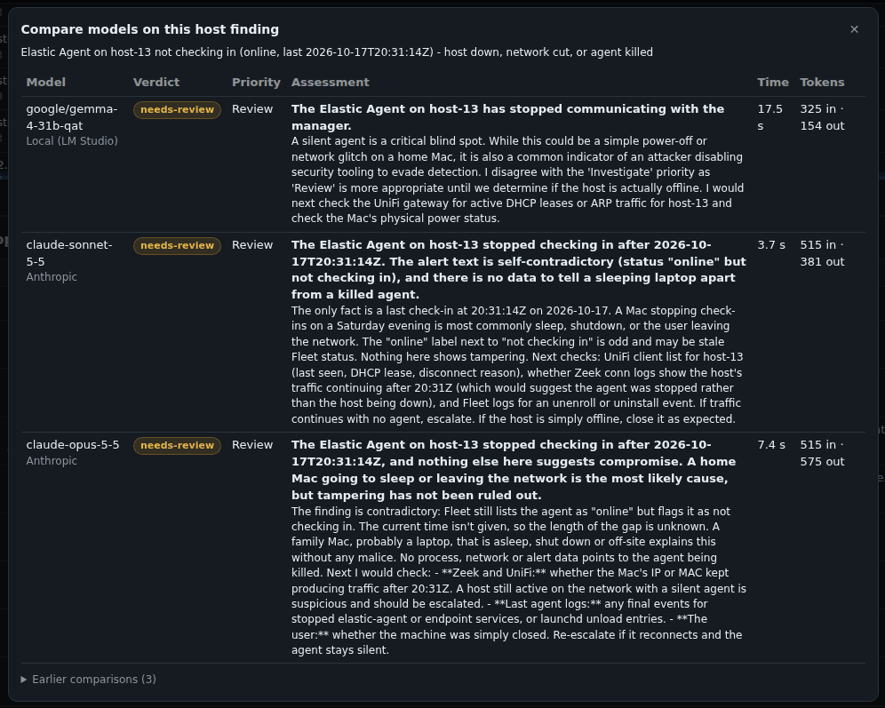
*Three models judging the same host finding: verdict, priority, assessment, time and tokens.*

### AI review

**More → AI review** shows the AI's work and lets admins configure it.

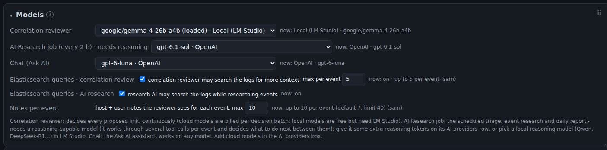

| Box | What it shows |
|---|---|
| **Models** | The model for the **correlation reviewer**, the **research job** and the **chat (Ask AI)**: a local LM Studio model or any model of the providers in **AI providers**. The research job and the chat are off until a model is chosen. Admins change them here (see the cost notes below). Picking a different **research job** model (before pressing Save) adds a dashed "Cost with <model>" line to the **Time and tokens per research run** chart and a line under its title with the estimated cost per run and per month: the recorded runs' tokens re-priced at that model's price as entered on its provider (a rough guide, since another model would use a different number of tokens). |
| **AI providers** (admins) | The AI services netmon calls, each with its own API key. **Add provider** asks for a name, the type (**OpenAI / OpenAI-compatible** covers OpenAI and services with the same API such as OpenRouter, Groq, Mistral, Together, DeepSeek, Gemini's OpenAI endpoint or a self-hosted vLLM; **Anthropic** takes an Anthropic API key), an optional base URL (empty = the official API; plain `http://` only for LAN or loopback addresses), the key, and the models to offer, one per line (**Fetch from provider** lists the models the key can use). After a model id you can add its prices in $ per million tokens, `model input output [cached-input]`; they drive the cost estimates and the $ limits. **Calls per hour** caps each provider's single calls (the reviewer and comparisons stop with an error when it is reached), and **Extra reasoning tokens** gives models that think before answering room to do so. **Test** checks the key by listing models (no tokens used). Keys are stored on the dashboard's state volume (file mode 600), only the last 4 characters are ever shown, they are removed from error messages, and an edit that changes the type or base URL needs the key again, so a saved key is never sent to a new host. A provider in use by the reviewer, the research job or the chat can't be deleted. Its models appear in every model menu and Compare dialog. |
| **Events to research** (admins) | One menu per category: host findings, Suricata severity 1-2, gateway events, threat-intel hits, urgent alarms, and all other events by severity (high, medium, low, info). **research** sends the event to the model (a repeat that already has a note is only rewritten if the new run contradicts it). **review** has the reviewer model compare the event with earlier research (its own note, notes of correlated events, notes on events with a similar name). If it is the same activity, the earlier note is copied to the event with a line saying it was copied and from where; otherwise (different, unsure, or nothing earlier) the event is sent to research in that run. **skip** ignores it. **test** queues the event and tags it *testing* in the lists, but never sends it: use it to see what a setting would send before it does (all filters, clears and Never-send rules still apply). The same **test** option exists for each event-type pair under Review limits. **New deployments start with every category and pair on test**, so nothing is sent until an admin switches categories to research or review; deployments that already had settings keep what they had. The **Awaiting research** number at the top counts events the next run would send; a grey **+N testing** badge counts the ones held in test mode, and the lists tag them *testing* (also in the 📝 popover). |
| **Review limits** (admins and network defenders) | Limits what is sent to the correlation reviewer and the research job, with no model call for what is held back. **Max links per event** (0-200, 0 = no cap) keeps the best-scoring links per event. **Event types** has a review/skip/test menu per type pair (e.g. alert-vuln) with its link count; click or hover the **i** next to a type for what it is. Segmentation (`seg`, cross-zone traffic) is its own type and its own research category. **Events with the most links** has **exclude** (that event) and **exclude similar** (same kind of event; ports and alert numbers ignored). **Never send** rules stop a class of events by **name** (part of the event text, or a pattern with `*` `?`), by **host** (an IP or text in the event), by **ID** (the event id or a pattern such as `iss|seg|*`), or by a combination (all filled fields must match, so host + ID is a host/ID pair), for the research job, the reviewer or both. These are the exceptions: admins and network defenders add and remove them, every change is logged with the user, and links that already have a verdict are kept. **Reviews / min** and **Awaiting review** at the top show the reviewer's speed and queue. |
| **Clearing queues** (admins) | **Clear research queue** and **Clear review queue** under the top numbers empty what is waiting, after a warning you must confirm. Cleared research events are not researched even if they recur under the same ID; cleared links are marked "not related" without asking the model. Existing notes and verdicts are kept. **Awaiting research** (admins) and **Awaiting review** (admins and defenders) open a list of what is waiting when clicked. |
| **Send to research** (everyone who sees the event) | Open the 📝 next to any event: below the notes, **🔬 Send to research** researches the event **right away** if the AI has not researched it yet, without waiting for the schedule or the queue. The host starts a one-event research run (about 1-3 minutes, roughly $0.10 with a cloud model) and the note appears when it finishes. Until then the popover shows "Research started"; if another one-event run is going, or the host can't be reached, the request waits in the queue for the next scheduled run. It ignores category modes, queue clears and Never-send rules. Users can do this only for their own devices' events; it is logged with the user's name and counts toward the daily $ cap. At most 200 requests wait at once. |
| **Cleared events** | When an event is checked off (it moves to **More → Checked**), netmon remembers its name and IPs. Events with the same name and the same IPs are no longer sent to the research job or the correlation reviewer, even after the cleared one leaves the snapshot. The memory is permanent: unchecking an event on the Checked page does not lift it. An admin can reset it by deleting the `cleared_sigs` setting. |
| **Research job limits** (admins) | Caps for the research job: **$ per run** (default 5), **$ per day** (UTC, default 20), **tokens per run** (input + output, works without prices) and **research batches** per run (8 events each, default 10). A run stops when it passes a cap, and no new run starts once the day's cap is reached. 0 = no limit. The $ caps need prices on the model's provider. The reviewer, comparisons and Ask AI have their own limits (calls per hour, chat limits). |
| **Research lookback window** | Admins set how many hours of logs (1-24, default 24) each research run collects and reviews. A window a little longer than the run interval (the box suggests interval + 1 h) cuts the cost of each run without leaving gaps; a window shorter than the interval leaves hours unreviewed, and the box warns about it. The daily 05:00 UTC PDF run always covers 24 h, and only full-day snapshots go into the device baseline. Between PDF runs the newest snapshot on the dashboard covers only the window, and a short run can open a Fix-list item but never mark one fixed. |
| **AI triage & enrichment** | Whether a research run is going on now, the schedule and next run, **Run now** and **Pause** buttons (admins), recent runs and how long they took, each enrichment pass (events researched, links reviewed), how many events have notes, and the latest run's summary. The token chart is in its own box below it. |
| **Time and tokens per research run** | Run time plus the tokens of each research run, split into new input, cache writes and output. Cache re-reads (the conversation re-sent on every API call; ~95% of the raw input count but billed at ~10% of the input price) are hidden by default; click their legend entry to show them. The header and tooltip give an estimated cost from the prices entered on the provider. |
| **Reviewer** | The correlation reviewer's model, its queue and its throughput. |
| **Verdicts per hour / All verdicts** | How many links were confirmed or rejected. |
| **Decisions** | Every link decision with its reason and model. You can override it (✓ confirm, ✗ reject), ask for a new review (↻), or **⇄ compare** models on it. Manual decisions always win and are never overwritten. |

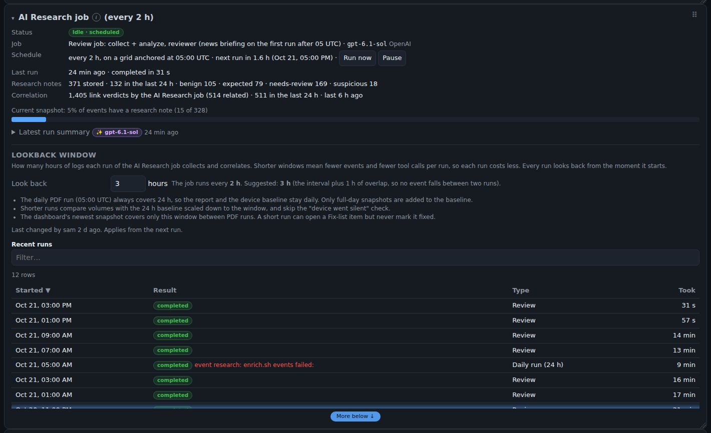

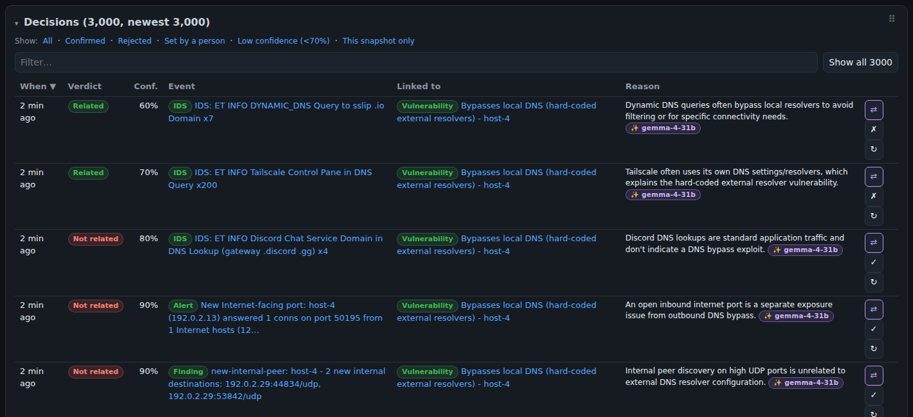

### Things to know about model choices

- **Cloud models** are faster and better at research, but cost money per request:
  - **Research job:** a run uses several million tokens, and shorter intervals mean more runs. The **Research job limits** box caps it.
  - **Correlation reviewer:** if it uses a cloud model, it decides every new link around the clock.
  - **Cap:** each provider's **calls per hour** (default 120) applies to comparisons and the reviewer.
- **Local models** are free, but slower and weaker at research and tool use. A model that isn't loaded in LM Studio has to load first, which takes time and may unload the model the reviewer is using.

---

## 8. Reports

- **When:** one PDF a day, made by the 05:00 UTC run (1 AM Eastern in summer, midnight in winter).
- **Turning it off:** admins can clear **AI review → Research job limits → PDF report**. The 05:00 UTC run then still covers 24 h, triages and writes the briefing, but makes no PDF; existing reports stay on the Reports page.
- **What it covers:** the last 24 hours. It contains:
  - the triage summary and alarms, with sources;
  - IDS signal versus known noise;
  - findings per device;
  - threat intel and UniFi;
  - ATT&CK mapping;
  - risk;
  - a short news briefing (security, cycling, local news).
- **Where:** **More → Reports**. **Download** saves the PDF; **Open** views it in the browser. The report for the selected snapshot is highlighted.
- **Notification:** when a new report is ready, a notification appears in the dashboard.

The other runs of the day update the dashboard but don't make a PDF.

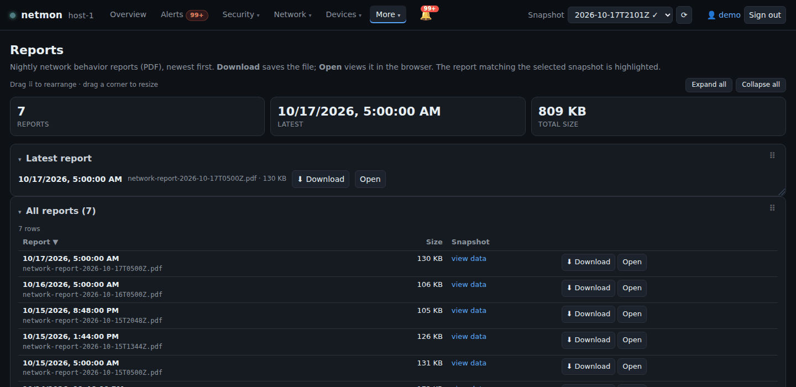

---

## 9. Phones and tablets

- **Install it:** add the dashboard to your home screen for an app-like experience and push notifications (required on iPhone and iPad).
- **Menu:** the ☰ button opens the menu. Your name and **Sign out** are at the bottom of it.
- **Lists instead of wide tables:** tables that would need sideways scrolling become a list of cards. Each card shows:
  - its badges and buttons on the first line;
  - the title in bold;
  - one *Label: value* line per column.

  A **Sort:** menu replaces the column headers.
- **Boxes:** they can be collapsed, rearranged and resized (height only) just like on a computer.

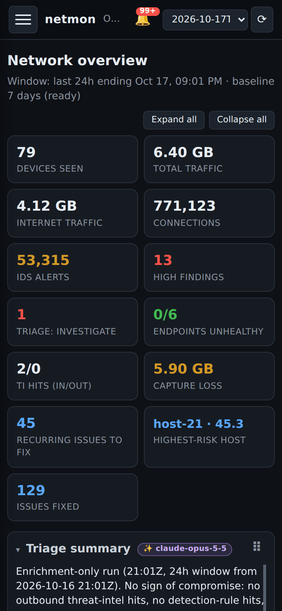 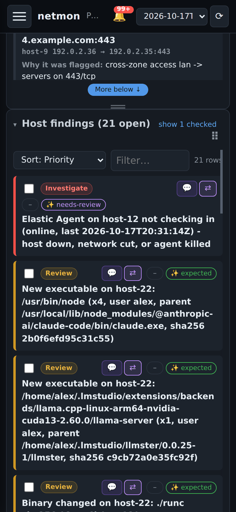
*On a phone, wide tables become lists of cards.*

---

## 10. Admin tasks

Every account has a role (full table in [ACCESS_CONTROL.md](ACCESS_CONTROL.md)):

- **Admin:** everything. Only admins can manage users, roles and device assignments, change integrations and Security Triage settings, change the correlation and research models, run model comparisons and use "Use this", manage AI providers and research-job limits, and choose the model per message in Ask AI.
- **Network defender:** sees every page, can check things off, write notes, confirm or reject AI links and use Ask AI (the configured chat model), but can't change settings. Configuration and Users are read-only.
- **User:** sees only the alerts and security events of the devices assigned to them (**My devices** and **Alerts**), and gets push notifications only for those.

**More → Users** (admins) lets you:

- **Add user:** pick a username, a role (default User) and a password that meets the rules shown.
- **Role:** change someone's role from the drop-down; it takes effect immediately. You can't demote yourself, and the last admin can't be demoted or deleted.
- **Assign…:** for a User, the devices they may see (a User with no devices sees nothing). For admins and defenders, the devices that alert them.
- **Change a password:** set a new one for a user. That user's other sessions are signed out.
- **Delete a user.**
- **Locked out?:** explains how to unlock an account after too many failed sign-ins.

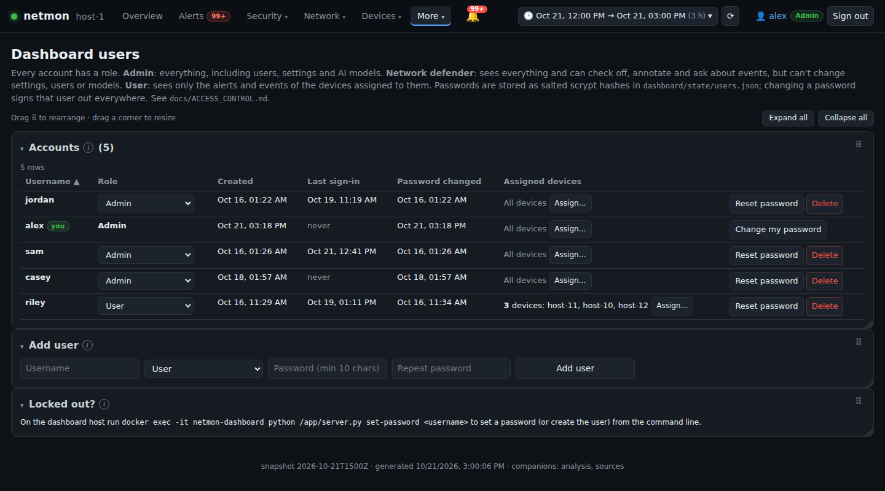

Installation, adding admins and other configuration are in [SETUP.md](SETUP.md).

---

## 11. FAQ and troubleshooting

**The page looks old after an update.**
Reload once (⟳ in the header, or the browser's reload). On a phone, close the app and open it again.

**I don't get push notifications.**
- **Is push on?** Check that Alerts → Notifications on this device says *on*.
- **Are notifications allowed?** Check the browser's site settings.
- **Is the device selected?** Check that the device is included under *Which devices alert me*.
- **iPhone/iPad:** notifications only work from the home-screen app.

**A finding keeps coming back after I checked it off.**
Checking off is tied to the finding's wording. If the finding's details change (for example a different port), it counts as a new finding. For segmentation flows, use **Clear**; it follows the device even if its IP address changes.

**There are no baseline findings, or the Overview says the baseline is not ready.**
Baselines need 3 days of history before deviation rules switch on. Until then the Overview subtitle says the baseline is "warming up"; it shows how many days are banked.

**The research note says "written for an earlier run".**
The note was written for the same finding in an earlier snapshot, so the numbers in it may be out of date. It is refreshed when the evidence changes enough.

**Ask AI says it is unavailable or not configured.**
No chat model is chosen yet, or the AI provider didn't answer. Try again in a minute. If it keeps failing, tell the admin (AI review → AI providers → **Test**).

**AI review shows "Last run failed".**
The latest research run failed. The error is shown in the box. The next scheduled run usually recovers; otherwise tell the admin.

**Why did a model comparison show an error for one model?**
That model didn't return a usable answer, or wasn't reachable (for example LM Studio was loading it). The other models' answers are still valid.

---

## 12. Glossary

| Term | Meaning |
|---|---|
| **Snapshot** | One collection run covering the previous 24 hours. A new one is made on every research run. |
| **Baseline** | What is normal for each device, learned from about one snapshot a day over the last 30 days. |
| **Triage** | The AI's review of a snapshot: a summary plus Investigate / Review / Info alarms. |
| **Finding** | Something a rule flagged: a *baseline* finding (network behaviour) or a *host* finding (on the computer itself). |
| **IDS / Suricata** | Intrusion detection: rules that match known attack or suspicious traffic patterns. Severity 1 is highest. |
| **Zeek** | Network sensor that logs every connection, DNS query, TLS handshake and file. |
| **Elastic Agent / Defend / osquery** | Software on each computer that reports processes, logins, files and settings (Defend is the anti-malware part). |
| **UniFi gateway** | The home router/firewall; its IPS blocks and logs attacks. |
| **Threat intel (TI)** | Public lists of known-bad IP addresses, domains and fingerprints. |
| **Beacon** | Traffic repeating on a regular timer. Malware does this, but so do updates and telemetry. |
| **Segmentation / zone** | Splitting the network into groups (main, IoT, servers, guest) with rules for which may talk to which. |
| **Lateral movement** | Moving from one computer to another inside the network, for example over SSH or RDP. |
| **JA3 / JA4** | Fingerprints of the software that opened a TLS (HTTPS) connection. |
| **ATT&CK** | MITRE's catalogue of attacker techniques. |
| **Correlation** | Linking events that are about the same activity. |
| **Research note** | The AI's per-event research: verdict, summary, evidence and sources. |
| **Capture loss** | Traffic the sensor couldn't record. High loss means parts of the network are invisible. |
