# netmon user guide

This guide covers everyday use of the netmon dashboard: what each page shows, how to work through alarms and findings, how notifications work, and how to use the AI features. For installation see [SETUP.md](SETUP.md). For how events are linked to each other, see [CORRELATION.md](CORRELATION.md). For who can see and change what, see [ACCESS_CONTROL.md](ACCESS_CONTROL.md). For the record of user actions and AI conversations, see [AUDIT_LOG.md](AUDIT_LOG.md). For step-by-step investigation workflows (troubleshooting, DNS tunnelling, lateral movement, insider threat and more), see [PLAYBOOKS.md](PLAYBOOKS.md).

> Screenshots in this guide come from a real dashboard with every IP address, MAC address, host name and account name replaced by placeholders (`192.0.2.x`, `host-N`, `site-N.example.com`, `alex`). Your dashboard shows your real names.

## Contents

1. [What netmon does](#1-what-netmon-does)
2. [Signing in and your account](#2-signing-in-and-your-account)
3. [Finding your way around](#3-finding-your-way-around)
4. [Notifications and alerts](#4-notifications-and-alerts)
5. [Working through findings](#5-working-through-findings)
6. [Page by page](#6-page-by-page)
7. [AI features](#7-ai-features)
8. [Phones and tablets](#8-phones-and-tablets)
9. [Admin tasks](#9-admin-tasks)
10. [FAQ and troubleshooting](#10-faq-and-troubleshooting)
11. [Glossary](#11-glossary)

---

## 1. What netmon does

netmon watches the home network and the computers on it and tells you what changed, what looks risky and what to fix.

| When | What runs | What you get |
|---|---|---|
| Every 15 minutes | **Urgent watcher.** Fixed rules, no AI. | Alerts on the Alerts page and push notifications for serious, new events. |
| Every few hours (the **review job**; interval set on the Configuration page, 30 min to 24 h, default every 4 h on a grid starting at 05:00 UTC) | **Collection, analysis and the event reviewer.** | A new *snapshot* (the lookback window, 24 hours by default), earlier research notes reused for repeat events, and correlation reviews. Events are researched only when you click **Send to research**. |
| First run at or after 05:00 UTC (1 AM Eastern in summer) | The same run, always over 24 hours. | A full-day snapshot, the only kind that goes into the device baseline. |
| All the time | The **decision model** and the **event reviewer**, local AI models. | The decision model decides which events are really related; the event reviewer labels each event suspicious, benign or expected and explains why (see [AI pipeline](#ai-pipeline)). |

The data comes from:

- **Security Onion:** Zeek connection logs, Suricata IDS alerts, DNS and TLS.
- **Elastic Agent** on each computer: Elastic Defend, osquery, logins and system logs.
- **The UniFi gateway:** IPS events, firewall flows, admin sign-ins and configuration changes.

netmon only reads data. It never changes the network, the gateway or Security Onion.

---

## 2. Signing in and your account

- Open the dashboard at the address you were given (HTTPS). Your browser may warn about the certificate the first time, because it is a private certificate for the home network.
- **More → My account** shows who you are signed in as and lets you change your password. Changing it signs out your other browsers and phones; the one you are using stays signed in.
- If you are locked out after too many wrong passwords, wait for the lockout to expire or ask an admin (see [Users](#9-admin-tasks)).
- The badge next to your name shows your role: **Admin** (everything), **Network defender** (sees everything, can't change settings) or **User** (only the alerts and events of the devices assigned to you; you get a **My devices** page and **Alerts**). Details: [ACCESS_CONTROL.md](ACCESS_CONTROL.md).

---

## 3. Finding your way around

### Header

| Item | What it does |
|---|---|
| **Overview** | The summary page. |
| **Alerts** | Urgent alerts from the 15-minute watcher. The number is your unread count. |
| **Open events** | Your to-do list: every event nobody has accepted (checked off) yet, of any age. Not time based; repeats of one condition are one row. The number is how many are open; the page lists at most 5000 rows (most severe and newest first). See [Open events vs Posture](#open-events-vs-posture). |
| **Security ▾** | Posture, Threat intel, ATT&CK, Risk, Fix list. |
| **Network ▾** | Network map, Lateral movement, DNS & TLS, Traffic map, **Users** (accounts seen in the logs and their usual patterns; the dashboard's own logins are under More → Dashboard users). |
| **Devices ▾** | Hosts (everything on the network), Endpoints (computers running the Elastic Agent) and Notes (what the AI and people have written about devices and events). |
| **More ▾** | Ask AI, AI pipeline monitoring, AI pipeline configuration, Checked, Dashboard users, Configuration, Settings (policy and site values, as tables) and Audit log (admins). |
| 🔔 | Unread urgent alerts. Click to open Alerts. |
| **🕒 Time range** | The start and end of the time you are looking at (your local time). The newest nightly report's 24 hours are shown by default. Click it to set a **Start** and **End** date and time, use a quick button (**Last 1h / 6h / 24h / 3d / 7d / 30d**), or pick a **Nightly report window**. See [Choosing a time range](#choosing-a-time-range). ⟳ reloads the data (and moves to a newer report if you were on the newest). |

### Choosing a time range

Every page except Alerts shows the selected time range: Overview, Posture's findings, Threat intel, ATT&CK, Risk,
Network map, **Lateral movement**, DNS & TLS, Traffic map, Users, **Devices (including New devices)** and Endpoints.

- **A nightly report window** (or a start/end within 10 minutes of one) loads instantly.
- **Any other range** is collected for exactly that time from Security Onion and UniFi. It takes about 20 seconds to a
  couple of minutes, depending on the length; the page shows the progress. Ranges are kept on the dashboard, so opening
  the same range again is instant (the last 30 are kept).
- **Limits:** at least 15 minutes, at most 31 days, starting at most 120 days ago, and the end can't be in the future.
  Security Onion only keeps network logs for a limited time; older ranges come back mostly empty.
- **New devices** in a range are devices whose *first ever* sighting falls inside it.
- **Baseline comparisons** (traffic spikes, NXDOMAIN spikes, …): a range's volumes are scaled to 24 hours before they
  are compared with the device's normal day, so a 3-day range isn't flagged just for being longer. "Went silent" is only
  checked for ranges of 24 hours or more.
- **Trend charts** show the daily baseline records inside the range (or all of them when fewer than two fall inside).
- **Some things stay per report.** The Alerts page, research notes, correlation, AI verdicts come
  from the latest nightly report that ended by the end of the range, or the oldest report if none had (named in the footer). They are written by the review job, not
  recomputed for arbitrary ranges.
- A range never changes the baseline or the device registry.
- The range stays selected while you move between pages and when you reload the browser tab.

The **Audit log** has its own From / To fields (see [More → Audit log](#more--audit-log)).

### Boxes

Every page is made of boxes (cards).

- **ⓘ About this box:** the small *i* next to each box title explains what the box shows, where its data comes from and how to use it. Click it again, press Esc or click elsewhere to close it.
- **Collapse or expand:** click a box's title. The first three boxes on a page start open.
- **Rearrange:** drag a box by its ⠿ grip.
- **Resize:** drag a box's bottom-right corner (on phones, height only).
- **Remembered:** your layout is saved per page in this browser. **Original order and sizes** at the bottom of a page puts it back.

### Tables

- Click a column header to sort, and use the filter box to search.
- Many rows are clickable and open the device, host or detail behind them.
- **Charts drill down:** click a bar, slice or line to open the filtered list behind it. A chip at the top shows the active filter; click ✕ on the chip to clear it.

### Buttons you will see on rows

| Button | Meaning |
|---|---|
| ☐ (check box) | **Check off**, meaning "I've looked at this". The item is hidden from its list. See [Checking things off](#checking-things-off). |
| ☐ **Clear** (green) | On segmentation violations: "this flow is expected". See [Segmentation](#segmentation-violations). |
| 💬 | **Ask AI** about this item. See [Ask AI](#ask-ai). |
| 🔎 (blue) | **Open in Kibana**: a list of links to the raw events behind this item in Kibana Discover (IDS alerts, Zeek connections/DNS/TLS, endpoint and syslog events), already filtered to the IPs, host, signature or process involved and to the item's time range (or the snapshot window). On gateway events it also links to the UniFi web app (Security detections, Flows; search for the source IP there). Shown on baseline findings, IDS signatures, host findings, beacon candidates and gateway events, and on every row of **Open events**. Searches the AI ran in Elasticsearch show up as clickable Kibana links too (see [Related events](#related-events)). |
| **Related** (number) | Other events linked to this one. Click it for the list. See [Related events](#related-events). |
| ✨ *verdict* | The AI's research note on this event. Click it to read it. See [Research notes](#research-notes-on-events). |
| ✨ *model name* | Marks text written by an AI and which model wrote it. |

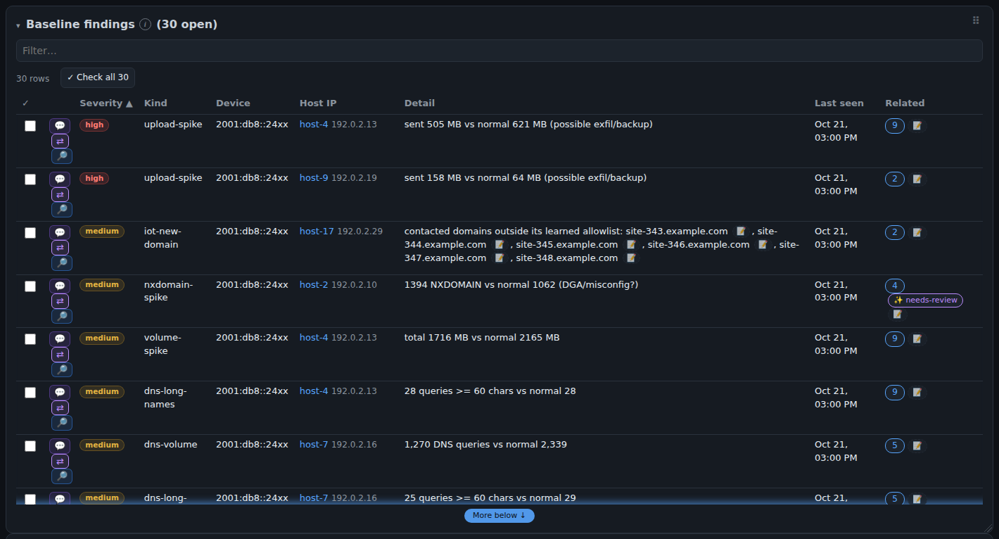

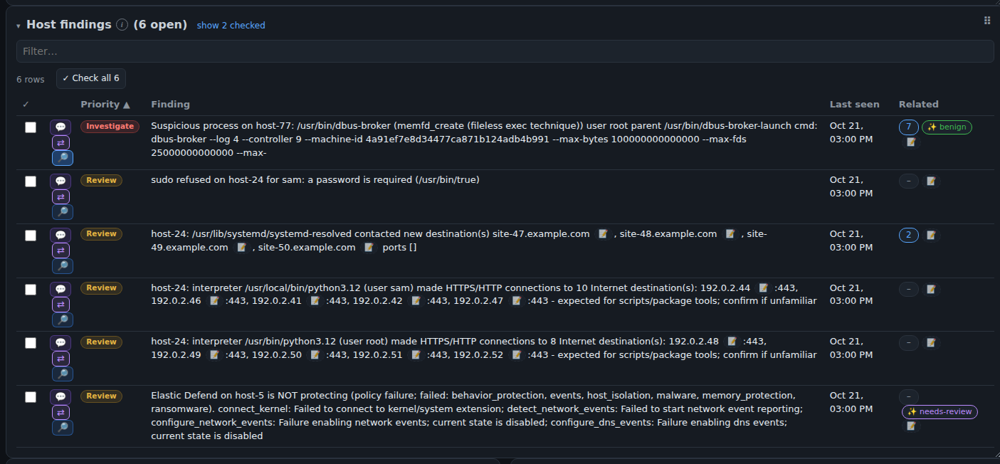
*Host findings on Posture: check box, 💬 Ask, Related count and the ✨ verdict button on each row.*

Tables with many rows (baseline findings, host findings, IDS signatures, Zeek weird) have a filter box above them. Findings tables show a **Last seen** column, and baseline findings also show the **Host IP** of the device they are about.

---

## 4. Notifications and alerts

The 15-minute watcher records a **detection** for things such as:

- a device that has never been seen before;
- a severity-1 IDS hit, or an IDS hit in a malware, command-and-control, exploit, privilege-gain or coin-mining category at any severity (signatures on the known-benign list are skipped);
- a threat-intelligence match (a connection to or from a known-bad address);
- a new port open to the internet;
- DNS tunnelling;
- failed admin logins;
- a serious problem on a computer, such as an agent going offline or a suspicious process.

Detections are not pushed on their own: they appear under **Detections by verdict**, and only those the review finds suspicious at medium or high severity are promoted to **Recent alerts** (bell, push). The watcher mutes a repeat of the same detection for 12 hours.

### Getting push notifications

1. Open **Alerts**.
2. Under **Notifications on this device**, tap **Enable** and allow notifications when the browser asks.
   - **iPhone and iPad:** first add the dashboard to the home screen (**Share → Add to Home Screen**), open netmon from that icon, then tap Enable.
3. Under **Which devices alert me**, choose **All devices** or pick only the devices you care about (for example your own laptop and phone), then **Save**. Users see **Your devices** instead: a read-only list an admin assigns on the Users page.

Push is set up per browser or phone, so do it on each one you use. The device choice belongs to your account.

### Reading alerts

**Recent alerts** lists the last 30 days, newest first. Unread alerts are highlighted. **Mark all read** clears the counter: for admins and network defenders it marks every alert read for everyone, for a User only for themselves. Admins and defenders also see **Verdict**, **Research**, **Notes** and **Artifact notes** columns; click a row to open the event with its related events. Users see When, Level and Alert.

**Noisy alerts (admins and network defenders).** Use 🚫 **suppress** on an alert (the same dialog as for findings): alerts like it are hidden from the feed and stop appearing, but still go through correlation, research and review. Suppress rules are listed and removed under Settings → Configuration → Suppress rules. Alert *mute* rules from earlier versions are still applied (a matching alert is stored already **cleared**: no push or chat message, not unread, not sent to the AI) and are listed in the **Alert mute rules** card on the Alerts page; **show cleared (N)** lists what they cleared and **Remove rule** deletes a rule and brings its alerts back. New mute rules can no longer be created.

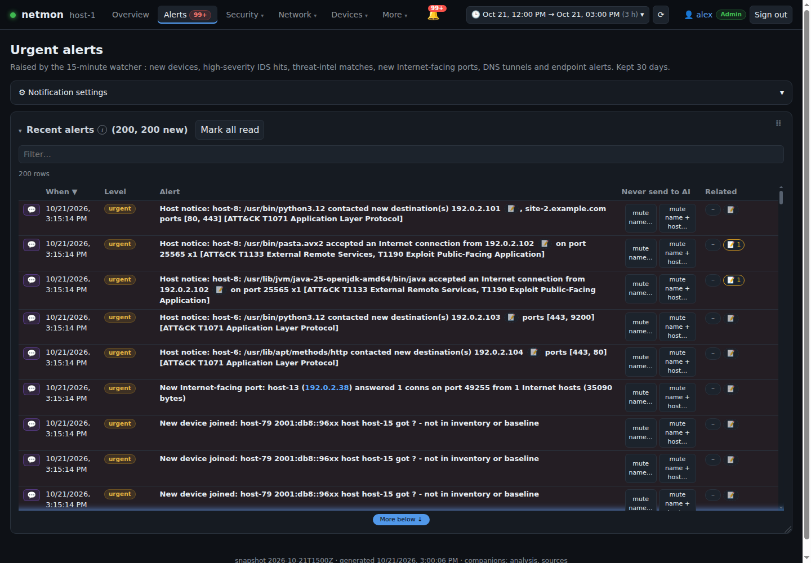

---

## 5. Working through findings

### Severity and priority

| Term | Where | Meaning |
|---|---|---|
| **Investigate / Review / Info** | Research notes | The AI's priority. *Investigate* means look at it now. *Review* means look when you can. *Info* means explained and benign. |
| **high / medium / low** | Baseline and host findings, IDS | How serious the rule considers it. |
| **malicious / suspicious / needs-review / benign / expected** | Research notes | The AI's verdict after looking into it. |

### Checking things off

When you have looked at an alarm or finding and are satisfied, tick its check box.

- The item disappears from the open list (Posture still shows it, greyed, with who checked it off).
- **show N checked** in a box's title brings checked items back into view.
- **Unchecking** restores an item in its list.
- **Carries over:** checking off is remembered across snapshots, so the same finding stays checked when it shows up again.
- **Nothing ages out.** Accepting (checking off) is the only way an event leaves the **Open events** page; the time range you picked does not hide an unchecked event, however old it is. Posture, by contrast, only shows the selected time range (see [Open events vs Posture](#open-events-vs-posture)).
- **Gateway events** (Posture → Gateway security) can be checked off and suppressed like findings. The 30-day threat rows at the bottom of that card can be checked off, but have no correlation event, so the suppress dialog offers only the name, not artifacts.

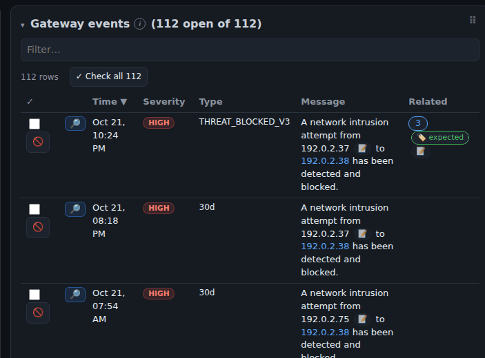

### Segmentation violations

The network is split into zones (for example main, IoT, servers, guest). The **network policy** (More → Settings) says which zone may talk to which. A *segmentation violation* is a connection the policy doesn't allow.

- **Severity is by port:** *high* = admin/remote-control ports (SSH, RDP, SMB, WinRM, databases, Docker/Kubernetes APIs... the same set as Lateral movement); *medium* = odd ports that are neither admin nor standard; *low* = standard ports (HTTP, HTTPS, DNS, mail, etc.). Lists come from the network policy on More → Settings (`sensitive_ports`, optional `standard_ports`). On **AI pipeline configuration** the three levels are separate categories (Segmentation: high / medium / low), each switched between *review* and *skip* in the event-type matrix of AI pipeline configuration → Review limits.
- If the flow is expected (for example your laptop managing a server over SSH), click the green **Clear** box on **Posture → Segmentation violations**, or the Clear box on **Lateral movement**.
- **What clearing does:** the flow is hidden on Posture and shown as allowed on Lateral movement; it stops counting toward host risk and is left out of correlation; and it folds into **show N checked** under Segmentation violations on Posture (the **Cleared segmentation** list is on Lateral movement). (Segmentation violations are not part of the Fix list.)
- **To bring a flow back:** uncheck it under **show N checked** in Segmentation violations, or in Cleared segmentation on Lateral movement.
- For a permanent rule, ask the admin to add an `allow` entry to the network policy on **More → Settings**.

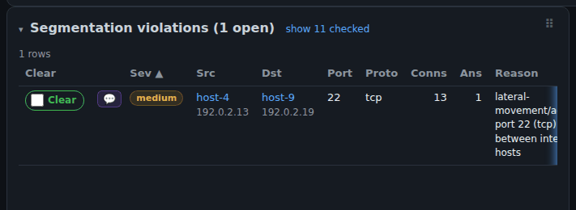

### Related events

Events that share a host, an IP address, a domain or an account, happen close together, or map to the same ATT&CK technique are proposed as *related* by a script. The decision model (an AI model) confirms or rejects each link. For each confirmed link the event reviewer (another AI model) lists the **correlated artifacts** (files, processes, users, IP addresses and DNS queries that tie the two events together), with a one-line relation and a decision: *benign*, *expected* or *suspicious*. Each artifact carries a flare showing which AI model wrote it. Click the Related count on an event to read them.

The popup also lists artifacts for each related event before any review has happened. They are read from the event itself: the users, processes, files and DNS names it names, plus its host IP and destination IP, each marked *info* until the event reviewer decides. When the event reviewer or event research searched Elasticsearch for an event, each search is kept as a **🔭 query** artifact with its hit count and the model's flare; click it to open the same search in Kibana Discover (searches with aggregations or complex clauses open an approximation, marked ≈). Each related event also shows when it happened. When **Classify events** is on (AI pipeline configuration → Review limits), an event whose correlations have all been reviewed gets a **🏷 suspicious / benign / expected** flair next to its notes button; click it for the reason. Each artifact has a 📝 button: add your own notes on that file, process, user, IP or DNS name. The event reviewer reads them in later reviews (together with the research notes on the events and the AI-written host notes; it bases its *benign* and *expected* artifact decisions on these notes and names the note it relied on), and they also appear on the Notes page. Links confirmed before this feature get artifacts only when they are reviewed again.

The **Related** column shows how many links an event has. Click it to see them, each with the decision model's verdict and the correlated artifacts, then click any one to jump to it. Details: [CORRELATION.md](CORRELATION.md).

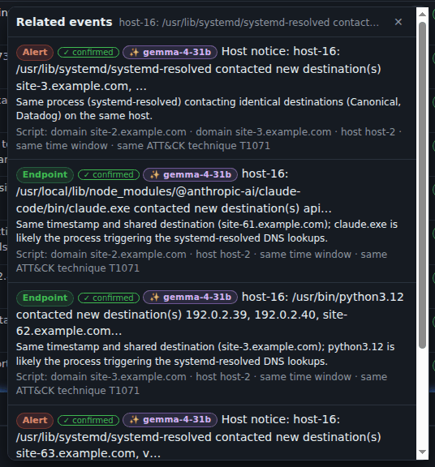
*The Related popup: each linked event with the model's verdict, its reason and the script's evidence.*

### Research notes on events

The scheduled review job does **not** research events: that costs the most tokens. Its event reviewer reuses an earlier note when an event repeats one already researched. A new event is researched only when you open its 📝 and click **🔬 Send to research**; the research is then done for that one event.

An event with a note shows a **✨ verdict** button next to its Related count. Click it to read:

- the verdict and priority;
- a short summary;
- what was checked and found (hosts, ports and times);
- links to the sources the AI actually read.

Notes carry over to the same finding in later snapshots, and are refreshed when the evidence changes. *Written for an earlier run* means the numbers may have moved since. The **AI pipeline monitoring** page shows how many events have notes.

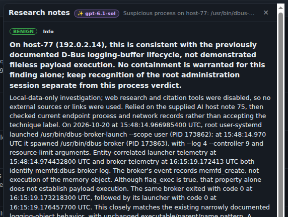

AI notes can be wrong. Treat them as a well-informed second opinion, and check the evidence before acting on anything important.

**Notes stay with the item.** A research note is stored on its own and never expires. If a finding has dropped out of the newest snapshots (for example because it was checked off), its ✨ button still appears: the page fetches the saved note by the finding's text. Only an admin using *Clear notes* on the AI pipeline pages removes notes.

**Times seen (👁).** Next to the Related count each event shows **👁 N×**: the number of snapshots it has appeared in (for an alert, how many times an alert with the same text was raised). Counting started when this feature was added. Hover for the first and last time it was seen.

### Managing notes

Notes are what netmon knows about your network. The AI reads them before it judges a device or an event, so keeping them accurate directly improves its verdicts. There are two kinds, and each has its own review buttons.

**Who writes notes**

| Note | Written by | Where you see it |
|---|---|---|
| **Host notes** (a device, endpoint or account) | The event reviewer and event research (✨ AI), and people (👤) | Device and endpoint pages, **Devices → Notes** |
| **Internet notes** (an external IP or a DNS name) | The same, keyed by IP or by domain | **Network → Internet notes** |
| **Event notes** (one event) | People, with the 📝 button beside an event's Related count | The 📝 popover, **Devices → Notes** |

**Accepting and rejecting host and Internet notes** (admins and network defenders)

Each host, endpoint, Internet IP and DNS note has review buttons:

| Button | What it does |
|---|---|
| **✓ Accept** | Marks the note as checked by a person. The event reviewer and event research get it as **authoritative**: they are told to rely on it and not to edit or delete it, and the server refuses any AI change to it. Nightly consolidation never merges it. Your name and the time are recorded. |
| **✕ Reject** | Keeps the note (shown struck through) but **never sends it to any AI**: not the event reviewer, event research, Ask AI or artifact matching on other hosts. The AI cannot edit or delete it either. |
| **↺** | Undo: back to *not reviewed*. |

A note nobody has reviewed is still read by the AI, but as an unverified AI note (or, if a person wrote it, as a person's note). The AI may also rewrite, merge or delete unreviewed AI notes as it learns more.

When to use which:

- **Accept** a note that is right and should stay as written, for example "this host runs the nightly backup to the NAS", so the AI stops reworking it and relies on it.
- **Reject** a note that is wrong but that you want kept on record (so you can see what the AI got wrong). If you do not need it at all, **delete** it instead.
- **Correct** a note by deleting it and adding your own (👤 notes are authoritative already). Notes cannot be edited in place on the dashboard.

**Approving event notes from User accounts** (admins and network defenders)

Notes and ✅/🟢/⚠️ verdicts written by admins and defenders apply at once and are authoritative. A User-role account can add notes only to events of its own devices, and those notes start as **pending**:

| Status | Effect |
|---|---|
| **Pending** | Shown to its author and to admins and defenders. **No AI ever sees it.** |
| **Approve** | The AI reads it as guidance from then on. If the note carries a verdict, the verdict now applies too (Expected/Benign move the event to Checked). |
| **Reject** | Kept, but never given to any AI. |

Pending notes are listed under **Event notes awaiting approval** on **Devices → Notes**, and have Approve / Reject buttons in the event's 📝 popover.

**Limits and housekeeping**

- Each host, account or domain holds at most a set number of notes (40 by default; admins change it with **Notes per host / user** on the AI pipeline pages). When a subject is full, the AI has to update or delete old notes before adding new ones.
- Nightly **host note consolidation** (AI pipeline configuration) merges overlapping, unreviewed AI notes. Notes written by people, accepted and rejected notes, and correlation profiles are never changed by it.
- Every add, delete, accept, reject and approve is logged with the user's name in the **Audit log**.
- The Notes page and Internet notes tables count the accepted (✓) and rejected (✕) notes per device, IP or domain.

See [ACCESS_CONTROL.md](ACCESS_CONTROL.md) for exactly which role may do what.

---

## 6. Page by page

### Overview

The one-page summary of the selected snapshot.

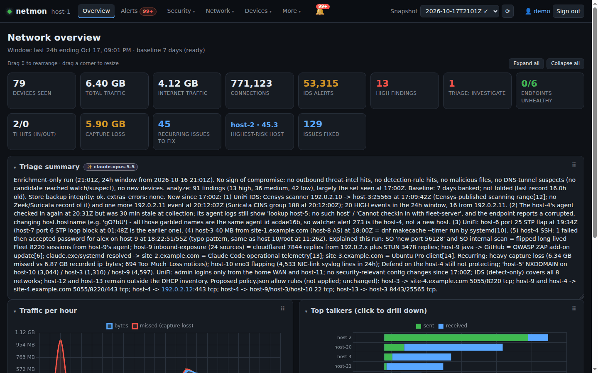

- **Tiles:** devices seen, total and internet traffic, connections, IDS alerts, high findings, unhealthy endpoints, threat-intel hits, capture loss, recurring issues, the highest-risk host and issues fixed.
- **Charts:** traffic per hour, top talkers, findings by severity and kind, devices by zone.
- **Health:** the endpoint fleet and the gateway's health.

### Alerts

Urgent watcher alerts and your notification settings (see [section 4](#4-notifications-and-alerts)).

### Open events vs Posture

Both pages list the same kinds of events with the same buttons, but they answer different questions.

| | **Open events** | **Security → Posture** |
|---|---|---|
| **Question it answers** | *What still needs a person's decision?* | *What happened in this time range?* |
| **Time range** 🕒 | **Not time bound.** The header's time range is ignored. An event stays until someone accepts it, whether it fired an hour ago or three months ago. | **Time bound.** Shows only what happened in the range chosen in the header. Pick another range and you see other events. Anything older drops off the page (but is still on Open events if nobody accepted it). |
| **How an event leaves** | **Only when it is accepted:** a person ticks its check box (or ✓ Check all), or an auto-close rule a person turned on in Configuration does it for them. Fix-list items and vulnerabilities also leave once the newest snapshot no longer lists them (and come back if a later one does), and an alert leaves when it is cleared. Detections held back from the alarm feed and alarms raised by the AI review are not listed as Alerts rows. Waiting, a quiet night or changing the time range never removes anything. | When the time range moves past it, or when it is checked off. |
| **Repeats** | **Collapsed.** One condition is one row however often it fires: the nightly numbers in its text (*145 conns*, *3,983 queries*) are ignored, one process talking to many remotes is one row (*N variants*), and one device breaking the same segmentation rule toward many devices is one row (*→ multiple devices (N)*). The **Seen** column shows how many times and how many variants. Click the row for every occurrence. | **Not collapsed.** Each finding is listed as that window reported it, with its own numbers, destination and row. The same condition can appear as several rows. |
| **Checking off** | Accepting a collapsed row accepts every occurrence and variant in it, so it does not come back next night under different numbers. | Accepts that one row. Check-offs and suppress rules are shared: whatever you accept on either page is accepted on both, and stays accepted in every time range. |
| **Use it for** | Working the queue down to zero. | Investigating a period: what the network looked like yesterday, last week or during an incident, including things already accepted (**show N checked**). |

In short: **Posture is the history, Open events is the backlog.** Accepting something on Open events means you have looked at it and are satisfied; it then leaves the backlog; uncheck it on Posture to undo it.

### Open events

Everything nobody has accepted (checked off) yet, **whatever its age**. The time range in the header does not apply to this page: an unreviewed finding from last week, or last month, stays here until someone accepts it. Events do not expire. Only accepting them (by hand or through an auto-close rule you enabled) removes them; alerts also leave once cleared. Fix-list items (vulnerabilities and misconfigurations) are not on this page or in its count: they have their own page, **Fix list**. The nav item shows how many are open; the page lists at most 5000 rows, most severe and newest first.

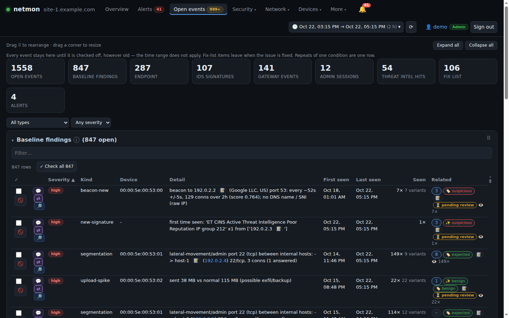

- **Same cards and tools as Posture.** One card per type: Baseline findings, Endpoint (host) findings, IDS signatures, Gateway events, Admin sessions, Threat intel hits, Alerts, Triage alarms. Every row has the check box and 🚫 suppress button, 💬 Ask AI, 🔎 Kibana pivot (opens on the event's own time window, not the loaded snapshot's), the **Related** count and popup, the ✨ AI research verdict, the 🏷 event reviewer classification (*suspicious*, *benign*, *expected*), your 📝 notes and the 👁 times seen. Tables sort and filter like everywhere else.
- **Repeats are one row (unlike Posture).** A finding's text contains numbers that change every night ("145 conns", "3,983 queries"), so on Posture one condition shows up as a new row in each window. Open events groups:
  - rows that differ only in those numbers (IPs, ports and MACs still tell them apart);
  - host findings of one process on one computer that differ only in the remote side (*N variants*);
  - segmentation findings of one device and one rule toward several devices (*→ multiple devices (N)*).

  The **Seen** column shows how many times and how many *variants*. Click the row for every occurrence. Checking a grouped row off accepts all of them.
- **Check off all.** Each card has **✓ Check all N** for what the card currently lists (after the type / severity filters at the top). It asks for confirmation; checked events move to Checked and can be restored there.
- **Types without their own check-off** (IDS signatures, threat-intel hits, alerts) are stored as type *Other event*.
- **Related events** come from the stored correlation verdicts, so events of any age show their Related count and popup (links, shared artifacts, the event's label) along with their notes, verdicts and classification.
- **Where it comes from.** Every snapshot's events are saved in the netmon database (table `events`) with their first/last time and how often they were seen, so the page needs no JSON files and survives snapshots aging out.

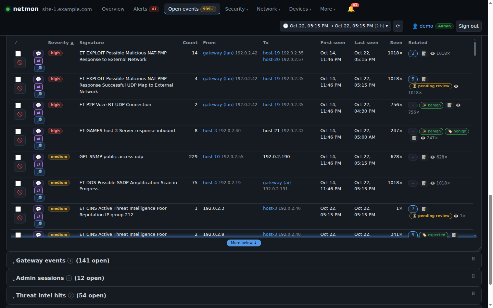

### Security → Posture

What happened **in the selected time range** 🕒, listed as reported: each finding has its own row with that window's numbers, and repeats are **not** collapsed. Events older than the range are not shown here; if nobody accepted them they are still on [Open events](#open-events-vs-posture). Check-offs made here count everywhere (see [Open events vs Posture](#open-events-vs-posture)).


| Box | What it is |
|---|---|
| Baseline findings | Things a device did differently from its own normal: new ports or services, traffic spikes, new countries or ASNs, new DNS habits, new TLS fingerprints. Needs 3 days of history. Columns include the **Device** (its name from the device registry, inventory or DHCP; the MAC address only when no name is known, otherwise on hover), its **Host IP** and **Last seen**; a filter box searches the table. |
| Host findings | Problems seen on the computers themselves: new accounts or groups, failed logins, sudo use, agent problems, Defend failures, system-log errors, new listening ports, unusual processes. Has a **Host** column (the computer the finding came from, linking to its endpoint page), a **To** column like the IDS From/To (the remote address or name for outbound connections and lookups; this host and port, with the source, for inbound connections, logins and new listeners; empty for accounts, files, processes and agent health) and a **Last seen** column and a filter box; **show N checked** folds checked-off findings back in. The Endpoints page's *Investigate* and *Checked off* tiles open this box already filtered. |
| IDS signatures / alerts | Suricata detections in the window, grouped by rule. |
| Segmentation violations | Connections the zone policy doesn't allow, each with a **Clear** box; **show N checked** brings cleared flows back into the list. |
| Beacon candidates | Connections that repeat on a regular timer (possible malware check-ins; usually updates or telemetry). Each row has a check box; the same list is on the device page. |
| Threat-intel feeds | Each feed netmon downloads and its status (see Threat intel below). |
| Inbound hits from listed IPs | Connections into the network from addresses on a threat-intel list. |
| Outbound TI hits / newly-registered domains | Devices contacting listed IPs or domains, and domains registered in the last 90 days, with their age. |
| Malicious JA3 / internal scans / detections | TLS client fingerprints known to belong to malware, internal devices scanning others, and other detections. |
| DNS-tunnel scoring | Domains with many random-looking subdomains (possible data smuggling over DNS). The 🔎 button on each row opens Kibana Discover links for that domain (all lookups, NXDOMAIN, TXT/NULL/ANY, per source device, TLS sessions); it needs `kibana_url` in the site settings. Each row has a check box (keyed by DNS name): check it off to hide it everywhere; "show N checked" brings it back. |
| Zeek notices / weird | Protocol oddities and notices from Zeek. |
| Files | Files transferred over the network and their reputation. |
| Software inventory from traffic | Software versions seen in network traffic. |
| Gateway security (UniFi) | IPS settings, security and gateway events, admin sign-ins and configuration changes. Each gateway event has a check-off box and (admin / defender) a 🚫 suppress button, plus Related links and research notes. **show N checked** brings checked events back. |

### Security → Threat intel

Every DNS name, TLS server name, JA3 fingerprint and internet IP address in the window, checked against the threat feeds. The page also has an **Indicator lookup** box: paste an IP, domain or hash to check it against the loaded feeds.

### Security → ATT&CK

Everything in the snapshot mapped to MITRE ATT&CK techniques.

- **Observed:** behaviour that was actually seen.
- **Exposure only:** a weakness that would allow the technique.

Click a technique in the matrix to list the items behind it.

### Security → Risk

Hosts and vulnerabilities ranked by the risk they pose to the whole network. Host risk is how likely it is to be compromised (its exposure, weaknesses and threat activity) multiplied by how much damage that would do (its role and what it can reach). The **Scoring model** box explains every component. The full model (every weight, cap and threshold, with a worked example) is in [RISK_SCORING.md](RISK_SCORING.md).

**Kubernetes containers** rank in the same list as hosts when a cluster is configured. Each Kubernetes workload (Deployment, StatefulSet, DaemonSet…) is scored with the same likelihood × impact model, using:

- its exposure (ingress, NodePort / LoadBalancer services);
- image CVEs and risky settings (privileged, host access, secrets in env, root, CIS);
- Security Onion activity on its pods;
- node access or a missing NetworkPolicy.

**Show** switches between hosts and containers, hosts only, or containers only. **Container vulnerabilities ranked by risk** lists what to fix per workload. Click a container to pivot into its pod's logs and events. See [KUBERNETES.md](KUBERNETES.md#risk-page).

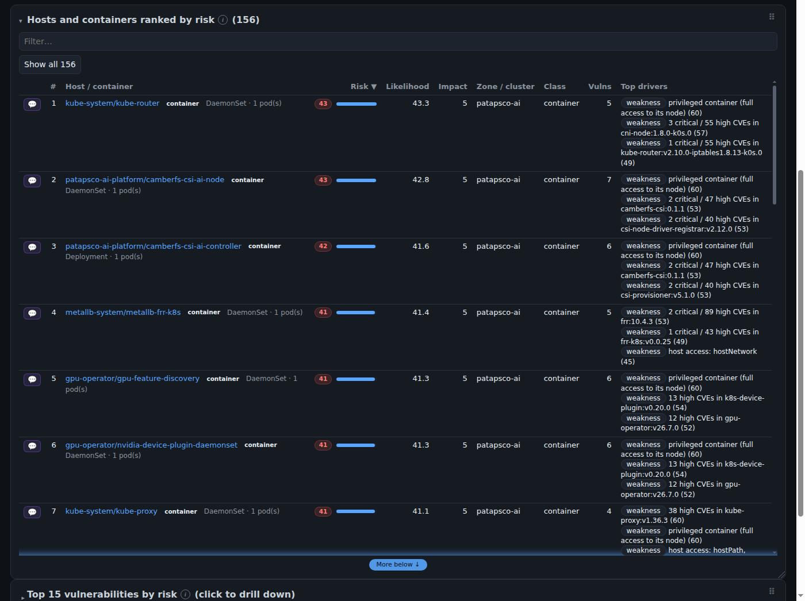

### Security → Fix list

Misconfigurations and security suggestions from all snapshots, such as SSH password logins, legacy TLS or exposed admin ports. Each issue shows when it was first and last seen. Segmentation violations are not listed here; they are on Posture and Lateral movement.

- **Recurring:** an item becomes recurring once it shows up in 2 or more snapshots.
- **New / seen once:** an item seen only once stays here and moves up to Recurring if it comes back.
- **Fixed:** items that stopped appearing move here automatically.

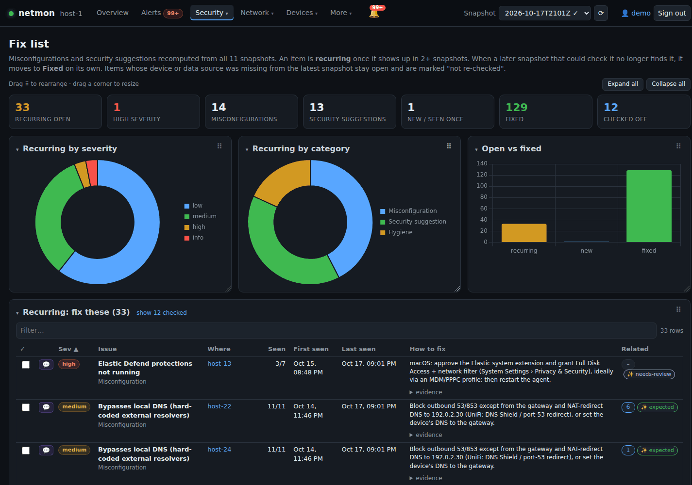

### Network → Network map

Every internal host in its zone behind the gateway, including hosts known from the device registry, DHCP or UniFi but not seen in the time range (greyed; **show hosts not seen in this time range** hides them). Gateway (.1), network (.0) and broadcast (.255) addresses are not drawn. **Colour by** switches between risk, device class and activity; the search box dims non-matching hosts. Click a host for details, or the gateway for its health and every zone interface. With no zones and no hosts yet (fresh install) only the gateway is shown, with a hint to add zones in Settings.

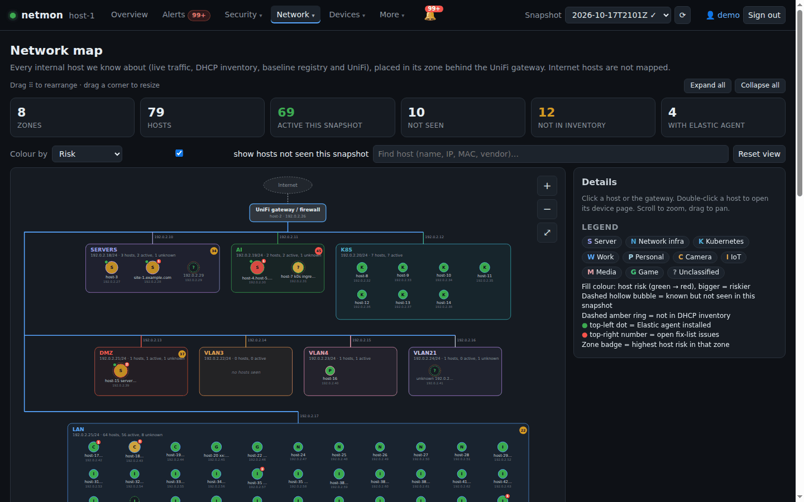

### Network → Lateral movement

Host-to-host connections inside the network, compared against the zone policy.

- **Graph:** internal hosts and the links between them, coloured by level (high, medium, low, allowed-admin, normal). **Show** picks risky, high + medium, risky + allowed or all links; **gateway interfaces** and **labels** switch those on or off; the **Focus** list (worst host risk first) centres one host. Click a link or host for its details panel (ports, levels with a legend, admin sessions); each port has a **Clear** box to mark that flow as expected. Internet addresses are never drawn: logins from the internet stay in the Admin access table.
- **Admin access:** lists every admin session (SSH, RDP, PsExec/SMB, WMI, WinRM, VNC, Docker, Kubernetes, remote-support tools) with its successful and failed logins. Check a session off once reviewed; **Checked admin sessions** lists them (uncheck to move one back).
- **Failed logins** raise host risk and alert the watcher.
- **Cleared segmentation** lists the flows you cleared; uncheck one to bring it back.

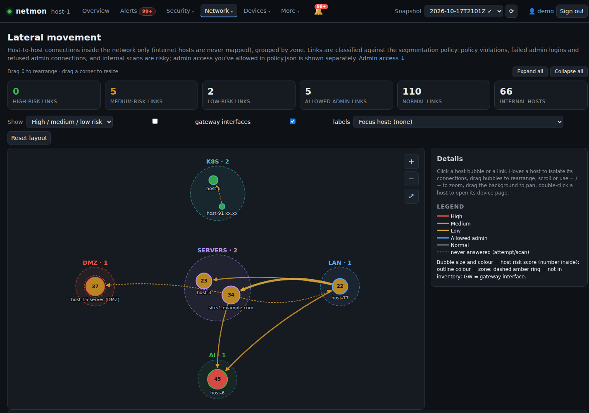


**Several time periods.** In the time picker at the top, press **+ Add period** under *Also include these periods* (up to 8 in total) and Apply. The graph, tables, charts and admin-session lists on this page then combine all periods: connection and login counts are added up and each link keeps its worst risk. A custom range, or any extra period, is queried straight from Security Onion's Elasticsearch (internal connections, admin logins, segmentation violations), so the page does not wait for the full range to be collected. Other pages show the main range only.

### Network → DNS & TLS

- **DNS:** queries and failures by device, top domains, query types, resolvers and TLDs.
- **TLS:** versions in use, certificates with problems, and client and server fingerprints (JA3, JA3S, JA4).
- **Devices using legacy TLS or bad certificates** are listed at the end.

### Network → Traffic map

- **Traffic:** top talkers, internet upload by device (top 15), top countries and ASNs with full **All ASNs** / **All countries** tables, protocols.
- **Zone-to-zone matrix:** hover a cell for the top ports. **Internal flows** lists the top 100 internal flows by connections.
- **Gateway (UniFi):** client and flow tiles, gateway health, blocks by policy, clients by network, top blocked clients, region blocks and risky flows. Left out when the snapshot has no UniFi data. Old `#/unifi` links open this section.
- **Host trends across snapshots:** from the banked 24-hour history, using the snapshots inside the time range when there are at least two, otherwise all of them. Old `#/history` links open this section.

### Network → Users

The accounts seen in your logs (endpoint logins, failed attempts, sudo, admin sessions, suspicious processes) and how each is normally used. This is not the list of dashboard logins; those are under **More → Dashboard users**. Everything here is counted from the logs, not an AI judgement.

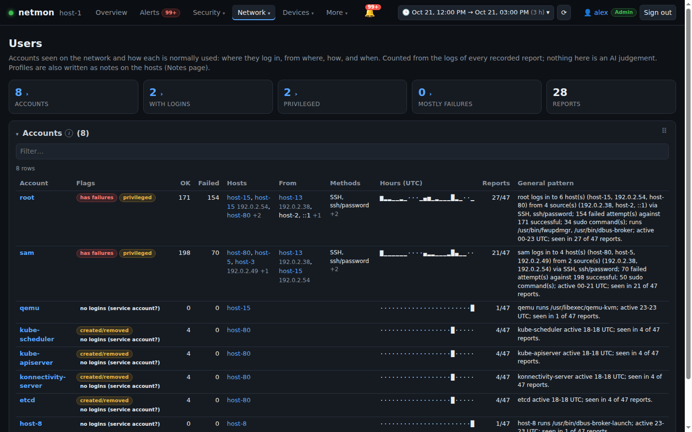

- **Tiles:** accounts, accounts with logins, privileged accounts (root or sudo), accounts with mostly failed attempts, and the number of reports looked at. Click a tile to filter the table; a chip above the table shows the filter and ✕ clears it.
- **Accounts table:** flags (for example *privileged*, *mostly failures*, *new*), successful and failed counts, hosts, sources, methods, an hour-of-day activity strip (UTC), how many reports the account appeared in, and its general pattern. Click an account for its page.
- **Account page:** the same tiles (successful, failed, sudo, hosts, sources, each filtering the *Where and how* table), the pattern and active hours, which host it is used on, from where and by which method or command, and the events in the latest report that name it.
- The correlation also writes these profiles as notes: a per-host account profile and frequent-IP profiles. They appear on the **Notes** page and are read by the event reviewer.

### Network → Internet notes

What is known about the outside world, in two parts. The event reviewer and event research write these notes as they learn, people can add or delete them, and both read them when judging whether activity is benign or expected.

- **External IPs:** every public address that has a note (owner, service, why this network talks to it).
- **DNS notes:** frequent or noteworthy DNS patterns by **domain or subdomain**. Add one with *Add a DNS note*. A note on `example.com` covers all its subdomains; a note on `cdn.example.com` covers only that name and the names below it, and the more specific note is shown to the AI first. A domain's page also lists the parent-domain notes that apply and any subdomains with their own notes. The event reviewer adds a DNS note when it judges a DNS artifact and has something durable to say (what it is, who runs it, which devices query it, why it is normal or a concern).

**Accept or reject (admins and network defenders).** Every note on host, endpoint, Internet IP and DNS pages has buttons:

| Button | Effect |
|---|---|
| **✓ Accept** | The event reviewer and event research treat the note as authoritative, like a note written by a person. The AI can no longer edit or delete it. |
| **✕ Reject** | The note is kept (shown struck through) but is never sent to the event reviewer, event research, Ask AI or the notes tool. The AI cannot change it or re-create it. |
| **↺** | Back to not reviewed (the default: sent to the AI as an unverified AI note, or as a person's note if a person wrote it). |

The tables show how many notes of each domain or IP are accepted (✓) or rejected (✕). Editing a note by hand clears its review status. Event research also writes notes for other artifacts (processes, files, accounts, ports) when it has something durable to say; they appear on the Notes page and as chips on the notes they belong to.

---

### Devices → Hosts

Every internal host ever seen (from the long-term device registry), with a **Last seen** column. Traffic columns cover the selected time range; hosts without traffic in it are marked *not in range* and show zero counts. Below are devices first seen in the range and devices not in the inventory. Click a host for its full page:

- **Identity and risk.**
- **Traffic:** by country, ASN, service and port, and its internal flows.
- **DNS and TLS habits.**
- **Detections:** IDS alerts, segmentation violations and beacons.
- **Files and software.**
- **Endpoint data:** shown if the device runs the Elastic Agent.

### Devices → Endpoints

Computers running the Elastic Agent: agent health, telemetry and auth/sudo/Defend counts. The open host-findings count links to the **Host findings** box on Posture. Click a host for its endpoint page:

- agent status and telemetry streams;
- findings, notable system-log entries and logins;
- network connections by process;
- what the host's baseline has learned.

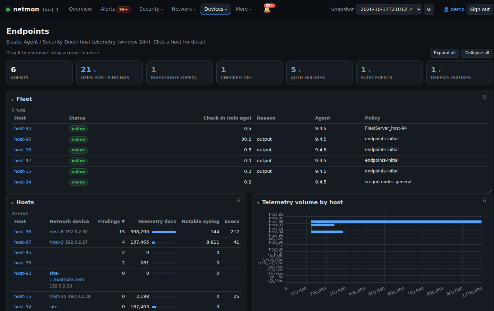

### Devices → Kubernetes

Security monitoring of the Kubernetes cluster, built **only from Security Onion data**: what the Elastic Agent Kubernetes integration ships (container logs, Kubernetes events, API server metrics, pod/container/node metrics) plus Security Onion alerts that involve a node or pod IP. netmon never connects to the cluster (no kubectl, no API access). Choose the window (1 hour to 7 days) at the top, or use the header time picker.

- **Security Onion data coverage:** every Kubernetes data set with its last arrival and collector error. If *kubernetes.container_logs* is stale or missing, the log checks are blind, and a finding says so. Error rows are collectors that run but cannot reach their target (for example kube-state-metrics that is not installed).
- **Container-log security signals:** container log lines that match reverse-shell and suspicious-command text, crypto-miner indicators, web-attack payloads (`${jndi:`, path traversal, `/etc/passwd`), private keys written to logs, authentication failures, access denied, TLS errors and crashes, by pod and container, with an example line. Namespaces whose logs legitimately contain such text (a threat-intel platform) can be exempted per pattern kind in **Settings → Endpoint policy → k8s → signal_exempt**. Exempt rows stay visible, greyed out, and raise no finding.
- **API server security:** what the API server counted in the window: 401/403 responses, pod **exec / attach / port-forward** (interactive access into containers), writes to RBAC objects, secrets, webhooks and nodes, throttling and 5xx. These are request counters, not audit logs, so they show the kind of request and its result but not who sent it.
- **Kubernetes warning events:** warning events (BackOff, Unhealthy, FailedMount, Evicted…), with security-relevant ones (forbidden, PodSecurity, admission denials, image pull problems) marked *sec*.
- **Security Onion alerts on nodes and pods:** Suricata and detection-rule alerts whose source, destination or host is a node or pod.
- **Pods, Container images, Nodes:** inventory with security hits, restarts and log volume per pod; images with mutable-tag warnings (`:latest` or no tag); nodes with Elastic Agent health.

Click a pod (or a signal row) to **pivot into the pod**. The pod page shows its node and IP, security hits, warning events, Security Onion alerts and a log-volume chart (stdout and stderr). It also has a log viewer that you can filter by text, container and stream, with an **Older lines** link. The filters are kept in the address, so a filtered view can be bookmarked. The **Pivot** box links to Kibana (all logs of the pod, stderr only, network logs of the pod IP, Kubernetes events), the node's endpoint page and the pod IP as a network device.

Kubernetes findings use keys that start with `k8s-`. The 15-minute watcher raises them as alerts (check 8), and the nightly snapshot adds them to the host findings, so the correlation, the review job and Posture handle them like any other host finding. Findings cover:

- container-log feed stale;
- reverse shell, miner, web-attack or secret text in container logs;
- pod exec/attach/port-forward;
- bursts of 401/403 responses;
- forbidden or PodSecurity events;
- high-severity Security Onion alerts on a node or pod;
- a container image not seen before.

Opening a pod's logs is recorded in the audit log (`k8s.pod_logs`).

**CIS Kubernetes benchmark.** This box is only filled when the read-only Kubernetes API account is set up (Configuration → Integrations → Kubernetes API; see SETUP.md 7e). netmon runs the benchmark checks that the API can answer:

- **API server, controller manager and scheduler flags** (CIS 1.2–1.4, 3.2): read from the control-plane static pods.
- **RBAC** (5.1): who is bound to cluster-admin, who can read secrets or create pods, wildcard roles, default service accounts, mounted tokens, bind/impersonate/escalate, nodes/proxy, webhooks.
- **Pod security** (5.2), checked on the running pods: privileged, host namespaces, privilege escalation, root, capabilities, hostPath and host ports.
- **Network policies** (5.3), **secrets in environment variables** (5.4), **seccomp** and **use of the default namespace** (5.7).

Results are:

- **fail**: becomes a **Fix list** item (`k8s-cis|<cluster>|<id>`) with how to fix it and the failing items. CIS results are configuration items, so they never show as endpoint findings or Open events.
- **warn**: a list to review by hand, such as who holds cluster-admin.
- **manual**: cannot be seen from the API. File permissions (1.1), etcd (2) and the kubelet (4) need node access, which the read-only account deliberately lacks. They are never reported as passed.
- **accepted**: a failed check you accepted with a reason in **Settings → Endpoint policy → k8s → cis_accept**.

Pods in namespaces labelled `pod-security.kubernetes.io/enforce=privileged` (CNI, storage, monitoring agents that need host access) are listed but do not fail the pod-security checks. The benchmark re-runs every 6 hours with the nightly collection, and **Run now** runs it at once (admins and defenders).

**Several clusters.** Add each cluster under Configuration → Integrations → Kubernetes API (one card per cluster, its own read-only token; **Remove cluster** deletes it). Every Kubernetes page has a **Cluster** selector at the top: *All clusters* or one of them. The choice is kept in your browser. Security Onion's Kubernetes data carries no cluster name, so netmon matches it to a cluster by the names of the nodes that sent it. A cluster without the Elastic Agent Kubernetes integration says *No Security Onion data for this cluster*; its CIS benchmark, images and map still work through the API. CIS findings carry the cluster in their key (`k8s-cis|<cluster>|<id>`).

**Container images: updates and CVEs.** Every image running in the clusters is checked daily at 04:00 UTC, and on **Scan now** (admins and defenders):

- **Update available:** the newest tag of the same form in the image's registry, such as `7.261030.1` → `7.261105.0`. Pre-release tags (rc, beta, alpha) are skipped, and the newest tag within the running major version is shown too. Registries that need a login show *registry not readable*.
- **CVEs now:** critical and high CVEs in the running image (its exact digest), from a Trivy scan.
- **Fixed by updating:** CVEs in the running image that the newest tag no longer has.
- **Fix by rebuild:** critical and high CVEs whose package already has a fixed version, so a rebuild fixes them even without a new tag.

Click an image to list its CVEs, with links to NVD and whether each one is gone in the newest tag. An image with critical or high CVEs fixed by an available update is a **Fix list** item (`k8s-imgcve|<repo>`, high for critical CVEs, medium for high ones) with the tag to update to. It is not an endpoint finding.

**Kubernetes events in Open events.** Every Kubernetes warning event (BackOff, Unhealthy, FailedMount, Evicted…) and every container-log hit that is not already a finding (authentication failures, access denied, TLS errors, crashes) is an *Info* host finding (`k8s-ev|…`, `k8s-log|…`). It shows in Open events with low severity, where it can be checked off, correlated and reviewed like any other event. Info events come from the 15-minute snapshot only and never raise a watcher alert. Security-relevant events (forbidden, PodSecurity) stay Review findings and do raise alerts.

### Devices → Kubernetes map

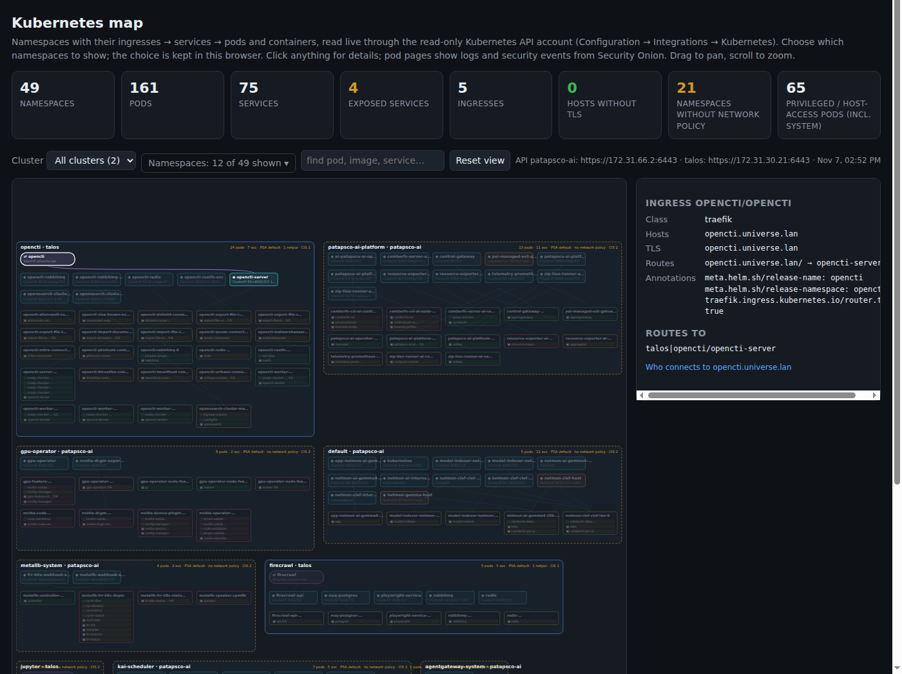

A live map of the cluster, read through the read-only Kubernetes API account. Each namespace is a box holding its ingresses (⇄, red when a host has no TLS), its services (◆, orange when NodePort or LoadBalancer makes them reachable from outside the cluster) and its pods, with one row per container. Lines go from an ingress to its backend service and from a service to the pods it selects.

Colours:

- **Pod border:** green = fine; amber = restarts, root containers, or security hits in its container logs (number badge, from Security Onion); red = privileged, host access or not running.
- **Container rows:** the same colours, for that container.
- **Namespace border:** dashed = no network policy.

With *All clusters* selected the map shows every cluster, with each namespace box labelled by its cluster. **Namespaces ▾** chooses which namespaces to show: tick boxes, or **All**, **None**, **Applications only** (hides kube-*, cattle-*, calico and other platform namespaces) or **With pods**. The choice is kept in your browser. The search box dims everything that does not match a pod, container, image or service name. Drag to pan, scroll to zoom, **Reset view** to start over.

Click any item to see its details on the right:

- **Namespace:** pod-security level, network policies, CIS findings, and a button to hide it.
- **Ingress:** hosts, TLS, routes, annotations, the services it routes to, and a Kibana link to who connects to its hosts.
- **Service:** type, cluster IP, ports, selector, the pods it selects (clickable) and the ingresses in front of it.
- **Pod or container:** workload, node, pod IP, service account and whether its token is mounted, host access, volumes, CIS findings. Per container: image and digest, state, restarts and last exit, ports, security context (privileged, root, privilege escalation, capabilities, read-only root, seccomp), secrets passed as environment variables, requests and limits, and mounts.

From a pod or container, **Logs, security hits and alerts** opens its pod page with logs from Security Onion. The map never reads secrets, ConfigMaps or logs from the cluster.

### Devices → Notes

The notes knowledge base. (Notes about external IPs and DNS names are on **Network → Internet notes**, below.) **Event notes awaiting approval** lists notes written by User-role accounts, with Approve and Reject (the AI never reads a note until it is approved). **Host notes** are what the AI and people have written about each device (role, what is normal, decisions), by category. The event reviewer also writes **expected behavior** host notes (category *behavior*) when it is confident that a related link is normal, for example a scheduled backup between two hosts. **Event notes** are notes on single events. AI runs read these notes before judging a device or an event; notes written by people count as authoritative. Host notes also appear on the device and endpoint pages.

### More → Ask AI

The AI assistant (see [Ask AI](#ask-ai)).

### More → AI pipeline monitoring / AI pipeline configuration

What the AI is doing and how well, and how it is set up (see [AI pipeline](#ai-pipeline)).

### More → Dashboard users

Accounts that can sign in to the dashboard, and their roles (see [section 9](#9-admin-tasks)). Network defenders see this page read-only; Users don't see it. Not to be confused with **Network → Users** above.

### More → Configuration

Settings that apply to everyone. Admins can change them; network defenders see them read-only.

- **Auto-close:** how often the review job runs (hours and minutes, 30 min to 24 h, on a grid starting at 05:00 UTC), and two switches that move events the AI judged *expected* or *benign* to Checked automatically. Auto-close runs once right after a research note is stored (a **Send to research** click) and when you press **Run now**. Items you checked off yourself are untouched, an item you uncheck stays open, and an item reopens if a later verdict changes to something else (and closes again if the verdict later goes back to expected/benign). It also runs every 5 minutes. Your own **✅ Expected / 🟢 Benign / ⚠️ Suspicious** verdicts (📝 popover on any event) always apply, even with every switch off. **Reopen N auto-closed** restores what was closed.
  - **Guard rails** (below the switches) keep you in control. They only hold back AI verdicts; your own Expected / Benign always applies.
    1. **Minimum event reviewer confidence** (default 0.8, 0 = off): an event reviewer *expected/benign* closes an event only at or above this confidence, or when a research note agrees. Lower-confidence events stay open with their 🟢 flair. The event reviewer gives low confidence when it is guessing without evidence.
    2. **Never auto-close these categories**: tick the attack-type categories that always need a person: high-severity IDS signatures, threat-intel hits, admin access (admin sessions that are not allow-listed, new logins, auth failures, sudo errors, password SSH, UniFi admin from a new source), new devices, new exposure (new listening ports, more inbound sources), C2 / exfiltration signs, host tampering (memfd / fileless processes, changed binaries, new accounts, agent or Defender off), gateway threat blocks, or anything high/urgent. All but the last two are on by default. The AI still labels and annotates these events.
    3. **Hold a host after a suspicious event** (always on, 24 h): while an open event on a device (MAC, host name or host IP) was called suspicious or malicious, by the AI or by a person, and was seen in the last 24 hours, nothing else on that device is auto-closed. AI closures of that device's events active in the window are reopened, so you see the whole picture. Checking the suspicious event off (or marking it Expected / Benign) lifts the hold.
    4. **AI closures expire after N days** (default 7, 0 = never): when an AI-closed event shows up again after that, it reopens and closes again only on a verdict newer than the old closure. Your own closures never expire.
    The card shows how many events each rule holds back right now, which hosts are on hold, and examples. Rules 1 and 2 do not reopen what was closed before they were set; **Reopen N closed earlier that these rules would hold** does that on demand.
- **Integrations (admins):** the Elasticsearch URL, API key and indices, the UniFi API URL and key, and the web search provider (DuckDuckGo needs no key; Brave Search and Tavily do; Firecrawl needs a key for its cloud, or the **Firecrawl URL** of your own instance, plus its CA certificate if it uses a private CA), and the **Kubernetes API** (API server URLs, a read-only ServiceAccount token and the cluster CA; its Test says whether the token is really read-only). Each has **Test connection**. Keys are write-only.

### More → Settings

Network policy, endpoint policy, the known-benign list and your site values, edited as tables. Admins can change them; network defenders see them read-only. Everything is stored in the netmon database; there are no policy or site JSON files any more.

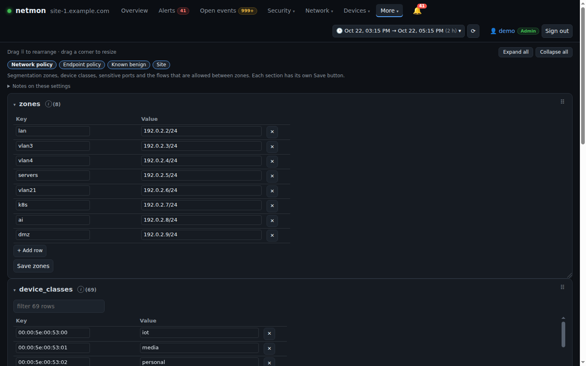

- **Four tabs:** *Network policy* (zones, device classes, sensitive and discovery ports, allowed flows), *Endpoint policy* (rules for endpoint findings: suspicious paths, processes, ports, trusted tools, admin sources, osquery expectations), *Known benign* (signatures, names, DNS and beacon domains the AI and the scoring treat as benign; the review job adds to it) and *Site* (your addresses, host names, URLs, display names, crown jewels).
- **Each section is a card with a table.** Edit a cell in place, **+ Add row**, ✕ to remove a row, and use the filter box on long lists. Nested values (a list inside a table cell) are tables too. There is no Save button: a change is saved as soon as you leave the edited cell (or press Enter), add a key, or remove a row, and a green "✓ Saved" appears under the card. Settings that are single values sit in a **General** card.
- **Validation.** The server refuses a section that would break a job: an invalid regular expression, an *allow* rule without a source and destination, a bad internal network range, or a known-benign table that isn't name → reason. A refused change is not saved: the reason appears in red under the card, and the cell stays as you typed it until you fix it.
- **When it applies.** Jobs and the dashboard pick changes up within a few seconds, except values the dashboard reads only once at start (crown jewels and host IPs used by risk scoring), which need a dashboard restart.
- **Notes.** The explanatory `_doc` text of each document is under **Notes on these settings** and can't be edited here.

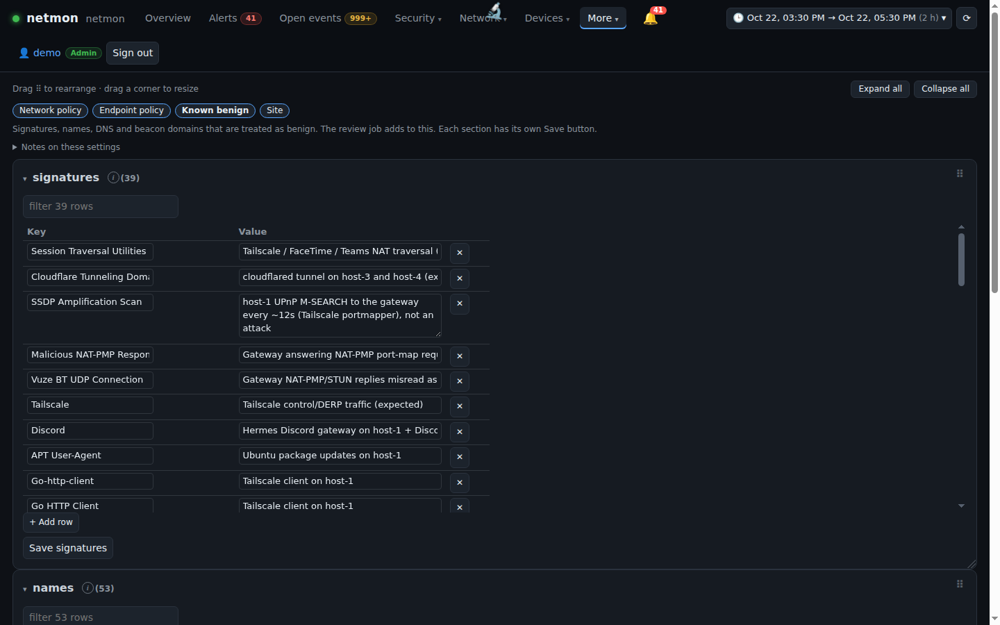

### More → Audit log

Admins only. A record of who did what in the dashboard and of every conversation between the dashboard and an AI model.

- **User actions**: sign-ins (failed ones too), sign-outs, page views, check-offs, notes, chat messages, AI verdicts, settings and user changes, report downloads and every refused request. Each entry has the user, role, time, source IP, browser and the result (HTTP status).
- **AI conversations**: Ask AI chats, the event reviewer and the review job's input and results. Each entry has the instructions (system prompt), the exact prompt the dashboard sent, the model's answer, provider and model, tokens and time. Background jobs show as user `netmon (…)`.
- Passwords, keys and tokens are replaced by `[redacted]` before anything is stored.

Filter by type, time range (a quick range, or **From** / **To** dates and times), user, action, outcome or model, or search the text (this searches prompts and answers too). Click an entry to see all its details. Filters are kept in the address, so you can bookmark a view.

The entries are stored in Elasticsearch on Security Onion, in the index `logs-netmon` (also searchable in Kibana). The **Audit log storage** box shows whether the dashboard can write there. The dashboard needs its own API key with only `create_doc` and `read` on `logs-netmon`, so it can add and read entries but never change or delete them. If Elasticsearch is unreachable or no key is set yet, entries wait on the dashboard (`state/audit_spool.jsonl`, up to 50 MB) and are sent automatically later.

To create the key, in Kibana → Dev Tools:

```
POST /_security/api_key
{"name": "netmon-audit",
 "role_descriptors": {"netmon_audit": {"indices": [{"names": ["logs-netmon"], "privileges": ["create_doc", "read", "view_index_metadata"]}]}}}
```

Paste the `encoded` value into **Change the audit key or index**, press **Test**, then **Save**.

Full details (every recorded action, fields, Kibana queries, retention, troubleshooting): [AUDIT_LOG.md](AUDIT_LOG.md).

---

## 7. AI features

netmon uses two kinds of AI:

- **A cloud AI provider** of your choice (any OpenAI-compatible service or Anthropic, added by an admin on **AI pipeline configuration → AI providers**): event research when someone clicks Send to research (web search), and the Ask AI chat. The review job's event reviewer is the event reviewer's model (local by default).
- **A local model** (served on the monitoring computer by any OpenAI-compatible model server): the event reviewer. It runs all the time and costs nothing per request. It can also be chosen for the review job or the chat.

Anything an AI wrote is labelled ✨ with the model name.

### Ask AI

A chat assistant that knows the netmon data. It can look up findings, devices, alerts, endpoint data and notes, and search and read the web. It is **read-only**: it cannot change anything. It uses the chat model an admin chose on **AI pipeline configuration → Models**; until one is chosen, the chat is off.

- **Starting a chat:** open **More → Ask AI** and type a question. Earlier chats are listed on the left (☰ Chats on a phone).
- **From an item:** click **💬** on any alarm, finding, alert or event. Pick one of the suggested questions or type your own. The item's details are attached, and the answer opens as a new chat. *What the AI will be given* shows exactly what is sent.
- **Choosing the model (admins):** a **Model** menu in the chat header and in the 💬 dialog lets you pick *Default* (the chat model set on AI pipeline configuration > Models), any model of the providers added on AI pipeline configuration > AI providers, or any model of the local server. The choice applies to the next message, is the same in both places, and is remembered in your browser. Each answer's ✨ label shows which model actually answered.

- **Tools (admins and network defenders):** two check boxes sit on their own row under the chat header, and in the 💬 dialog: **🔎 Elasticsearch** (on by default) lets the AI query the network's Security Onion logs, and **🌐 Web research** (off by default) lets it search and read web pages. The choice is remembered in your browser and is shared by the chat page and the 💬 dialog. Other roles always get Elasticsearch on and web research off. The Elasticsearch switch on AI pipeline configuration still applies: if it is off there, the box has no effect. With web research off the AI is told it cannot search the web.

Limits: 40 messages per person per hour, 4,000 characters per message. Answers can be wrong. Check important findings on the dashboard pages.

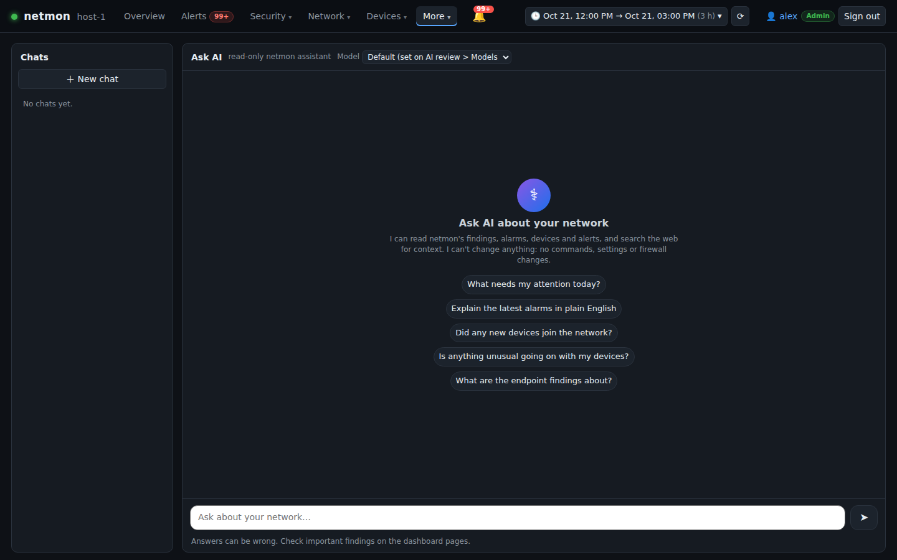

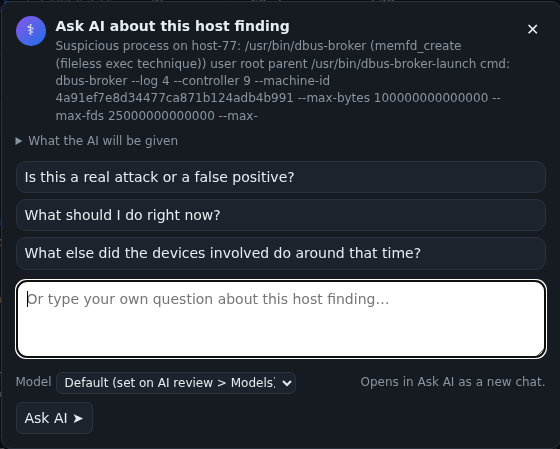
*The 💬 dialog: suggested questions, your own question, and the Model menu (admins).*

### AI pipeline

The AI pipeline has two pages. Each is four boxes, one per part (jump links at the top of each page); what used to be separate boxes are titled sections inside them. The monitoring page loads its parts separately: the status figures, the decision model figures, model status and the Decisions list each show a spinner until their own data arrives, so the rest of the page is usable meanwhile.

| Part | **More → AI pipeline monitoring** (`#/aireview`) | **More → AI pipeline configuration** (`#/aiconfig`) |
|---|---|---|
| **Models** | **Model status**: the model behind each step (decision model, event reviewer, event research, Ask AI chat), its source (server or AI provider and endpoint) and whether it is **up**, **down**, **check** (answers, but the model is missing or not loaded) or **off**. Checked with the server's health or model list, no tokens used, at most once a minute; admins can press **Check now**. Below it, **Time and tokens** (review job, event research and Ask AI chat per day, and every researched event's cost). | **Models**, **AI providers** (admins), **Decision model server** |
| **Correlation review** | **Decision model** figures, **Event reviewer**, verdict charts, **Decisions** (override here), **Review log** | **Decision model settings** (on/off, related threshold), **Review limits** |
| **Event review** | **Review job** (runs, Run now / Pause), events per day, the event reviewer's **web searches**, **Host note consolidation** (nightly time, Consolidate now, last runs) | **Review job schedule** (Run every, Run now / Pause, **Review lookback window**), **Event reviewer look-ups**, **Event reviewer context notes**, **Host note consolidation** |
| **Research review** | **Event research**: spent today against the daily cap, events researched, average cost, tokens, events waiting for a person | **Event research limits** (caps, web access, Elasticsearch) |

Everyone who can see the pages sees the configuration page; only admins can change it (review limits: admins and network defenders). The boxes:

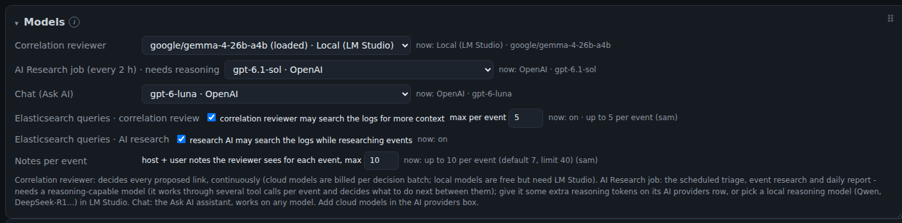

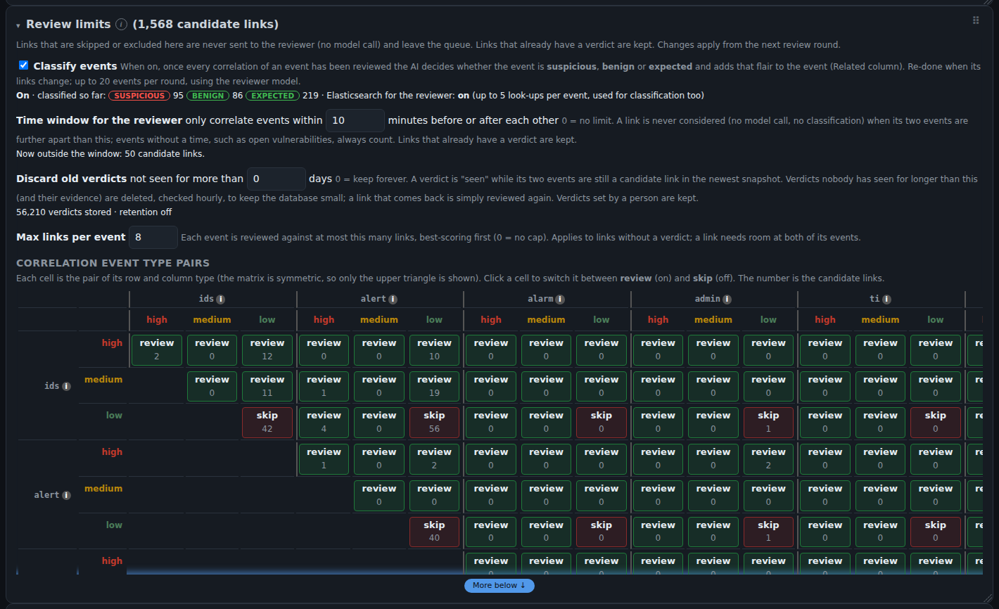

| Box | What it shows |
|---|---|
| **Models** | The model for the **event reviewer** (also used by the review job), **event research** (used only on Send to research) and the **chat (Ask AI)**: a local server model or any model of the providers in **AI providers**. Event research and the chat are off until a model is chosen. Admins change them here, and a choice applies at once (see the cost notes below). Picking a different research model adds a dashed "Cost with <model>" line to the **Time and tokens** chart and a line under its title with the estimated cost per researched event: the recorded research's tokens re-priced at that model's price as entered on its provider (a rough guide, since another model would use a different number of tokens). Three more settings sit under the model menus (admins change them): **Elasticsearch queries · correlation review** (whether the event reviewer may run read-only searches of the Security Onion logs for more context, and the most per event, default 3), **Elasticsearch queries · event research** (the same switch for event research, used on **Send to research**), and **Notes per event** (the most host and account notes the event reviewer is given with each event; more notes mean more context and more input tokens). |
| **Host note consolidation** (on AI pipeline monitoring → Event review) | Once a night, at the time set there (admins; your browser's time zone, default 03:00), the **event reviewer's model** reads each host's AI-written notes and merges the ones that repeat or overlap, so a host keeps a few complete notes instead of hundreds of near-duplicates. **Consolidate now** starts a run at once and shows progress. Only unreviewed AI notes are changed: notes written by a person, approved or rejected notes and correlation profiles are never touched. Notes are merged only when they are about the same artifact (the same IP, DNS name, process / file or account, not counting the host itself or a port): notes about different artifacts stay separate, so consolidation never links things the notes did not link, and a merged text that names an IP, domain, path or fingerprint none of its notes had is rejected. Every valid `[reviewer:…]` tag is kept on the merged note (malformed ones such as `[reviewer:ip:25565]` are dropped), and a merge that would drop an IP, domain, port, path, MAC or fingerprint is retried once and otherwise rejected (the notes stay as they were; counted under *Merges rejected*). Hosts whose notes have not changed since their last pass are skipped. The notes database is backed up before each run (`/state/backup-kbnotes/`, the last 7 kept). The table lists the last 10 runs: hosts, notes before and after, rejected merges and failed requests. |
| **AI providers** (admins) | The AI services netmon calls, each with its own API key. **Add provider** asks for a name, the type (**OpenAI / OpenAI-compatible** covers OpenAI and services with the same API such as OpenRouter, Groq, Mistral, Together, DeepSeek, Gemini's OpenAI endpoint or a self-hosted vLLM; **Anthropic** takes an Anthropic API key), an optional base URL (empty = the official API; plain `http://` only for LAN or loopback addresses), the key, and the models to offer, one per line (**Fetch from provider** lists the models the key can use). After a model id you can add its prices in $ per million tokens, `model input output [cached-input]`; they drive the cost estimates and the $ limits. **Calls per hour** caps each provider's single calls (the event reviewer stops with an error when it is reached), and **Extra reasoning tokens** gives models that think before answering room to do so. **Test** checks the key by listing models (no tokens used). Keys are stored on the dashboard's state volume (file mode 600), only the last 4 characters are ever shown, they are removed from error messages, and an edit that changes the type or base URL needs the key again, so a saved key is never sent to a new host. A provider in use by the event reviewer, event research or the chat can't be deleted. Its models appear in every model menu and Compare dialog. |
| **Review limits** (admins and network defenders) | Limits what is sent to the event reviewer, with no model call for what is held back. **Classify events** (switch, only used with the decision model off; with it on, the event reviewer labels every event anyway): once every correlation of an event has been reviewed, the event reviewer also decides whether the event is *suspicious*, *benign* or *expected* and adds that flair to the event (up to 20 events per round, re-done when its links change). **Time window for the event reviewer** (minutes between correlated events, 0 = no limit; this one setting replaces any separate before/after windows) only correlates events that are within that many minutes before or after each other; links further apart are never sent to the model (events without a time, such as open vulnerabilities, always count). **Max links per event** (0-200, 0 = no cap) keeps the best-scoring links per event. **Event types** is a matrix with a review/skip cell per pair of types (e.g. alert-vuln) and its link count; click a cell to flip it, and click or hover the **i** next to a type for what it is. Types are split by severity, and segmentation (cross-zone traffic) appears as three types by port class: high, medium and low. **Discard old verdicts** (0-3650 days, 0 = keep) deletes verdicts whose pair has not been a candidate for that long; verdicts set by a person are kept. Admins and network defenders change these limits, every change is logged with the user, and links that already have a verdict are kept. **Reviews / min** and **Awaiting review** at the top show the event reviewer's speed and queue. |
| **Clearing queues** (admins) | **Clear event queue** and **Clear review queue** under the top numbers empty what is waiting, after a warning you must confirm. Cleared events do not come back to the queue even if they recur under the same ID (Send to research still works on them); cleared links are marked "not related" without asking the model. Existing notes and verdicts are kept. **Queue (no note yet)** (admins) and **Awaiting review** (admins and defenders) open a list of what is waiting when clicked. |
| **Send to research** (everyone who sees the event) | Open the 📝 next to any event: below the notes, **🔬 Send to research** researches the event **right away** if the AI has not researched it yet, without waiting for the queue; the review job never researches events, so this is the only way a new event gets a note. The host starts `research.py` for that event (about 1-3 minutes, roughly $0.10 with a cloud model) and the note appears when it finishes. Until then the popover shows "Research started"; if another research is running the click waits and starts as soon as it ends. It ignores queue clears and Never-send rules. Users can do this only for their own devices' events; it is logged with the user's name and counts toward the daily $ cap. At most 200 requests wait at once. |
| **Event verdict** (📝 on any event, every page) | **⚠️ Suspicious** saves your call at once. **✅ Expected** and **🟢 Benign** only select the verdict: type why in the box, tick under **Applies to** what it covers (💻 the device, 🧭 the kind of finding such as *port-spike*, 🛡️ the IDS signature, and the event's IPs, DNS names, processes / files, accounts and ports), then press **Save**. Any event that shows *all* ticked artifacts, on any device and from any detector, gets your verdict too; tick the device IP as well to keep it to that device, or tick nothing for this event only. Your verdict outweighs the event reviewer's label: it counts as 95 % confidence when the ticked artifacts match and 90 % on the event itself, and replaces the reviewer's label unless the reviewer is at least that confident. A *suspicious* label on an event with threat-intel hits is never turned into expected or benign. The event is reviewed again on the next review pass; its classification shows **👤 <verdict> verdict applied · the event reviewer said X (NN %)**, or why it was not applied (*threat intel* or *event reviewer confident*). The Alerts **Verdict** column shows your verdict first, then the event reviewer's. The AI treats it as authoritative. Expected/Benign move the event (and later repeats of it) to Checked right away; Suspicious brings it back to the findings and auto-close leaves it alone. The latest verdict shows under the buttons and as a badge on the note and on the Notes page. A User account's verdict needs a defender or admin to approve it first. |
| **Checked events** | Checked-off events are still reviewed (and can be sent to research). If the event reviewer classifies one as suspicious, it is reopened into the findings. |
| **Suppress (🚫)** | Next to the check-off box of an event is a 🚫 button (admin / defender). It suppresses the finding instead of checking it off: pick or edit the signature name and, optionally, one artifact from the event or its correlated events (🌐 IP, 🔗 domain, 👤 user, ⚙️ process, 📄 file, 🔌 port). Matching findings (including gateway events) are hidden and matching alerts stop appearing, the rule is listed under **Settings → Configuration → Suppress rules**, where it can be removed to bring everything back. Suppressed events are still correlated and reviewed, but the event reviewer never un-suppresses them. When you suppress from a card, every other event in the same card that matches the signature (and the artifact, if you picked one) is suppressed too. |
| **Event research limits** (admins) | Caps for event research (Send to research): **$ per research** (default 5), **$ per day** (UTC, default 20), **tokens per research** (input + output, works without prices), **research batches** per run (8 events each, default 10), **searches per event** (web searches allowed per researched event, default 3, 0 = no limit) and a **Web access** switch (off by default: no web search and no sources). A research run stops when it passes a cap, and Send to research is refused once the day's cap is reached. 0 = no limit. The $ caps need prices on the model's provider. The event reviewer, comparisons and Ask AI have their own limits (calls per hour, chat limits). |
| **Review lookback window** | Admins set how many hours of logs (1-24, default 24) each review job run collects and reviews. A window a little longer than the run interval (the box suggests interval + 1 h) cuts the cost of each run without leaving gaps; a window shorter than the interval leaves hours unreviewed, and the box warns about it. The daily 05:00 UTC run always covers 24 h, and only full-day snapshots go into the device baseline. Between daily runs the newest snapshot on the dashboard covers only the window, and a short run can open a Fix-list item but never mark one fixed. |
| **Review job** | The scheduled job: collect, analyze, correlate, then the event reviewer copies matching earlier notes; everything else waits in the queue. It never researches events; that happens only on **Send to research**. Whether a run is going on now, the schedule and next run, **Run every [ ] minutes** (admins: 5 to 1440; saves by itself about a second after you stop typing), **Run now** and **Pause** buttons (admins), recent runs (*Daily run (24 h)* or *Review*, *Run now* when started by hand, and how long they took), how many events have notes, and the latest run's summary. The token chart is in its own box below it. |
| **Time and tokens: review job, event research and Ask AI chat** | Time plus the tokens of each review run, each researched event and each **Ask AI** message (all counted in the same daily bars and totals; a dotted yellow line shows the chat's share of the estimated cost, and the tooltip splits review runs, researched events and chat turns; chat history starts when this was added), split into new input, cache writes and output. Cache re-reads (the conversation re-sent on every API call; ~95% of the raw input count but billed at ~10% of the input price) are hidden by default; click their legend entry to show them. The header shows the average tokens per minute (total run tokens divided by total run minutes, with and without cache re-reads). The header and tooltip give an estimated cost from the prices entered on the provider. |
| **Event reviewer** | The event reviewer's model, its queue and its throughput: reviews and tokens per minute, and the **average tokens in and out per event review** (last 24 hours; hover for the all-time figure). |
| **Verdicts per hour / All verdicts** | How many links were confirmed or rejected. |
| **Decisions** | Every link decision with its reason and model, newest first. The first 100 load with the page and older ones load as you scroll to the end of the list. Filters from the charts (verdict, confidence, event types, this snapshot) are applied on the server; sorting and the Filter box act on the rows loaded so far. You can override a decision (✓ confirm, ✗ reject), or ask for a new review (↻). Manual decisions always win and are never overwritten. |

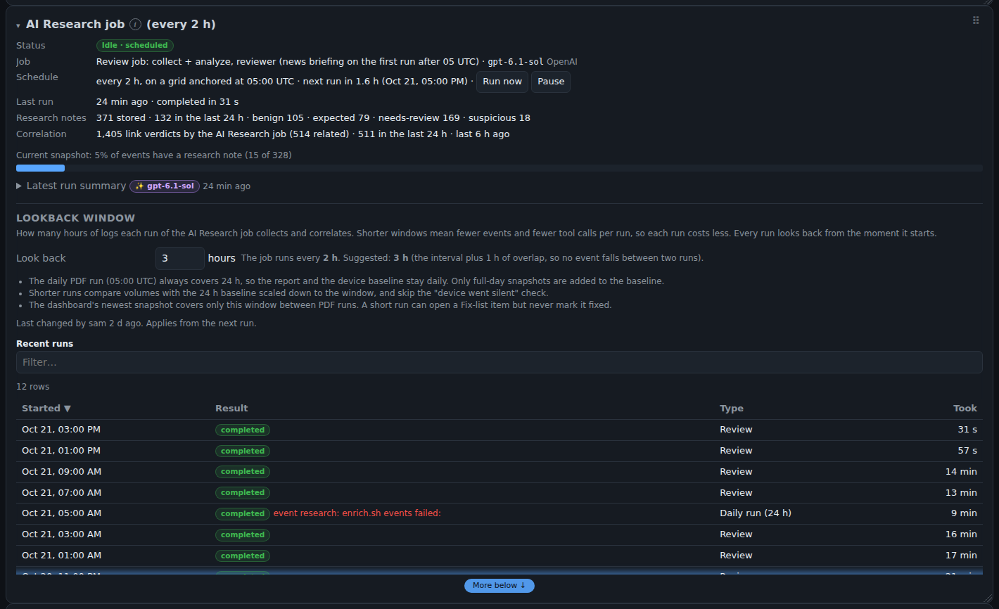

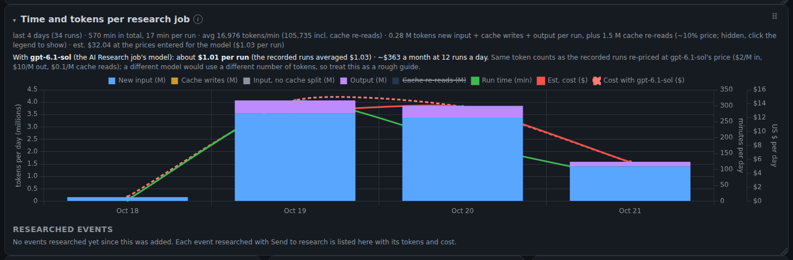

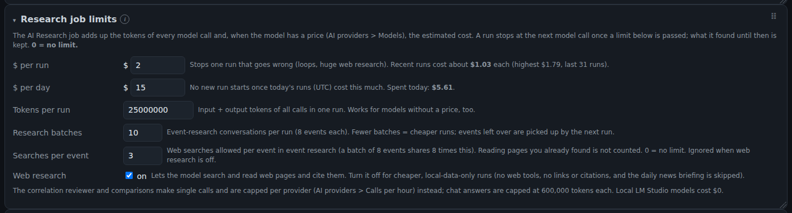

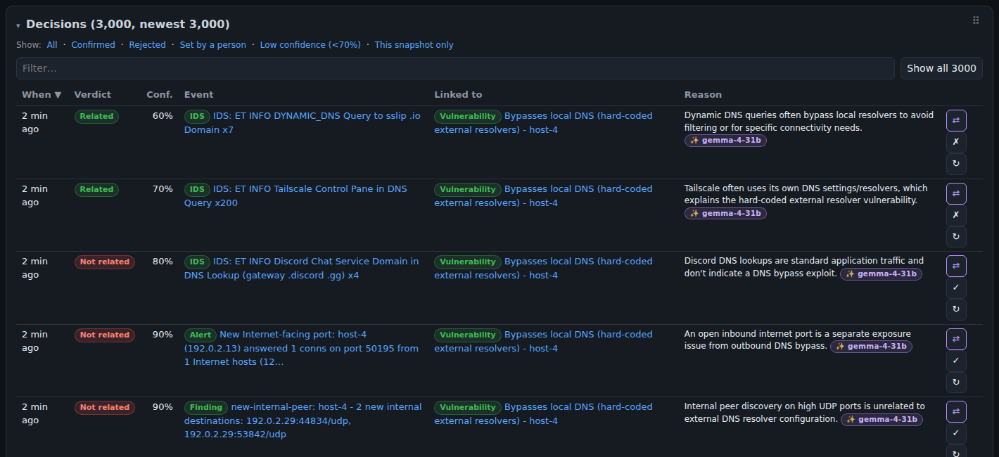

### Things to know about model choices

- **Cloud models** are faster and better at research, but cost money per request:
  - **Review job:** it uses the event reviewer's model, so with a local model it costs nothing; shorter intervals mean more runs.
  - **Event research:** billed only when someone clicks Send to research. The **Event research limits** box caps it.
  - **Event reviewer:** if it uses a cloud model, it decides every new link around the clock.
  - **Cap:** each provider's **calls per hour** (default 120) applies to the event reviewer.
- **Local models** are free, but slower and weaker at research and tool use. A model the local server hasn't loaded has to load first, which takes time and may unload the model the event reviewer is using.

---

## 8. Phones and tablets

- **Install it:** add the dashboard to your home screen for an app-like experience and push notifications (required on iPhone and iPad).
- **Menu:** the ☰ button opens the menu. Your name and **Sign out** are at the bottom of it.
- **Lists instead of wide tables:** tables that would need sideways scrolling become a list of cards. Each card shows:
  - its badges and buttons on the first line;
  - the title in bold;
  - one *Label: value* line per column.

  A **Sort:** menu replaces the column headers.
- **Boxes:** they can be collapsed, rearranged and resized (height only) just like on a computer.
- **Time range:** in the header the range picker is shrunk to a 📅 icon; tap it to open the same range popup.
- **Research indicator:** a spinning 🔬 at the top centre shows while an event is being researched (Send to research) (checked every 15 seconds; on every page).

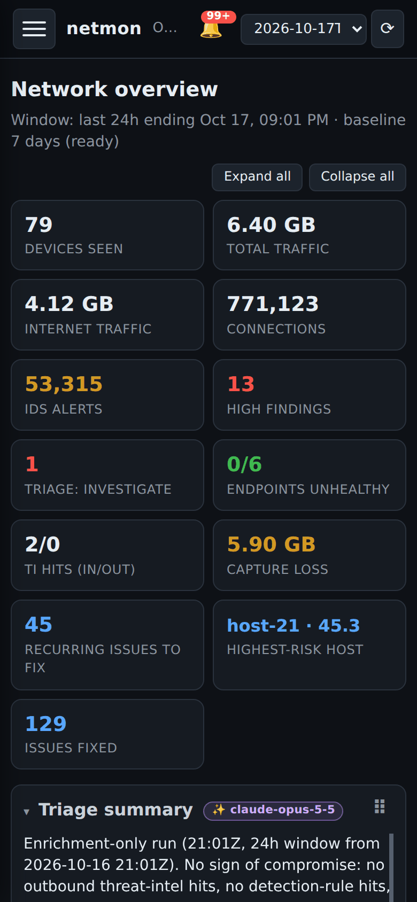 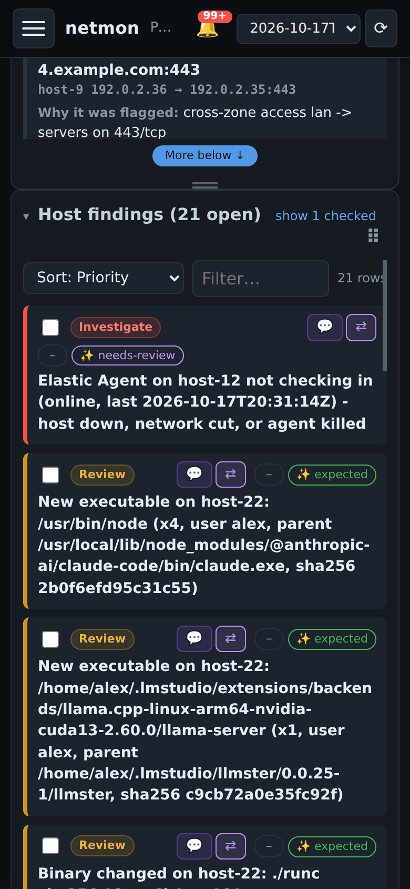
*On a phone, wide tables become lists of cards.*

---

## 9. Admin tasks

Every account has a role (full table in [ACCESS_CONTROL.md](ACCESS_CONTROL.md)):

- **Admin:** everything. Only admins can manage users, roles and device assignments, change integrations and Auto-close settings, change the event reviewer and research models, manage AI providers and research-job limits, and choose the model per message in Ask AI.
- **Network defender:** sees every page, can check things off, write notes, confirm or reject AI links and use Ask AI (the configured chat model), but can't change settings. Configuration and Dashboard users are read-only.
- **User:** sees only the alerts and security events of the devices assigned to them (**My devices** and **Alerts**), and gets push notifications only for those.

**More → Dashboard users** (admins) lets you:

- **Add user:** pick a username, a role (default User) and a password that meets the rules shown.
- **Role:** change someone's role from the drop-down; it takes effect immediately. You can't demote yourself, and the last admin can't be demoted or deleted.
- **Assign…:** for a User, the devices they may see (a User with no devices sees nothing). For admins and defenders, the devices that alert them.
- **Change a password:** set a new one for a user. That user's other sessions are signed out.
- **Delete a user.**
- **Locked out?:** explains how to unlock an account after too many failed sign-ins.

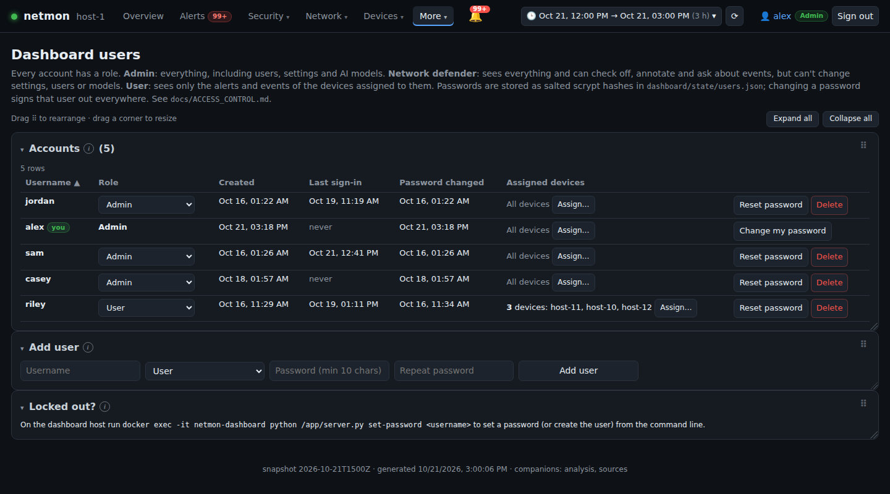

Installation, adding admins and other configuration are in [SETUP.md](SETUP.md).

---

## 10. FAQ and troubleshooting

**The page looks old after an update.**
Reload once (⟳ in the header, or the browser's reload). On a phone, close the app and open it again.

**I don't get push notifications.**
- **Is push on?** Check that Alerts → Notifications on this device says *on*.
- **Are notifications allowed?** Check the browser's site settings.
- **Is the device selected?** Check that the device is included under *Which devices alert me*.
- **iPhone/iPad:** notifications only work from the home-screen app.

**A finding keeps coming back after I checked it off.**
Checking off is tied to the finding's wording. If the finding's details change (for example a different port), it counts as a new finding. For segmentation flows, use **Clear**; it follows the device even if its IP address changes.

**There are no baseline findings, or the Overview says the baseline is not ready.**
Baselines need 3 days of history before deviation rules switch on. Until then the Overview subtitle says the baseline is "warming up"; it shows how many days are banked.

**The research note says "written for an earlier run".**
The note was written for the same finding in an earlier snapshot, so the numbers in it may be out of date. It is refreshed when the evidence changes enough.

**Ask AI says it is unavailable or not configured.**
No chat model is chosen yet, or the AI provider didn't answer. Try again in a minute. If it keeps failing, tell the admin (AI pipeline configuration → AI providers → **Test**).

**AI pipeline monitoring shows "Last run failed".**
The latest review job run failed. The error is shown in the box. The next scheduled run usually recovers; otherwise tell the admin.

---

## 11. Glossary

| Term | Meaning |
|---|---|
| **Snapshot** | One collection run covering the lookback window (24 hours by default). A new one is made on every review job run. |
| **Baseline** | What is normal for each device, learned from about one snapshot a day over the last 30 days. |
| **Finding** | Something a rule flagged: a *baseline* finding (network behaviour) or a *host* finding (on the computer itself). |
| **IDS / Suricata** | Intrusion detection: rules that match known attack or suspicious traffic patterns. Severity 1 is highest. |
| **Zeek** | Network sensor that logs every connection, DNS query, TLS handshake and file. |
| **Elastic Agent / Defend / osquery** | Software on each computer that reports processes, logins, files and settings (Defend is the anti-malware part). |
| **UniFi gateway** | The home router/firewall; its IPS blocks and logs attacks. |
| **Threat intel (TI)** | Public lists of known-bad IP addresses, domains and fingerprints. |
| **Beacon** | Traffic repeating on a regular timer. Malware does this, but so do updates and telemetry. |
| **Segmentation / zone** | Splitting the network into groups (main, IoT, servers, guest) with rules for which may talk to which. |
| **Lateral movement** | Moving from one computer to another inside the network, for example over SSH or RDP. |
| **JA3 / JA4** | Fingerprints of the software that opened a TLS (HTTPS) connection. |
| **ATT&CK** | MITRE's catalogue of attacker techniques. |
| **Correlation** | Linking events that are about the same activity. |
| **Research note** | The AI's per-event research, written when someone clicks Send to research: verdict, summary, evidence and sources. |
| **Capture loss** | Traffic the sensor couldn't record. High loss means parts of the network are invisible. |
